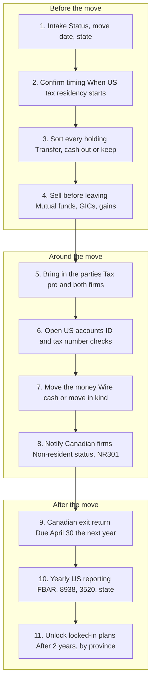

## **BRIDGEPILOT: BRIDGING THE GAP BETWEEN CANADIAN AND US WEALTH MANAGEMENT**

Prepared for
Upper Management

Prepared by
Blue Team:
Avarie Fortenberry
Manali Patel
Pawara Laothamatas
Umay Ozmeral
Vernon Robinson

October 15, 2026

## **TABLE OF CONTENTS**

**TITLE**.................................................................................................................................................. i
**TABLE OF CONTENTS & LIST OF FIGURES**.................................................................................... ii
**EXECUTIVE SUMMARY**...................................................................................................................... iii
**INTRODUCTION**................................................................................................................................. 1
Background:.......................................................................................................................................... 1
Problem Statement:.............................................................................................................................. 1
Organizing Principles:............................................................................................................................ 1
**THE CHALLENGE**................................................................................................................................. 2
Today’s Process: no owner, little expertise......................................................................................... 3
Market Opportunity:............................................................................................................................... 3
**Findings and Elaboration**.................................................................................................................... 4
**Complexity of Cross-Border Documentation, Workflows and Opportunities**.............................. 4
1. Complexity of Cross-Border Investment Transfers.......................................................................... 4
2. Gaps in Current Financial Advisor Workflows.................................................................................... 8
3. Market Opportunity and Existing Solutions....................................................................................... 10
**RECOMMENDATIONS & SOLUTIONS**.............................................................................................. 11
Proposed Solution:................................................................................................................................. 11
Core Features:............................................................................................................................................ 12
Why It Works:............................................................................................................................................ 12
Success Metrics:........................................................................................................................................ 13
**REFERENCES**....................................................................................................................................... 14

## **LIST OF FIGURES**

**Figure 1.** Only a Few Holdings Can Cross the Border.......................................................................... 2
**Figure 2.** Today, Advisors Choose Between Losing the Client and Risking Mistakes.......................... 4
**Figure 3.** Immigration Status Shapes How Permanent the Move Is..................................................... 5
**Figure 4.** Leaving Canada Requires Six Departure Steps and Forms.................................................... 7
**Figure 5.** US Reporting Forms Carry Penalties Starting at $10,000...................................................... 8
**Figure 6.** An 11-Step Move Has Seven Points Where It Can Stall.......................................................... 9

ii

## **EXECUTIVE SUMMARY**

There are no tools today to help a US wealth advisor manage Canadian clients’ investments during a move to the US. Our market research and competitive analysis show that this gap creates a clear opportunity for BridgePilot. Upper management authorized this study to identify the need in the financial services market. Leadership asked for evidence that advisors truly need this product.

The findings in this report are based on migration data (Migration Policy Institute), US and Canadian tax rules, cross-border tax experts, industry surveys and new, competitor websites and advisor forums.

Our analysis revealed findings in three areas:

* **Market:** Each year, over 100,000 people move from Canada, and the US is their top destination. Canadians in the US are a high-income group, with a median household income of $104,300, about a third higher than US-born households. These clients are valuable for advisors, but managing their investments during the move is complex.
* **Process:** A Canadian client can hold about 20 types of accounts and investments, and most cannot be transferred to the US as they are. For each account, the advisor needs to decide whether to transfer it, cash it out, or keep it in Canada, based on the account type and the move date. Tax residency, not visa type, drives the process. Since Canada and the US use separate tests, the exit date and the US start date often do not line up.
* **Competition.** Today, advisors have two options. They can refer the client to a cross-border firm, but they usually lose the client. Or they can rely on general tools like ChatGPT, which do not know Canadian rules. Advisors have been asking for a solution since 2019.

Based on findings, we recommend developing BridgePilot, a step-by-step digital process guide built only for US wealth advisors. The tool maps each Canadian account to its options (transfer, cash out, or keep in Canada), gives the advisor a clear path for each client's case, and tracks deadlines tied to the move date. The tool tells the advisor who needs to be involved such as a tax specialist or the client, but the advisor stays in charge of the process from start to finish. As a result, advisors will manage cross-border cases more efficiently, reduce mistakes in tight deadlines, and retain clients rather than referring them elsewhere.

iii

## **INTRODUCTION**
### **BRIDGEPILOT: BRIDGING THE GAP BETWEEN CANADIAN AND US WEALTH MANAGEMENT**

#### **Background:**

More than 100,000 people leave Canada each year to move to the US as a top destination. This leads to an attractive market segment for US wealth managers. The average Canadian household has a median income of over $100,000 a year while US households make shy of $78,000 a year (Lacarte, 2025). Despite being an attractive segment to US wealth managers there are major hurdles that need to be overcome to transfer funds in a secure, legal and seamless way. The simple ask to “move my accounts and money over” becomes a complex process that often involves various legal and security hoops for both client and manager to jump through. Without a single office or entity to coordinate, clients and advisors alike often have to pay expensive fees, repeat paper work or inefficiently cash out or close accounts.

#### **Problem Statement:**

The simple task of “moving my assets over” becomes nigh impossible when the 20 different Canadian accounts (including but not limited to RRSPs, TFSAs and REFPSs) are not directly translatable to US financial account types and institutions. Each account has to be cashed out, transferred or kept in Canada, with timing being a struggle while moving. Financial advisors and wealth managers have a black box that they have to refer to see what the correct plan of action is for each account type when their clients move assets into the US. This opaqueness can lead to incorrect filings of various forms and can result in expensive fines for the advisors as well as the moving clients. Both parties need to adhere to four separate levels of legal entities (Canadian Provincial, US State, US Federal, and Canadian Federal) along with their associated guidelines. This level of legalese and paperwork can lead to immense burden with the client having to fill out on average six to ten tax forms from each legal party and there be no single person or office to coordinate the process or check if those tasks have been done correctly.

#### **Organizing Principles:**

*Significance:* In this report we will be reviewing the financial motivations to close this gap with the proposed solution called “Bridgepilot” , a tool that tackles the legal and financial black box issue of Canadian immigrants and their US wealth advisors. Several forms have a fixed fine starting at $10,000 for incorrect filings. When selling assets at the wrong time, clients could be paying taxes twice on the same gain. Since Canadian immigrants only make up 2% of the immigration population, many advisors don’t gain expertise in filing these cases. This lack of expertise creates a knowledge gap within industry professionals (Wealth Professional, n.d. ). Advisors who have to refer their clients lose $10,000 per year to every $1 million the client invests which over time can lead to significant losses.

*Purpose*

1

This report will examine how US wealth advisors currently handle Canada to the U.S. investment process and where it breaks down. It then evaluates BridgePilot, a step-by-step digital process guide and connector that helps advisors manage those moves rather than just referring clients. This prevents managers from losing not only valuable clientele but also the meaningful relationship that they have built with their client over time.

### *Scope*

The scope of this report will cover Canadian account types, their closest US equivalents, each country’s regulations, required forms and deadlines, current advisor workflows, the costs involved as well as current competitors.

### *Organization*

The report will start with, identifying the most commonly transferred accounts from movers and their US siblings, then deadlines and submission protocol, following the current advisor workflow and its points of friction and failure. Next, we will examine the competitive analysis and then finally the opportunity and recommendations for the BridgePilot build.

## **THE CHALLENGE**

The challenge starts with what these clients own. A Canadian client can hold about 20 account types, and almost none can move into a US account as they are. Each one must be transferred cashed out or left in Canada, and the right call depends on when US tax residency starts, which state the client moves to and whether the move is permanent.

### **Only a few holdings can cross the border as they are**

#### **Transfer**
Lands in a US account as is

Bank accounts
Some stocks (non-registered)

#### **Cash out**
Sold, taxed, cash sent over

Canadian mutual funds, ETFs
GICs
Other non-registered assets
TFSA (often closed)

#### **Keep in Canada**
Stays, reported to IRS yearly

RRSP and RRIF
LIRA and locked-in plans
RESP, FHSA, RDSP
CPP, QPP, OAS

*Figure 1. Note. Figure generated with Claude (Opus 5.5 version; Anthropic, 2026), based on the team's research.*

The rules make it harder. Four rulebooks apply at once (US federal, US State, Canadian federal, and Canadian province), and they don’t line up: the tax treaty protects Canada’s RRSP (registered retired savings account) federally,y but states like California ignore and tax RRSP growth every year. A typical move also brings 6 to 10 forms due between March and October, several carrying US penalties of $10,000 or more per form, per year.

2

## **Today’s Process: no owner, little expertise**

No one owns the process today. A move involves at least four parties (the US advisor, the Canadian financial institution, a cross-border tax professional, and the US custodian) and roughly 11 steps before, around, and after the move. The most expensive mistakes come from a single missed fact at intake or one step done at the wrong time. Selling investments after arriving instead of before leaving, for example, can mean paying tax on the same gain in both countries.

The expertise rarely builds up. Canadians make up less than 2% of US immigrants, so most advisors see few of these cases. They piece answers together from Google, general AI (ChatGPT, Gemini, etc) and call colleagues who may have dealt with these cases before for guidance. Many decline these clients altogether, leaving clients “orphaned”, split between two advisors in two countries, or forced to sell.

## **The Cost: lost fees and client penalties**

For advisors, the default answer is to refer the client out, and that is expensive. At a typical 1% fee, every $1 million a client invests is worth about $10,000 a year, and a referral usually ends the relationship, even with a referral fee of up to 20%. The alternatives cost more, Canadian licensing means exams plus registering through a Canadian dealer, and buying a cross-border practice runs 2 to 2.5 times its yearly revenue.

For clients, the cost of getting it wrong is just as real. A missed TFSA (Tax Free Savings Account) trust form or Form 8938 means a penalty of $10,000 USD or more, and it can repeat every year. A willful FBAR violation can cost the greater $100,000 USD or half the account.

## **Market Opportunity**

US advisors with a client moving from Canada face two costly options. Referring the client to a cross-border firm gets the rules right, but the advisor loses the client and about $10,000 a year in fees per $1 million invested. Handling the move alone with planning software, CRMs or general AI keeps the client, but none of these tools know cross-border rules. A single missed US filing, such as Form 8938, can cost the client $10,000 or more in IRS penalties. Advisors have asked for an international planning checklist since 2019, and no product yet lets them keep the client and get the rules right. BridgePilot is designed to do both.

Future competition will likely come from three directions:

1. Checklist providers such as fpPathfinder adding cross-border guidance.
2. Financial planning software companies adding a cross-border module.
3. General AI giving more precise cross-border answers, or a new AI tool built for complex financial planning.

3

## **Today advisors choose between losing the client and risking mistakes**

<table><thead><tr><th>Refer out</th><th>Go it alone</th><th>Use BridgePilot</th></tr></thead><tbody><tr><td>To a cross-border firm</td><td>Planning software, CRMs, AI</td><td>Rules and steps built in</td></tr><tr><td>Keeps the client and fees</td><td>Keeps the client and fees</td><td>Keeps the client and fees</td></tr><tr><td>No</td><td>Yes</td><td>Yes</td></tr><tr><td>Gets the Canadian rules right</td><td>Not reliably</td><td>Yes</td></tr><tr><td>Loses ~$10K a year per $1M</td><td>Penalties from $10K a form</td><td>Keeps fees, avoids misses</td></tr></tbody></table>

*Figure 2. Note. Figure generated with Claude (Opus 5.5 version; Anthropic, 2026), based on the team's research.*

Bridgepilot can fill the current market gap for about the price of planning software ($1,500 to $4,100 USD a year), far less than what one referred out client costs an advisor. To win, it needs to combine five things no current option offers together, this includes: Canadian account, rules built in, a plan timed to the clients move date and state, deadline tracking across both countries, one secure place that complies every document and note on the case, and handoffs top the right specialist at the right step. This matters because today a client’s move is scattered across CRM notes, email threads, spreadsheets, and the tax professionals files, even though advisors must keep client records for five years.

### **Findings and Elaborations:**
### **Complexity of Cross-Border Documentation, Workflows and Opportunities**

#### **1. Complexity of Cross-Border Investment Transfers**

The complexity of the cross-border investment transfer is an issue many Canadians face each year. What investments can be moved, how the investments are taxed, and the timeline to process important documents are just a few of the steps that need to be examined to transfer assets correctly and reduce the possibilities of fines.

Any Canadian can sell their investments and wire cash in and out of the US, but when a Canadian becomes a green card holder or meets the Substantial Presence Test, they automatically become a US tax resident, meaning the US not only considers your income taxable, it considers your global income (investments, capital gains, and business ventures) taxable too.

4

The table below lists each immigration status a Canadian might hold in the US, what it means, whether it makes them a US tax resident, and how it tends to shape what they do with their Canadian investments.

<table><thead><tr><th>Status</th><th>What it means</th><th>Becomes a US tax resident?</th><th>Likely approach to Canadian investment</th><th>Source</th></tr></thead><tbody><tr><td>US citizen (including dual Canadian-US citizens)</td><td>Full US citizenship</td><td>Yes, always, wherever they live</td><td>Plans for the long term in the US; full move likely</td><td>https://www.barretttaxlaw.com/tax-services/cross-border-retirement-<u>accounts-rrsp-401k-ira</u></td></tr><tr><td>Green card holder (permanent resident)</td><td>Allowed to live and work in the US permanently</td><td>Yes</td><td>Full move likely; keeps RRSP in Canada since it can't transfer tax-free</td><td>https://www.migrationpolicy.org/journal/spotlight/canadian-immigrant-us-united-states</td></tr><tr><td>TD (spouse or child of a TN worker)</td><td>Can live in the US but not work</td><td>Usually, by day count</td><td>Follows the TN worker's plan</td><td>https://ois.uic.edu/immigration/uic-employees/<u>tn-professional-under-</u><u>nafta/</u></td></tr><tr><td>Other work visas (H-1B, L-1, E-1, O-1)</td><td>Temporary employer-based statuses available to Canadians</td><td>Usually, by day count</td><td>Depends on whether a green card is planned</td><td>https://www.jackson-hertogs.com/usmcaandthetnclassification</td></tr><tr><td>Student (F-1, J-1)</td><td>In the US to study</td><td>Generally no; student days don't count</td><td>Usually keeps everything in Canada</td><td>https://www.irs.gov/individuals/international-taxpayers/substantial-presence-test</td></tr><tr><td>Cross-border commute</td><td>Lives in Canada, works in the US daily</td><td>No; commuting days don't count</td><td>Not a move</td><td>https://www.irs.gov/individuals/international-taxpayers/substantial-presence-test</td></tr></tbody></table>

*Figure 3.*

5

## **Canadian Account Types Have Different U.S. Implications**

There are few US equivalents for Canadian investment accounts, so account holders must determine where their funds will be kept and examine the factors that will keep their investments and owed taxes in good standing.

Canadians moving to the US also have to understand what rules and regulations are in each state, as some don’t adhere to the same tax rules and regulations as others. Typically, Canadian accounts are placed into three categories: retirement accounts, savings accounts, and Regular Investments + cash (non-registered accounts.

Retirement accounts like the RRSPs stay in Canada and are managed by a Canadian financial institution and keep growing tax-deferred for US federal tax purposes; however, states like California do not abide by that tax deferral, consequently taxing annual growth, dividends, and interest RRSPs earn that year. (<u>MoneySense</u>, <u>SEC</u>, <u>Investment Executive</u>)

Savings accounts such as TFSA (Tax-Free Savings Account) are comparable to Roth IRAs and both have their tax advantages inside of their respective countries, but the US considers the gains and income from the TFSA taxable. Additionally, certain TFSA accounts can trigger foreign trust reporting requirements that could result in penalties and fines starting around $10,000. <u>Raymond James</u>, <u>MapleMoney</u>, <u>Andersen</u>

Canadian mutual funds are considered regular investments that are a close match to mutual funds in the US, but cannot be transferred cross-border and are taxed very differently, as the US treats them as PFIC’s (Passive Foreign Investment Companies), meaning they are taxed heavily. <u>RSM Canada</u>, <u>MoneySense</u>

### **Regulatory Requirements, Documentation**

When discussing the requirements of transferring investment from Canada to the US, it is important to understand that there are 4 regulatory systems that apply: US Federal, US State, Canadian Federal, and Canadian Province.

The Canada-US tax treaty is an agreement between the two federal governments about which country taxes what, so the same income isn't taxed twice. This is why an RRSP can keep growing tax-deferred for US federal tax.

However, this treaty binds federal governments and not states, so the states can apply tax even if the treaty protects against it. The tax treaty, which is supposed to smooth out the confusion federally, can be simply ignored by the states and provinces.

To further the confusion within those 4 regulatory systems, additional agencies and regulators are involved in setting additional rules and regulations.

6

1. **SEC (Securities and Exchange Commission)** (US) The federal agency that regulates investment firms and larger investment advisers.
2. **FINRA** (US) The industry regulator that licenses and oversees brokers.
3. **State securities regulator** (US) Each state’s agency. It registers smaller advisers and licenses individual advisers.
4. **IRS** (US) The federal tax agency.
5. **FinCEN** (US) The Treasury office that collects the FBAR.
6. **CIRO** (Canada) The industry regulator that licenses investment dealers and their advisors.
7. **CRA (Canada Revenue Agency)** (Canada) The federal tax agency.
8. **Provincial pension regulators** (Canada): Each province sets its own rules for locked-in pension accounts.

### **Advisor Regulators**

**US:** Advisory firms over $100 million register with the SEC; smaller ones register with states. Individual advisers are licensed by states either way. (<u>Investor.gov</u>)

**Canada:** CIRO licenses investment dealer staff. Since January 1, 2026, this is done by exam (CA$475 each) instead of required courses. (<u>CIRO</u>)

### **Forms**

A typical move touches 6 to 10 forms across the two countries, with deadlines spread from March to October and fixed penalties starting at $10,000 for several US forms.

Below are the tables of the 13 forms that are used during the process of transferring investment documents.

## **Forms for Cross-Border Investment Transfers (Canada)**
Compliance chart • Canada departure requirements

<table><thead><tr><th>FORM / ACTION</th><th>WHAT IT COVERS</th><th>WHEN</th><th>IF MISSED / RISK</th><th>SOURCES</th></tr></thead><tbody><tr><td>Departure-year tax return</td><td>Final Canadian tax return as a resident.</td><td>April 30 of the year after leaving.</td><td>The return is late and departure tax may remain unpaid.</td><td><u>Cardinal Point CRA</u></td></tr><tr><td>T1243</td><td>Calculates the gain from the deemed sale of investments on departure (departure tax).</td><td>With the departure return.</td><td>Departure-tax calculations may be incorrect or incomplete.</td><td><u>Advisor.ca</u></td></tr><tr><td>T1161</td><td>Lists reportable property when the total value is over the stated $25,000 threshold.</td><td>With the departure return.</td><td>A required disclosure may be missing.</td><td><u>CRA</u></td></tr><tr><td>T1224</td><td>Used to request deferral of departure-tax payment, where eligible.</td><td>With the departure return.</td><td>Tax may be payable sooner if deferral is not requested or approved.</td><td><u>Advisor.ca</u></td></tr><tr><td>NR301</td><td>Provided to a Canadian payer/institution to support application of a reduced treaty withholding rate.</td><td>When requested by the institution; confirm validity if circumstances change.</td><td>The institution may withhold tax at a higher rate.</td><td><u>CRA</u></td></tr><tr><td>Notify Canadian institutions</td><td>Notify banks and dealers of the change to non-resident status.</td><td>Around the move date.</td><td>Incorrect withholding, account restrictions/closure, or other account-specific issues may occur; RESP grant issues may arise.</td><td><u>MoneySense</u></td></tr></tbody></table>

*Figure 4. Note: Figure generated with ChatGPT, based on the team's research.*

7

## **Forms for Cross-Border Investment Transfers (US)**

Compliance chart • U.S. reporting requirements

<table><thead><tr><th>FORM / ACTION</th><th>WHAT IT COVERS</th><th>WHEN</th><th>IF MISSED / RISK</th><th>SOURCES</th></tr></thead><tbody><tr><td>FBAR (FinCEN 114)</td><td>Reports foreign financial accounts when their combined value exceeds $10,000 at any point in the year.</td><td>April 15, with an automatic extension to October 15.</td><td>Your notes list penalties of up to $10,000 for non-willful violations; willful violations may carry substantially larger penalties.</td><td>AAFCPAs Taxes for Expats</td></tr><tr><td>Form 8938</td><td>Reports specified foreign financial assets with the U.S. tax return when applicable thresholds are exceeded.</td><td>With the tax return.</td><td>Your notes list an initial $10,000 penalty and up to $50,000 additional penalty for continued failure after IRS notice.</td><td>IRS — Form 8938 IRS</td></tr><tr><td>Forms 3520 / 3520-A (TFSA-related)</td><td>Your notes describe possible foreign-trust reporting for TFSAs; treatment depends on the facts and applicable guidance. RRSPs and qualifying RESPs are described in your notes as exempt.</td><td>3520-A: generally March 15 for a calendar-year trust; Form 3520 timing depends on the taxpayer and filing situation.</td><td>Your notes list a penalty based on the greater of $10,000 or 5% of the account per year; applicability should be confirmed.</td><td>Greenback Barrett Tax Law</td></tr><tr><td>Form 8621 (PFIC)</td><td>May be required for each Canadian mutual fund or ETF classified as a passive foreign investment company.</td><td>Generally with the tax return, subject to the specific filing situation.</td><td>Your notes state there is no standalone late-filing penalty in many cases, but other tax consequences may apply.</td><td>RSM Canada</td></tr><tr><td>State tax return (e.g., California Form 540)</td><td>State-specific reporting; some states do not follow all federal treaty treatment for RRSP earnings.</td><td>With the state return.</td><td>Unreported income may lead to additional state tax, interest, or penalties.</td><td>Cardinal Point</td></tr><tr><td>Form 8840 (snowbirds)</td><td>May support a closer-connection exception for eligible individuals who would otherwise meet the substantial presence test.</td><td>Deadline depends on the taxpayer's filing circumstances; confirm current instructions.</td><td>Late or missing filing may affect whether the exception is available.</td><td>Baker Tilly</td></tr><tr><td>Form 8843 (certain students/trainees)</td><td>Used by eligible individuals to explain a claim that certain days in the U.S. do not count toward the substantial presence test.</td><td>Generally by the applicable due date; exact deadline depends on the person's circumstances.</td><td>Failure to file may affect whether days can be excluded.</td><td>IRS — Substantial Presence Test</td></tr></tbody></table>

*Figure 5. Note: Figure generated with ChatGPT, based on the team's research.*

The number of regulatory agencies, forms, due dates, conditional statements, and questionable directions can and has led to penalties and misfiled documents of which have led to financial firms declining to advise in these cross-border processes and clients desperately searching for assistance. The regulatory agencies are not going anywhere, but neither is the fact that Canadians are relocating to the United States.

### **2. Gaps in Current Financial Advisor Workflows**

Managing multiple cross-border documents, varying cross-border deadlines, severe tax penalties, unique family situations, and a lack of standardized end-to-end workflow exposes US wealth advisors to operational risk and financial liability.

#### **Current Investment Accounts Transfer Process**

Managing multiple cross-border documents, an 11 step investment transfer process, varying cross-border deadlines, unique family situations, and lack of standardized end-to-end workflow leaves US wealth advisors open to operational risk and financial liability.

Wealth investors are often as prepared as they can be, hoping that stall points are minimal.

8

Below is data reconstructed from current rules and case examples, tracking the client in three phases: before, around, and after the move. This chart illustrates how a process that includes 11 steps, 4 external parties, and 7 documents can lead to multiple stall points.

flow_chart: Cross-border move process timeline

**Where it stalls (from sources)**

1 Many firms decline these clients as too complex
2 Non-treaty states tax RRSP growth every year
3 Advisors unfamiliar with Canadian-dollar assets
4 Canadian funds and GICs cannot cross the border
5 Selling after arrival can tax the same gain twice
6 Some Canadian firms close non-resident accounts
7 Missed US forms: penalties from $10,000

*Figure 6. \*\* Note. \*\* Figure generated with Claude (Opus 5.5 version; Anthropic, 2026), based on the team's research.*

## **Financial Advisors See Cross-Border Regulations as a Nonstarter**

Research shows that many firms have decided against taking on these potential clients due to knowledge and licensing gaps (<u>Wealth Professional</u>), as well as the mounting costs and complexity of the regulations. (<u>Advisor.ca</u>) Without a standardized process, firms view constantly changing rules and regulations as a liability and often opt out and refer clients to specialized financial advisors, many times losing clients in the process.

## **Clients Experience Uncertainty Due to the Current Fragmented Process**

Clients moving to the United States can often feel as if they are set in a repetitive cycle of frustration. They can be left without an advisor because Canadian firms aren't registered to serve clients living in the US (<u>Raymond James Sandhu Wealth</u>) or receive conflicting advice

9

from their Canadian and American counterparts, resulting in lost time and additional fees because the initiated process must be halted and restarted. (<u>Wealth Professional</u>)

Some clients are forced to sell funds and GICs, and some Canadian institutions will close their clients' regular accounts once they become non-residents. (<u>MoneySense</u>) Others lose money when the Canadian dollar is converted into the US dollar, or they are double taxed on the same capital gain. (<u>Raymond James</u>, <u>MoneySense</u>)

An all-encompassing app that can remove the fragmentation of the current process, clearly identify the current rules and regulations to guide US wealth advisors through every step of the investment transfer, will ultimately reduce US wealth advisors' and clients pain points, redirection costs, and time.

10

## **RECOMMENDATIONS & SOLUTIONS**

----

### **Proposed Solution**

**Bridgepilot** is a clear, step-by-step guide for US wealth advisors. When a Canadian client requests to move their assets to the US, the tool will walk the advisor through every step, from beginning to finish. **This includes:** Information to gather, the key people who need to be looped in, and the processing sequence, broken down into simple, easy-to-follow steps.

**BridgePilot** provides US advisors with three core capabilities:
* A cross-border account guide (mapping each Canadian account to its US equivalent)
* A concise roadmap of **each client's unique case & key people** to involve
* A **deadline tracker**

Together, these features will turn scattered, advisor-dependent (or “DIY” knowledge from the client) into a repeatable workflow, so wealth managers have a complete understanding of the steps to take. **This will allow them to serve their clients in a more timely manner, as well as avoid missing deadlines, and retain more clients—rather than referring them elsewhere.**

<table><thead><tr><th>Findings &#x26; Market Gaps</th><th>Recommendation</th><th>Expected Impact</th></tr></thead><tbody><tr><td>Account Mapping Gaps</td><td>Build an account-mapping guide showing each Canadian account, its US equivalent, and the options (keep, transfer, liquidate).</td><td>Fewer advisor errors, faster client conversations.</td></tr><tr><td>Lack of Client Ownership</td><td>Add a “refer or retain” feature that flags which cases actually need a specialist + a prepared case brief for the cross-border accountant, if needed. This keeps the US advisor in the loop, and their involvement is clear to the client.</td><td>Increased client retention.</td></tr><tr><td>Lack of Clear Process</td><td>Provide a clear path for wealth managers to take, considering specific client use cases, which includes: involving specialists in areas that require legal or regulatory processes. The tool will allow wealth managers to gather and share all required information.</td><td>Consistent, reliable client experience.</td></tr></tbody></table>

11

<table><thead><tr><th>Findings &#x26; Market Gaps</th><th>Recommendation</th><th>Expected Impact</th></tr></thead><tbody><tr><td>Lack of Clear Timeline</td><td>Add a deadline tracker with alerts tied to the move date.</td><td>Fewer deadlines missed, fewer penalties, and no unexpected taxes.</td></tr></tbody></table>

## **Core Features**

* **Account Mapping:**
  * Each Canadian account
  * Its US equivalent
  * Treatment/Transfer options (to retain, or refer out)
* **Move Timeline:** Pre- and post-border deadlines.
  * Auto-generated, referring to the client’s <u>**move date**</u>, with alerts.
* **“Refer or Retain” Feature:** A short intake that sorts simple and complex cases.

## **Why It Works**

* **No guesswork:** US wealth advisors will no longer lose the client to cross-border firms, and have sufficient information to manage cases efficiently.
* **Comprehensive Information:** The tool is personalized to each client case, and keeps track of the entire client timeline. It provides comprehensive information and options, as opposed to one-time answers (no “DIY research”).
* **Clarity:** Wealth advisors have a full understanding of their capacity—there will be a clear line between **cases they can handle**, and ones they have to ‘**refer out**’.

## **Success Metrics**

* **(Quantitative) Decrease in time spent by advisors** on cross-border preparation
* **(Qualitative) Advisor confidence** in mapping accounts, measured before and after use of BridgePilot
* **(Qualitative) Client satisfaction** with the clarity, speed and flow of the process

12

## **REFERENCES**

AAFCPAs. (2017, April 14). *FBAR filing now due April 15, automatic relief available.*
<u>https://aafcpa.com/2017/04/14/fbar-filing-now-due-april-15/</u>

Advisor.ca. (n.d.-a). *Advising non-resident Canadian clients.*
<u>https://www.advisor.ca/tax/tax-news/advising-non-resident-canadian-clients/</u>

Advisor.ca. (n.d.-b). *Client caught in cross-border trap.*
<u>https://www.advisor.ca/tax/tax-news/client-caught-in-cross-border-trap/</u>

Advisor.ca. (n.d.-c). *Disability tax credits for dual residents.*
<u>https://www.advisor.ca/tax/tax-news/disability-tax-credits-for-dual-residents/</u>

Advisor.ca. (n.d.-d). *Partnering like a pro.* <u>https://advisor.ca/practice/your-business/partnering-like-a-pro/</u>

Advisor.ca. (n.d.-e). *Raymond James launches payout program for U.S. client referrals.*
<u>https://phoenix.advisor.ca/?p=15979</u>

Advisor.ca. (n.d.-f). *Tax consequences when your client leaves Canada.*
<u>https://www.advisor.ca/tax/estate-planning/tax-consequences-when-your-client-leaves-canada/</u>

Advisor.ca. (n.d.-g). *Tax problems with IRAs.* <u>https://www.advisor.ca/tax/tax-news/tax-problems-with-iras/</u>

Advisor.ca. (n.d.-h). *Tax problems with U.S. individual retirement accounts.*
<u>https://www.advisor.ca/advisor-to-client/tax-advisor-to-client/tax-problems-with-u-s-individual-retirement-accounts/</u>

Advisor360°. (2023). *Next-gen financial advisors say generative AI will help, not harm, their careers and the industry.*
<u>https://www.advisor360.com/advisor360-next-gen-financial-advisors-say-generative-ai-will-help</u>

AICPA & CIMA. (2026). *Navigating international financial planning: Cross border case study for U.S. expatriates* [Webcast].
<u>https://www.aicpa-cima.com/cpe-learning/webcast/navigating-international-financial-planning-cross-border-case-study-for-us-expatriates</u>

Andersen. (n.d.-a). *Cross-border tax referrals for advisors.* <u>https://ca.andersen.com/?p=9481</u>

Andersen. (n.d.-b). *Investing strategies for U.S. citizens resident in Canada.*
<u>https://ca.andersen.com/?p=9922</u>

ATB Financial. (n.d.). *Registered disability savings plan (RDSP).*
<u>https://www.atb.com/personal/investing/disability/</u>

Baker Tilly Canada. (n.d.). *Snowbirds and the closer connection exception.*
<u>https://www.bakertilly.ca/insights/snowbirds-and-the-closer-connection-exception</u>

Barrett Tax Law. (n.d.-a). *Cross-border retirement accounts: RRSP, 401(k) and IRA.*
<u>https://www.barretttaxlaw.com/tax-services/cross-border-retirement-accounts-rrsp-401k-ira</u>

Barrett Tax Law. (n.d.-b). *TFSA and RESP U.S. tax treatment.*
<u>https://www.barretttaxlaw.com/tax-services/tfsa-resp-us-tax-treatment</u>

13

Betterment Advisor Solutions. (2026, September 10). *Clients are already using AI to research finances: Here’s how advisors can help.*
<u>https://www.betterment.com/advisors/resources/2026-advisory-survey-results</u>

Canada Revenue Agency. (n.d.-a). *Leaving Canada (emigrants)*. Government of Canada.
<u>https://www.canada.ca/en/revenue-agency/services/tax/international-non-residents/individuals-leaving-entering-canada-non-residents/leaving-canada-emigrants.html</u>

Canada Revenue Agency. (n.d.-b). *More information on forms NR301, NR302, and NR303*. Government of Canada.
<u>https://www.canada.ca/en/revenue-agency/services/forms-publications/information-on-forms-nr301-nr302-nr303.html</u>

Canada Revenue Agency. (n.d.-c). *Non-residents and FHSAs*. Government of Canada.
<u>https://www.canada.ca/en/revenue-agency/services/tax/individuals/topics/first-home-savings-account/non-residents-and-fhsas.html</u>

Canadian Investment Regulatory Organization. (2026). *Proficiency: Investment dealers*.
<u>https://www.ciro.ca/registered-individuals/proficiency/investment-dealers</u>

Capterra. (2026). *RightCapital pricing, reviews and features*.
<u>https://www.capterra.ca/software/210548/rightcapital</u>

Cardinal Point Wealth Management. (n.d.-a). *California residents and RRSPs*.
<u>https://cardinalpointwealth.com/tag/rrsp/</u>

Cardinal Point Wealth Management. (n.d.-b). *California tax rules for Canadian retirement accounts*.
<u>https://cardinalpointwealth.com/?p=659</u>

Cardinal Point Wealth Management. (n.d.-c). *Cross-border Canadian departure checklist: Moving to the U.S.* <u>https://cardinalpointwealth.com/tag/rrsp-trading</u>

Cardinal Point Wealth Management. (n.d.-d). *Cross-border wealth management*.
<u>https://cardinalpointwealth.com/?p=2483</u>

Cardinal Point Wealth Management. (n.d.-e). *Moving to the U.S. from Canada*.
<u>https://cardinalpointwealth.com/?p=2115</u>

Claude Market. (n.d.). *Cinderfi: Retirement planning* [MCP server listing].
<u>https://claudemarket.ai/mcp/josephjohansson/cinderfi</u>

Creative Planning. (n.d.). *Expat checklist: Financial checklist tips for U.S. expats moving abroad*.
<u>https://creativeplanning.com/international/insights/expat-checklist-moving-abroad/</u>

Fast.io. (2026). *Best AI for financial advisors: 9 tools worth your time in 2026*.
<u>https://fast.io/resources/best-ai-for-financial-advisors-2026/</u>

FE fundinfo. (2026). *Financial adviser survey 2026: Five takeaways for every advice firm*.
<u>https://www.fefundinfo.com/insights/financial-adviser-survey-2026-five-takeaways-for-every-advice-firm</u>

Financial Planning Association. (2026). *Tax considerations for clients relocating internationally* [Continuing education session].
<u>https://www.financialplanningassociation.org/tax-considerations-clients-relocating-internationally</u>

14

fpPathfinder. (2019, October 15). *Issues to consider for international planning* [Suggestion board post]. <u>https://suggestaflowchartorchecklist.featureupvote.com/suggestions/184078/issues-to-consider-for-international-planning</u>

Go Far Global. (2026, September 25). *Canada population 2026: Who came, who left (revised data)* [Summary of Statistics Canada Tables 17-10-0009-01 and 17-10-0040-01]. <u>https://www.gofarglobal.com/news/canada-population-2026</u>

Greenback Tax Services. (n.d.-a). *How are Canadian pensions taxed in the U.S.*? <u>https://www.greenbacktaxservices.com/blog/canadian-retirement-plans-us-taxation/</u>

Greenback Tax Services. (n.d.-b). *US expats in Canada: Impact of TFSAs on tax savings.* <u>https://www.greenbacktaxservices.com/?p=35560</u>

Globe Advisor. (n.d.). *Could cross-border partnerships be the key to serving ex-pat clients?* The Globe and Mail. <u>https://beta.theglobeandmail.com/investing/globe-advisor/advisor-practice/article-could-cross-border-partnerships-be-the-key-to-serving-ex-pat-clients/</u>

iA Financial Group. (2022, November 17). *iA Private Wealth announces launch of U.S. registered investment advisor firm.* <u>https://ia.ca/newsroom/2022/november/ia-private-wealth-announces-usa-registered-investment-advisor-firm-launch</u>

Iconic. (2026). *How to value an RIA or financial advisory firm.* <u>https://iconic.co/blog/how-to-value-an-ria-or-financial-advisory-firm/</u>

Income Lab. (2026, March). *Switching from MoneyGuidePro.* <u>https://incomelaboratory.com/switching-from-moneyguidepro/</u>

Internal Revenue Service. (n.d.-a). *Comparison of Form 8938 and FBAR requirements.* <u>https://www.irs.gov/node/5065</u>

Internal Revenue Service. (n.d.-b). *Do I need to file Form 8938, Statement of Specified Foreign Financial Assets?* <u>https://www.irs.gov/node/4675</u>

Internal Revenue Service. (2026, March 14). *Substantial presence test.* <u>https://www.irs.gov/individuals/international-taxpayers/substantial-presence-test</u>

InvestmentNews. (n.d.). *Canada’s CI Financial plans to dominate US wealth management.* <u>https://www.investmentnews.com/?p=199103</u>

Investment Executive. (n.d.-a). *Don’t jump hastily into Canada’s cross-border advice market.* <u>https://investmentexecutive.com/?p=471150</u>

Investment Executive. (n.d.-b). *Making the most of an RRSP/RRIF when moving to the U.S.* <u>https://www.investmentexecutive.com/news/industry/building-your-business/making-the-most-of-an-rrsp-rrif-when-moving-to-the-u-s/</u>

Investment Executive. (n.d.-c). *Managing capital gains when moving to the U.S.* <u>https://www.investmentexecutive.com/news-newspaper/managing-capital-gains-when-moving-to-the-u-s/</u>

Investment Executive. (n.d.-d). *Unlocking locked-in accounts.* <u>https://www.investmentexecutive.com/?p=71323</u>

15

Investor.gov. (n.d.). *Investment adviser registration: Transition of mid-sized advisers*. U.S. Securities and Exchange Commission.
<u>https://www.investor.gov/introduction-investing/general-resources/news-alerts/alerts-bulletins/investor-bulletins/transit</u>ion

Jackson Hertogs. (n.d.). *USMCA and the TN classification*.
<u>https://www.jackson-hertogs.com/usmcaandthetnclassification</u>

Kitces, M. (n.d.-a). *Financial planning software user preferences: Efficiency, time and depth*. Kitces.com.
<u>https://www.kitces.com/blog/financial-planning-software-user-preferences-efficiency-time-better-faster-comprehensive-depth/</u>

Kitces, M. (n.d.-b). *Libby Greiwe: Efficient advisor client referrals and the 30-day onboarding period* [Podcast episode]. Kitces.com.
<u>https://www.kitces.com/blog/libby-greiwe-444-efficient-advisor-client-referrals-onboarding-coaching-consulting-30-day-period/</u>

Lacarte, V. (2025, June 11). *Canadian immigrants in the United States*. Migration Policy Institute.
<u>https://www.migrationpolicy.org/journal/spotlight/canadian-immigrants-united-states</u>

Manitoba Pension Commission. (n.d.). *Locked-in accounts* [Bulletin 4]. Government of Manitoba.
<u>https://manitoba.ca/finance/pension/pdf/bulletin4.pdf</u>

MapleMoney. (n.d.). *U.S. vs. Canadian retirement plans: What’s the equivalent to 401k or Roth IRA?*
<u>https://maplemoney.com/us-canada-retirement-plans/</u>

MoneySense. (n.d.-a). *Can you move your investments from Canada to the U.S.?*
<u>https://www.moneysense.ca/columns/ask-a-planner/can-you-move-your-investments-from-canada-to-the-u-s/</u>

MoneySense. (n.d.-b). *Moving to the U.S.? Here’s what to do with your Canadian investments*.
<u>https://www.moneysense.ca/columns/ask-a-planner/what-to-do-with-your-canadian-investments-when-moving-to-the-u-s</u>

MoneySense. (n.d.-c). *RESP advice for Canadian citizens living in the U.S.*
<u>https://moneysense.ca/save/resp</u>

MoneySense. (n.d.-d). *RESPs and Canadian non-residency*.
<u>https://www.moneysense.ca/save/investing/resp/resps-non-residency-canada/</u>

PlanAdviser. (2026). *CRM software top of mind among advisers’ tech options*.
<u>https://planadviser.com/crm-software-top-of-mind-among-advisers-tech-options/</u>

Private Banker International. (n.d.). *Raymond James to launch payout program for US client referrals*.
<u>https://www.privatebankerinternational.com/?p=14836</u>

Ratehub. (n.d.). *Do GICs exist in other countries?*
<u>https://www.ratehub.ca/blog/do-gics-exist-in-other-countries/</u>

Raymond James Ltd., Contego Wealth Management. (n.d.). *Cross-border services*.
<u>https://raymondjames.ca/contegowealthmanagement/cross-border-services</u>

Raymond James Ltd., Langill McHenry. (2024, February 12). *Moving between Canada and America: Comparison of financial accounts*.

16

<u>https://www.raymondjames.ca/langillmchenry/knowledge-centre/our-blog/2024/02/12/moving-between-canada-and-america-comparison-of-financial-accounts</u>

Raymond James Ltd., Sandhu Wealth. (2022, February 3). *Canadians moving to the US, or back to Canada from the US.*
<u>https://www.raymondjames.ca/sandhuwealth/blog/2022/02/03/canadians-moving-to-the-us-or-back-to-canada-from-the-us</u>

Raymond James (USA) Ltd. (2023, November 7). *Moving to the U.S. from Canada.*
<u>https://raymondjames.ca/grantham/insights/2023/11/07/moving-to-the-us-from-canada</u>

RBC Royal Bank. (n.d.). *Moving to the U.S.: Part five.*
<u>https://www.rbcroyalbank.com/en-ca/my-money-matters/goals-aspirations/travel-and-cross-border/living-in-the-us/moving-to-the-u-s-part-five/</u>

RBC Wealth Management. (n.d.-a). *Introducing the tax-free first home savings account.*
<u>https://ca.rbcwealthmanagement.com/john.ord/fhsa</u>

RBC Wealth Management. (n.d.-b). *Moving from Canada* [PDF].
<u>https://ca.rbcwealthmanagement.com/documents/208666/0/Moving+From+Canada.pdf/32151652-9f25-4fa7-a87d-81eb9ecfec3f</u>

RBC Wealth Management. (n.d.-c). *Taxation of Canadian registered retirement savings plan (RRSP) and registered retirement income fund (RRIF) for U.S. persons* [PDF].
<u>https://rbcwealthmanagement.bynder.com/m/d8a22faedb97a5f6/original/Taxation-of-Canadian-registered-retirement-savings-plan-RRSP-and-registered-retirement-income-fund-RRIF-for-U-S-persons.pdf</u>

RBC Wealth Management. (2025, October 29). *Taxation of a tax-free first home savings account (FHSA) for U.S. persons.*
<u>https://ca.rbcwealthmanagement.com/charles.cullen/blog/4672286-Taxation-of-a-Tax-Free-First-Home-Savings-Account-FHSA-for-US-Persons</u>

Rework. (2026). *Best AI tools for financial advisors in 2026: 15 tools for wealth management and RIA practices.* <u>https://resources.rework.com/tools/ai-tools/best-ai-tools-for-financial-advisors-2026</u>

RightCapital. (2026, January 14). *RightCapital vs eMoney: 7 key differences for financial advisors.*
<u>https://www.rightcapital.com/blog/rightcapital-vs-emoney-differences</u>

RSM Canada. (2017, September 17). *Canadian mutual funds and ETFs: Soften the impact of U.S. taxation.*
<u>https://rsmcanada.com/insights/services/business-tax-insights/canadian-mutual-funds-and-etfs-soften-the-impact-of-us-taxation.html</u>

Seward & Kissel. (2026, March 10). *90-day warning: Regulation S-P amendments compliance deadline approaching for smaller entities.*
<u>https://www.sewkis.com/publications/90-day-warning-regulation-s-p-amendments-compliance-deadline-approaching-for-smaller-entities/</u>

SmartAsset. (n.d.). *How much does a financial advisor cost?*
<u>https://www.smartasset.com/financial-advisor/financial-advisor-cost</u>

Spring Financial. (n.d.). *Roth IRA equivalent in Canada.*
<u>https://springfinancial.ca/blog/save-invest/roth-ira-equivalent-canada/</u>

17

Taxes for Expats. (n.d.). *New due date for FBAR filing: April 15 with automatic extension until Oct 15.* <u>https://www.taxesforexpats.com/articles/news/new-due-date-for-fbar-filing-april-15-with-automatic-extensi</u><u>on-until-oct-15.html</u>

TD Wealth. (n.d.). *Locked-in plans* [PDF]. <u>https://financialplanners.td.com/aimee.avery/mediahandler/media/129029/LockedInPlans_English.pdf</u>

The Tax Adviser. (2016, August). *Reporting requirements for Canadian retirement accounts*. American Institute of CPAs. <u>https://www.thetaxadviser.com/issues/2016/aug/reporting-requirements-for-canadian-retirement-accounts/</u>

Tucker Ellis. (n.d.). *Investment adviser recordkeeping requirements*. <u>https://tuckerellis.com/?p=4272</u>

University of Illinois Chicago, Office of International Services. (n.d.). *TN professional under NAFTA.* <u>https://ois.uic.edu/immigration/uic-employees/tn-professional-under-nafta/</u>

U.S. Securities and Exchange Commission. (2000, June). *Offer and sale of securities to Canadian tax-deferred retirement savings accounts* (Rule 237). <u>https://www.sec.gov/rule-release/33-7860</u>

U.S. Securities and Exchange Commission. (2005, January 11). *Canadian tax-deferred retirement savings accounts*. <u>https://www.sec.gov/answers/canadiansnow.htm</u>

Wealth Professional. (n.d.-a). *How to deal with cross-border clients.* <u>https://www.wealthprofessional.ca/news/industry-news/how-to-deal-with-cross-border-clients/256554</u>

Wealth Professional. (n.d.-b). *When transferring pension assets, cross-border clients need to “take deep breaths”.* <u>https://www.wealthprofessional.ca/investments/retirement-solutions/when-transferring-pension-assets-cro</u><u>ss-border-clients-need-to-take-deep-breaths/379469</u>

Anthropic. (2026). *Claude* (Opus 5.5 version) [Large language model]. <u>https://claude.ai</u>

18