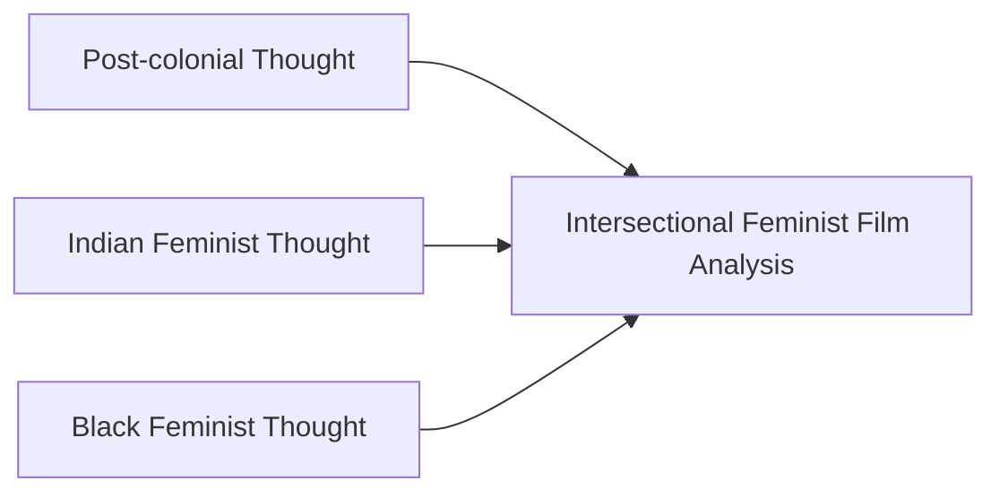

1

logo: Gemma Erasmus Mundus Master's Degree in Women's and Gender Studies
logo: Erasmus Mundus
logo: University of York
logo: Universidad de Oviedo

# **TINCTION OF BROWN BODIES: AN EXPLORATION OF GENDERED COLOURISM AND REPRESENTATION OF DARK-SKINNED WOMEN IN MALAYALAM MOVIES**

**By Uthara Geetha**

**Main Supervisor: Prof. Isabel Suárez Carrera (Universidad de Oviedo)**
**Second Supervisor: Dr Clare Bielby (University of York)**

**Submitted to**
**Universidad de Oviedo, Centro de Investigaciones Feministas (CIFEM)**
**Oviedo, Spain**
**2021**

2

logo: Gemma Erasmus Mundus Master's Degree in Women's and Gender Studies
logo: Erasmus Mundus

# **TINCTION OF BROWN BODIES: AN EXPLORATION OF GENDERED COLOURISM AND REPRESENTATION OF DARK-SKINNED WOMEN IN MALAYALAM MOVIES**

**By Uthara Geetha**
**Main Supervisor: Prof. Isabel Suárez Carrera (Universidad de Oviedo)**
**Second Supervisor: Dr Clare Bielby (University of York)**

**Submitted to**
**Universidad de Oviedo, Centro de Investigaciones Feministas (CIFEM)**
**Oviedo, Spain**
**2021**

**Approval signed by Main Supervisor:**

logo: Universidad de Granada
logo: Central European University
logo: Alma Mater Studiorum University of Bologna
logo: University of Lodz
logo: University of York
logo: Universidad de Oviedo
logo: Universität Utrecht

3

## **Abstract**

----

Indian society suffers from deep-rooted colourism emerging from its complex history of early racial mixing, rigid social systems and colonialization, which results in the active practice of skin-colour based discrimination in socio-cultural spaces. Due to the mixed-race and culturally diverse nature of Indian society, this study sought to decode colourism as a racial hierarchy which is intertwined with other forms of discriminations. In particular, I argue, pre-existing indigenous social inequalities— caste, class and region— were reinterpreted in terms of skin colour following co-option of colonial racist ideologies by native elite to legitimise discrimination against the historically oppressed groups. Colourism is perpetuated through popular stereotypes which establishes dark skin colour as a signifier of lower class, lower caste and South Indian identity rooted in biological difference and essentialism. Furthermore, colourism in modern India is a highly gendered phenomenon. Due to normalisation of white beauty ideals by media and racialised capitalist economies in the present-day globalised Indian society, the awareness of the inadequacy of dark skin in a colourist society moulds their positionality and ways of knowing in a similar process to how race builds unique lived experience.

Cinema as an artform and industry has huge influence in India and serves as an appropriate research platform to analyse colourism and its socio-cultural connotations. Taking into consideration marginalisation of dark-skinned women and cinema as a cultural platform, the study focused on the ways of representations of darker skinned women in Malayalam films. Two films were chosen for detailed analysis—*Celluloid* (2013) and *Kammattipadam* (2016)— which have dark-skinned female leads, an exception in commercial and mainstream cinema production in India. The research sought to investigate the reasons behind the choice and how it influences the representation of women and the role of skin-colour in cinema production. The research found close association between popular skin-colour based stereotypes and representation of bodies in the films. The findings reveal that the films reflect and adhere to above-mentioned skin-colour based stereotypes and help to maintain the status quo of socio-cultural and gendered inequalities underutilising the subversive potential of cinema.

**Keywords:** *Colourism, Gender, Caste, Indian Cinema, Representation, Colonialism, Malayalam film, Black feminist thought, Brahmanical patriarchy*

4

# **Acknowledgements**

First and foremost, I am extremely grateful to my supervisors, Prof. Maria Isabel Carrera Suárez and Dr Clare Bielby for their invaluable advice, continuous support, and patience during each phase of the dissertation. Their immense knowledge and critical evaluation have encouraged me to produce this work and have reaffirmed my passion for research.

I would also like to thank, Dr Rachel Aslop, Dr Emilia Maria Duran Almarza and Natalia Vázquez Rubiera for their academic and technical support which made the degree and dissertation process easier and achievable, especially given the global pandemic.

Dr Malavika Binny, my sister and fellow angry feminist, has been a constant support throughout the study by acting as human search engine for Indian history references and her feedback.

Getting through my dissertation required more than academic support. I cannot begin to express my gratitude and appreciation for the unwavering support offered by my Amma (mother) and for her daily morning calls exclusively for dissertation chatter.

I would also like to thank all my fellow Erasmus GEMMA scholars from different parts of the world for educating and inspiring me. It is their kind help and support that have made my study and life in Spain and the UK a wonderful time. I also place on record, my sense of gratitude to Belen for listening to my endless loop of dissertation gabs without the slightest hint of annoyance.

Finally, I would like to express my gratitude to my best friends- Disha and Adrita— for their own brand of kindness and humour. Without their tremendous understanding and late-night videocalls, it would have been impossible for me to complete my study.

I have undertaken this research project inspired by the Black Lives Matter and Dalit Lives Matter movements and hopes to highlight the transnationality of anti-racist and other anti-oppression movements.

5

# **Table of Contents**

----

Abstract.................................................................................................................... 3  
Acknowledgements............................................................................................ 4  
Table of Contents ............................................................................................ 5  
Introduction.................................................................................................... 7  

1. Chapter I: Literature Review- A Historical Overview of Gendered Colourism, Beauty Ideals and Representation in India.................................................................................... 9  
   I.A. Colourism: Origins, Myths and Social Reality.................................................... 10  
   I.B. Beauty Ideals and Economy of Bodies............................................................ 15  
   I.C. (Absence of) Representation of dark-skinned bodies of women in Indian movies 22  

2. Chapter II: Methodology and Theoretical Framework.................................................... 27  
   II.A Research Questions........................................................................................ 28  
   II.B. Sample Selection............................................................................................ 29  
   II.C. Theoretical Framework, Core Model and Methods of Research........................ 30  
   II.D. Ethical Considerations.................................................................................... 33  
   II.E. Limitations.................................................................................................... 34  

3. Chapter III: Celluloid: Colouring gendered images of Caste, Cinema and Colonialism 35  
   III.A. Context........................................................................................................ 35  
   III.B. Plot Summary ............................................................................................ 37  
   III.C. Rosie versus Janet: Shades of Brahmanical Patriarchy............................ 39  
   III.D. Decolonialism: Masculinity and Gendered Colourism............................ 44  
   III.E. Cinema and its subversive potential.......................................................... 48  
   III.F. Conclusion.................................................................................................... 50  

4. Chapter IV: Kammattipadam: A tale of Coloured People, Shrinking landscapes and Light-skinned Messiah.................................................................................................. 52  
   IV.A. Context........................................................................................................ 53  
   IV.B. Plot Summary............................................................................................ 55  
   IV.C. Dalit Femininity and Masculinity............................................................ 57  
   IV.D. Gentrification and Violence.................................................................... 62

<table><tr><td>IV.E. Light-Skinned Messiah</td><td>65</td></tr><tr><td>IV.F. Conclusion</td><td>67</td></tr><tr><td>Conclusion: Complexities within complexion: A call for Subversive Representation</td><td>69</td></tr><tr><td>A. A Brief Overview</td><td>72</td></tr><tr><td>B. Main Findings</td><td>74</td></tr><tr><td>C. Discussion</td><td>77</td></tr><tr><td>D. Scope for future work</td><td>79</td></tr><tr><td>Bibliography</td><td>80</td></tr><tr><td>Appendix I</td><td>88</td></tr></table>

7

# **Introduction**

## **‘*Karuthu poyalo!*’: Colourism in everyday life of Indians**

***‘Kali, it was my mother’s fault that she birthed me on the banks of Kaveri; For try as they did, they could not wash the black alluvial soil off my skin…’ - Hema Gopinathan Sah (Kali1)***

‘Aiyo Karuthu poyalo!’2— A common phrase used in Indian chit-chats is a prime example of casual conversations about skin-colour where the contempt towards dark skin is explicit and extremely normalised. A conversation on sun tan is inevitably followed by exchanges of herbal skincare routines to remedy the ‘problem’ of being darker skinned. Frantic phone calls are made between family members in the event of a birth in the family to enquire about the skin colour of the new born infant — another typical instance within the everyday practice of colourism. Growing up in an Indian household, it is hard to not to position yourself within an imagined brochure of brown skin tones which measures your social value. It is a constant fight to remain on the right side of the skin tones; ‘fairness’ creams, umbrellas, lighter makeup and surgeries are just a few options. *The lighter you are, the prettier; the prettier the better.* This is what every brown child, especially brown girls learn from these interactions and normalise.

In India, over the years, racism and deep-rooted colourism has created a way of knowing unique to the members of the community which include hyper-awareness about the colour of their body and the constant pursuit to achieve lighter skin. Furthermore, there is a substantial gender gap in India in terms of colourism i.e., women suffer discrimination more than men on the basis of their skin colour (Binny, 2020). Gendered colourism starts at a very early age curtailing freedom and opportunities for dark-skinned girls. It is a common practice to prevent little girls to go out and play in the sun because— ‘Veylathu poyyal karukum, venda venda!’ (If you go out in sun, you will tan. A big No!) which is not extended to the boys. The curtailment of playtime is a foreshadowing for the several big noes they eventually face in adulthood due to gendered colourism. Due to the existence of colourism, lighter skin is an aesthetic capital which opens up opportunities, especially for women, in social, economic and cultural spaces in India. Multi-billion-dollar cosmetic industry feeds off colourism by selling whitening and lightening products to women promising a better future (Arora & Maheshwari, 2020). *Bottled opportunities.*

Images in the visual and print media adhere to the dominant beauty ideal linked to light-skin hegemony which reproduces colourism and reinstates lighter skin as the norm. Representation in a diverse country such as India with different sub-cultures, social groups and

----

1 (Trends Desk, 2021)
2 A common phrase used in Malayalam meaning ‘Oh, you have become black!’ (Read: dark skinned). This is used to point out that the individual is looking tanner than usual and needs to remedy that as soon as possible.

8

high levels of economic inequality is an important tool of socio-politics. Recurrent representation of beauty ideals especially targeted at women due to their status as the object of desire creates deep rooted physical and mental effects. Cinema is the most popular art form and entertainment for majority of the population and is a highly influential medium which has proven its ability to stimulate the Indian audience (Srinivas, 2002). Indian film industry was valued at 183 billion Indian Rupees in 2020. India has consistently been the world’s largest producer of films since 2007 and is the leading film market in terms of the number of tickets sold (Keerly, 2020). Therefore, representation of the marginalised in such a platform is crucial and requires sensitivity to the social and coloured landscape of India. However, dark skinned female leads are a rarity in the film industry robbing dark-skinned women of being represented and contributes to the maintenance of the gendered racial hierarchy.

Building on this premise, this thesis project – divided into four chapters – aims to explore gendered colourism with central focus on the representation of dark-skinned women in Malayalam movies. The aim of the study is to bring to the forefront the stereotyped representations of darker skinned women in Indian movies and to critique the reproduction of hegemonic ideals through cinema. It seeks to address the absence of feminist research on colourism as an intersection of race, caste and gender within both academia and popular discussions. The research adopted an intersectional framework to investigate the socio-cultural connotations attached to darker skin tones and how gender norms interact with them. In India, colourism is under-researched and lacks theoretical discussions on the topic, therefore, the study seeks to draw parallels from the strong theoretical knowledge produced by black feminist thought contextualised within post-coloniality. The study has tied together the above-mentioned schools of thought with Indian feminist theories to fill the gap and contribute to the research of gendered colourism in Malayalam films.

In order to contextualise the research, the thesis starts by combining theories from Indian history, Genetics, Economics and Gender studies to build a comprehensive overview of the past leading to the present form of colourism. The second chapter explains the methodological design of the study including the theoretical framework, research questions, sample selection and the specific research tools used for the close-reading analysis of the films. The third and fourth chapters are entirely dedicated to the analysis of the selected feature films in order to explore the ways of representation of dark-skinned women and identify major subthemes closely associated to gendered colourism. The conclusion to the thesis addresses the various research questions and provides the major findings followed by a short discussion on possible feminist interventions.

9

# **Chapter I**

## **Literature review: A Historical Overview of Gendered Colourism, Beauty Ideals and Representation in India**

***‘Out of the huts of history’s shame, I rise; Up from a past that’s rooted in pain, I rise; I’m a black ocean, leaping and wide; Welling and swelling I bear in the tide’ - Maya Angelou (Still I rise3)***

A series of historical happenstances leading to centuries of subjugation along lines of race and ethnicity have established a structural system of discrimination reproducing racialised inequalities based on the incidence of birth in the ‘wrong’ body: the coloured body. It has resulted in the establishment of racial hierarchies through which skin colour becomes a major signifier of human worth. On the other side, white bodies hold the position of dominance with its attached privileges, which translate into accumulated advantages in terms of social, material and economic conditions. Though traced back to the histories of colonisation and slavery, racial discrimination takes different forms and interacts with several variables depending on the context and region. Colourism is widely conceived as a system which privileges lighter skinned over dark-skinned bodies within a community of colour which is rooted in the principle of racial superiority of the white ‘race’ and thus, racism (Hunter, 2011). However, studies affirm colourism can and has gone beyond the framework of racism in numerous countries (Gabriel, 2007; Franklin, 2012).

The concept of subaltern as derived from Gramsci’s work, perfectly applies to women of colour due to their position at the bottom of race and gender ladders relegating them to societal margins (Green, 2002). All forms of oppression manifests in their utmost severity when they intersect with each other and this holds true for colourism as well. Gendered colourism is a phenomenon of conjugated oppression of coloured women where colourism intersects with gender norms to reproduce racialised patriarchy which works to curtail their freedom and life choices. Over the years, colourism has been identified to disproportionately affect women of colour in decolonising countries, propelled by capitalist forces of consumerism and individualism (Russell-Cole, et al., 1992; Arora & Maheshwari, 2020). Thus, it needs to be studied as a product emerging from the residues of colonial racist ideologies coupled with modern racialised capitalism facilitating a glocal bias against the bodies of coloured women. Due to historical specificities embedded in regions and cultures, research on gendered colourism will benefit from adopting an

3 Hercules, B., et al. (2017). Maya Angelou, and still I rise.

10

intersectional framework which supports critical analysis and is attentive to different variables particular to a context.

Colourism produces a distinctive set of experiences in the lives of Indian women which moulds their positionality as women of colour and consequently their view of social reality. Caste, class, and region are some of the variables which play an important part in the working of gendered colourism in India. Therefore, the selection of previous studies, theories and concepts included in this chapter is carefully chosen to provide a full picture of gendered colourism in the Indian context and its entanglements with the above-mentioned socio-cultural factors. Scholars have worked extensively on contextualising the history of colourism and the subsequent reproduction of inequalities. However, most studies on colourism follow a historical analysis based on European colonialism and slavery (Hunter, 2002; Glenn, 2008; Omi & Winant, 1994) which cannot be fully applied to the Indian context.

In this chapter, I seek to draw from existing literature discussing concepts from Black feminist thought, Indian ‘post’-colonial theories and Indian feminist thought with special emphasis on brahmanical patriarchy4 to produce an intersectional feminist analysis of how gendered skin color hierarchies were established and are maintained in India. The first section of the chapter is a critical reading of colourism as a social construct based on biological reductivism contextualised within Indian history. The next section will highlight works on gendered colourism and the centrality of neo-liberal capitalism and beauty ideals in its perpetuation with focus on its impact on material and economic conditions of Indian women within a Bourdieusian framework. It is followed by the last section on representation of darker skinned bodies in Indian movies succeeded by a brief conclusion.

## **A. Colourism: Origins, Myths and Social Reality**

In simple words, colourism is a system of structural hierarchy which places lighter skin at a higher position in comparison to darker skin, wherein, privileges increase as you move up the hierarchy within a particular community. Though there are differences in racism and colourism, these phenomena are regarded as completely interconnected. Margaret L Hunter, a leading

----

4 Uma Chakravarti in her article titled ‘Conceptualising Brahmanical Patriarchy in Early India: Gender, Caste, Class and State’ explains Brahminical patriarchy as ‘the need for effective sexual control over women to maintain not only patrilineal succession (a requirement of all patriarchal societies) but also caste purity, the institution unique to Hindu society’ (1993, p. 579). Therefore, Brahmanical patriarchy is a hegemonic tool of control which affects economic and socio-cultural relations (re)producing unequal opportunities in well- being where caste and gender norms are inseparable.

11

scholar of race, explains colourism as a system that rests on the effect of racism which privileges whiteness in terms of phenotype, aesthetic and culture (Hunter, 2011). In her conception, the existence of colourism is inconceivable without the concept of race and racism. The system of colourism is similar to racism in its prescription of intrinsic characteristics to varied skin colours but it is marked by the absence of white bodies within the community. In short, colourism is built around the ideology of white supremacy in a coloured landscape where lightness is rewarded due to its proximity to whiteness. This definition helps to make sense of colourism in the contemporary world pointing out the roles played by colonialism and race in the making of the hierarchies based on skin colour.

On the other hand, Jones examines colourism in the context of East Asian communities and points out the possibility of colour preferences existing independent of, and predating racist ideologies (Jones, 2013). She points out that the origin of colourism differs according to regions and cultures. It can also carry different connotations along the line of skin colour according to the structure of society. For example, in *The Colour Complex*, the authors point out class-colourism in the context of the Americas, wherein, darker skin is strongly associated with lower class status. They expand on how colourism has become even more pervasive in the modern era with increased interracial mixing and dilution of ‘pure’ racial categories. In the recent decades, racialisation of an individual depends on how society perceives their body through signifiers such as skin tones and facial features rather than genetics (Russell-Cole, et al., 1992). Accordingly, skin tone plays a huge role in shaping the experiences of coloured people.

The concept of ‘pigmentocracy’ when used together with the concept of colourism can offer a more nuanced analysis of a mixed-race and heterogenous society such as India. Pigmentocracy is a term coined to describe a system of hierarchy where women of colour are positioned according to the lightness of their skin by men of the group (Leeds, 1994) which helps to bring to the forefront the overlooked gendered nature of the system. More specifically, the ‘ocracy’ in pigmentocracy shifts the focus from the difference in the skin tones to the values and social implications arising out of the system. Indian society suffers from deep-rooted colourism and has an active pigmentocracy emerging from its complex history of early racial mixing, rigid social systems and colonialization (Verma, 2010; Gellens, 2011). Therefore, in this section, a critical reading of Indian history alongside genome studies is explored to identify the major narratives within the practice and structure of colourism in India.

12

The biological explanation for racism based on the notions of racial superiority and purity has been disproved by scientific research5 much of which cites a complete absence of any ‘pure race’ within populations across the world (Reich, 2018). South Asian ethnicities have evidence of racial mixing which dates back thousands of years resulting in a high level of admixtures in their genetic compositions. Studies show that the Indian population descends from a mixture (around 1800- 4200 years before present) of two genetically divergent populations: Ancestral North Indians (ANI) related to Central Asians, Middle Easterners, Caucasians, and Europeans; and Ancestral South Indians (ASI) not closely related to groups outside the subcontinent (Narasimhan, et al., 2019). Moreover, research on Indian genomes using ancient DNA finds evidence of pervasive mixing of genes among early populations which has left evident marks on nearly every group in India (Moorjani, 2013). Therefore, it negates any possibility of claims based on racial purity while also highlighting the impossibility of isolating a dominant genomic ancestry in the present population sub-groups in India which could constitute a significant racial or ethnic difference.

However, colourism in India works through popular stereotypes based on caste, regional and class differences by retelling myths of biological difference. Thus, colourism and its manifestation in terms of discrimination against darker-skinned individuals is entwined with other systems of inequalities and is undoubtedly a social construct rooted in biological reductionism. Colourism in its present form, I argue, plays a vital role in the social space of India by reframing pre-existing social inequalities in terms of skin colour using imported colonial ideologies and erroneous biological essentialism. A glance at the history of India can help substantiate my argument.

There are overlapping theories which can be used to explain the origin and prevalence of colourism in India. Indian historians opine that there is evidence in ancient literature of dark-skinned heroes and deities (even goddesses) which points towards the acceptability of the darker skinned (Hussain 2006). Some of the most powerful gods and goddesses, and beautiful princesses were described as dark. Therefore, it is unlikely that people at the time saw being dark skinned as less appealing (Tripathi 2014). For example, Kali – the goddess of power and strength in Hindu mythology – is referred to as being dark skinned; the name Kali itself means one who is black in colour; ‘Shyamli, meaning ‘of dark colour’ has been used to define beautiful dark coloured

----

5 Science in the News. 2020. How Science and Genetics Are Reshaping the Race Debate of the 21St Century - Science in The News. [online] Available at: <http://sitn.hms.harvard.edu/flash/2017/science-genetics-reshaping-race-debate-21st-century/> [Accessed 20 April 2020].

13

females since olden times (Mishra 2015). However, the late medieval and modern period (1550 CE - to present) in the history of India witnessed cycles of migration from white and light-skinned groups from various parts of the world – including the Mughals, Portuguese, and British, who all occupied powerful positions akin to rulers – which is believed to have contributed to the special status of lighter skinned individuals (Mishra, 2015).

While the origin of colourism in each culture is different, as mentioned above, the institutionalisation of the same can be traced back to colonialization. Colonialization and its role in establishing skin colour as an irreconcilable difference, and the subsequent formation of models of racial hierarchy are discussed in detail in the academia (Lorde, 1984; Collins, 1991; Wallace, 2017) . Light skin is associated with Europeans and is assigned a higher status than darker skin which is associated with African or indigenous people and assigned a lower status (Barrera 1979; Almageur 1994). Fanon in all of his works explain how the colonizers were successful in making the colonized feel inferior. As a result, the colonized felt they needed to wear a ‘white mask’ (i.e., culture6) as the only way to overcome that ‘psychological disability’ (Fanon, 1963; Fanon, 1967). Therefore, colonial values and aesthetic ideals were forced on and later internalized by the colonized. This facilitates the sustenance of old colonial values in the form of symbolic capital associated with European imperialist ideologies and desire for lighter skin is a residue of the same. Decolonialisation is a slow and gradual process in previously colonized countries where a ‘post-colonial’ society without the influence of colonial values and ideals is still a distant goal.

A remarkable difference in the colonialization of the Indian sub-continent in comparison to other British colonies is the pre-existence of an elaborate social structure solidified over thousands of years which was alien to the colonisers, namely, the caste system. The colonizers were able to exploit the caste system as a means to gain control by merging racial and caste-based theories. The invention of the Aryan race theory in nineteenth century Europe was to have, as we all know, far-reaching consequences on world history. Its application to European societies culminated in the ideology of Nazi Germany. Another sequel was that it became foundational to the interpretation of early Indian history and there have been attempts at a literal application of the theory to Indian society. In order to create a loyal community within the natives, Aryan invasion theory was used to establish that upper castes, especially Brahmins,7 were linguistically and

----

6 By trying to appropriate and imitate the culture of the colonizer. This behaviour is more readily evident in the upwardly mobile and educated among the colonised who can afford to acquire status symbols within the world of the colonial ecumene.

7 Brahmins are the priestly caste of India which occupy the highest ranking of the four varnas, or social classes, in Hindu India.

14

racially of the same stock as the colonisers through common Aryan ancestry8 while the lower castes were racialised (Thapar, 1996). Caste as racial segregation, separating the upper caste Aryans from the lower caste non-Aryans, was viewed as a scientific way of organising society in keeping with ‘modern’ ideas, but this view was gradually discarded when there was evidence to the contrary (Thapar, 1996, p. 10).

Historically, the earlier form of caste system which started as occupation guilds known as *jatis* predated colourism and racial hierarchies (Nesfield, 1885). Therefore, the idea that skin colour is the basis of caste categorization is an implausibility. The complexities of caste were simplified through it being explained as racial segregation by British colonial historians, demarcating the Aryan upper castes from the others. Nevertheless, there still exists a popular misconception and a racial stereotype of the lower caste known as *Shudras* or *Dalits*9 being the darkest skinned people in India (Rajashekhar, 1996). The misinterpretation of the caste system created an imagined racial divide between the upper and lower castes. This inevitably led to the still persisting narrative of upper castes as being ‘lighter and beautiful’ in opposition to the ‘dark and ugly’ *Dalits* (Alam, 2019; Yengde, 2019). Amalgamation of caste and gender norms to form the unique institution of brahmanical patriarchy, additionally, marginalises Dalit women for their lack of beauty; a characteristic expected of all women under patriarchal norms (explored in detail in subsequent chapters). Lighter skin colour and tan free skin is also regarded as a pointer of higher financial and social status and thus also signifies ‘class’ (Chandrasekhar, 1946). In India, class in its interpretation as labour and status is directly linked to caste as lower ranked manual and agrarian labour, with continued exposure to sun, is still predominantly performed by the lower castes (Deshpande, 2000; Vaid, 2012).

Another discussion which is relevant with regard to colourism is the supposed racial difference between North and South Indians. Here, Indian population is divided into two, namely the lighter skinned Aryans of the North and the darker skinned Dravidians of the South (Vetticad, 2017). There are opposing studies about genetic difference between people who inhabited different regions in India thousands of years back. Studies have revealed facial index difference induced by environmental factors between South and North (Prasanna & Mamatha, 2013). Meanwhile recent studies show evidence of major mixture between populations in India which occurred around 1900-4200 BP,10 rejecting the presence of distinct unmixed groups within India

----

8 However, there was a separation of European Aryans from the Asian Aryans of which European Aryans held much higher position denying equal status to the natives.
9 (in the traditional Indian caste system) a member of the lowest caste and ex-untouchables
10 Before Present

15

i.e., all groups in the mainland India are admixed11 (Moorjani, 2013, p. 429). In the present day, there is consensus among scientists on the presence of lighter and darker skinned individuals in both regions which makes wide generalisations about skin-colour on the basis of region untenable, especially because any difference due to temperature variation and location is microscopic and nearly absent to the eyes of an outsider (non-Indian). However, the cultural, linguistic and social difference between the two regions along with the historical happenstance which situated national capital and larger political representation due to higher population in the north of India has created tension between the regions. This led to the stereotype of darker-skinned and racially inferior South Indians, thereby subjecting the South Indians to skin-colour based discrimination by their North Indian counterparts (BBC, 2017). This is yet another example of the imposition of superfluous imagined racial difference among Indian sub-populations to explain historical social and cultural difference by denying them any causal autonomy.

It is clear from the discussion above that there has been an assimilation of colonial racist narratives into the pre-existing sociocultural inequalities and differences which culminated in the creation of caste, class and regional stereotypes based on skin colour. In India, biological myths in terms of racial and ethnic differences are a tool used to claim legitimacy for the oppression and discrimination of the marginalised. Therefore, a darker body in India is popularly imagined as a body belonging to lower caste, lower class, South Indian or all of the mentioned. However, when it is a dark-skinned body of a woman, these stereotypes adversely affect their life choices. A deeper understanding of how gender norms intersect with other social positions is therefore required. Gendered colourism and its working in contemporary Indian society is explored in the next section.

## **B. Beauty Ideals and Economy of Bodies**

A cursory search of the keywords ‘woman/ bodies’ on any research database would provide scores of pages of articles and books. The subject of women’s bodies has been a focal point in feminist research due to the continued subjection and alteration it has been put through over centuries across cultures and geographies. This has influenced how women’s bodies are looked at and perceived by others as well as themselves around the world. Women’s bodies, their anatomies, their contours, their bodily functions and processes are expected to fit societal demands and perceptions, often without adding any benefits to women themselves. Ranging across female genital mutilation, to criminalisation of abortion to skin tightening and whitening

16

treatments and colour-correcting ‘foundation’ creams, female bodies have been used as an unwieldy canvass for patriarchal notions of propriety, morality and beauty. Thus, the’ ideal’ body of women is attached to changing beauty standards created in line with patriarchy, power dynamics and consumerism. In this section, I want to explore how gendered colourism works in present-day India.

Within patriarchy, women are considered as the objects of desire, necessitating the embodiment of beauty – a gendered responsibility to be performed by women (Beauvoir, 1953; Wolf, 1991). Generally, feminist scholarship is caught between two different and opposing analyses of beauty, wherein one frames beauty as part of a structure of oppression and the other as a potentially pleasurable instrument of female agency (Craig, 2006). This is a dichotomy inherent in the conception of a ‘female’ body as it is both a principal means of expression and site of the embodiment of social controls. Moreover, beauty in itself is a gendered, racialised and contested symbolic resource which is never fully accessible to a coloured body. Black feminist theorists have succeeded in highlighting how women of colour are doubly subaltern due to their gender and race positions. Although both men and women engage in skin-whitening practices of various sorts, women generally have higher rates of skin-whitening than men (Jr & Buchanan, 2004; Fokuo, 2009). As lighter skin tones are interpreted as beautiful, it is expected of women to embody the same (Glenn, 2008), thus, excluding darker-skinned women of colour from the category of ideal beauty. Collins explains the working of racist beauty ideals as relational i.e., those who are defined as beautiful are juxtaposed in relation to other women who are ‘ugly’ i.e., standards of beauty that privilege whiteness can only function by degrading Blackness (Collins, 1989). This is applicable to the working of colourism, where exaltation of lightness effectively marginalises darker skinned women.

The prevalence of gendered colourism is evident and recognised from an early age by dark-skinned girls where family and media act as the initial informers. According to Parameswaran and Cardoza, there is a clear association of darker skin tone to negative behavioural characteristics in Indian children’s comic books. They note:

> Comic book illustrations code dark-skinned masculinity through the semiotics of violence, brutality, stupidity, bestiality, and low caste status. Fashioning a similar set of symbolic oppositions, these pictorial stories link light-skinned femininity to beauty, wholesome family life, and happiness, whereas dark-skinned femininity manifests through embodiments of grotesque physical appearance, anger, promiscuity, and deviance (Parameswaran & Cardoza, 2009, p. 19).

17

The majority of brown women know about the privilege which goes with lighter skin and how skin tone will shape one’s experiences in life. In accordance with Black standpoint theory (Collins, 1991), colourism stimulates a different consciousness in brown women concerning their material reality. Ahmed relying on Fanon’s work explains: ‘the racial and historical dimensions are beneath the surface of the body described by phenomenology, which becomes, by virtue of its own orientation, a way of thinking the body that has surface appeal’ (Ahmed, 2007, p. 153). The intense awareness of one’s brown body along with the consciousness of the institutional bias that entails is a unique set of bodily knowledge for Indian women. It moulds our (brown women’s) positionality and ways of knowing similar to how race builds unique lived experience. Skin colour-based discrimination, I argue, informs brown women of a socially constructed inadequacy of their darker skin which results in the pursuit for lighter skin to appropriate privileges attached to it and to shed the connotations which come with darker tones. Colourism in India, apart from being a racist ideology, is simultaneously sexist, casteist and classist.

In a qualitative study of colourism in India, Mishra notes that ‘being a female with darker skin shade surely is a cause for worry for the whole family’ (Mishra, 2015, p. 745). She claims that an average Indian woman suffers from ‘Gendered Colourism’. Colourism is ingrained into the experience of coloured women’s lives. It has produced a way of knowing where women interpret their experience and bodies in a world where lighter skin is rewarded and exalted. Dark skin is therefore an inherent flaw which needs to be altered or fixed to gain acceptance. It also acts as disqualifier in terms of achieving success. While discussing colourism, Hunter introduces the concept of racial capital as ‘the merging of new technologies with old colonial ideologies which has created a context where consumers can purchase “racial capital” through skin-bleaching creams or cosmetic surgeries’ (Hunter, 2011). Though I agree with Hunter’s premise, I believe racial capital cannot be completely purchased by a woman of colour as race is assigned to/for them. The possibility of increasing their ‘aesthetic value’ is to approximate whiteness or lightness and fit the beauty standards as close as possible, especially within the community of colour.

Philips in her article recalls one of her Indian students’ personal experience where ‘her mother often referred to her endearingly as the *black cat* and chastised her for spending a great deal of time outdoors in the hot sun’ (Philips, 2004, p. 253). From my personal experience as a South Indian woman, if my skin appears tanner than usual, it will inevitably invite unsolicited advices from family members in terms of herbal skin care routines and cosmetic products. Another common compliment bestowed on Indian women is ‘Oh, you look lighter skinned compared to the last time I saw you’ which is received graciously by a ‘Thank you’ or ‘That is so kind of you’! These

18

interactions and instructions/approvals inform brown women of the ‘need’ to alter their bodies to access opportunities available to their lighter skinned counterparts.

In a globalised world, beauty standards are undergoing a unification towards the ‘white beauty’ ideal, slowly eliminating unique cultural aesthetics establishing a new form of cultural imperialism. The beauty industry including pharmaceutical companies sells, along with images of white beauty, an entire lifestyle imbued with racial meaning (Burke, 1996; Saraswati, 2010). With increased influence of western media in the past few decades, there has been a gradual assimilation of beauty ideals, especially in terms of body weight, wherein women are expected to be as thin as possible (Gellens, 2011). However, beauty standards in India with respect to skin diverges considerably from the West. It follows from a profit strategy of multi-billion cosmetic industry to develop contrasting beauty ideals to diversify and broaden their market. For example, tanning is increasingly accepted as beautiful in the present-day western society, wherein increasingly large numbers of European-American women use tanning products to get new desirable skin. Tanning has become a symbol of class privilege while also distinguishing itself from the skin colour of people of colour (Kozee, 2016). This is a problematic trend as it uniquely bestows on white women the ability to appropriate brown skin without suffering racism associated with it. Meanwhile, skin colour ‘trends’ in India are different as neo-liberal capitalism along with global networks have made lighter skin a part of the cosmopolitan lifestyle along with the narrative of the possibility of buying lightness (Saraswati, 2010). This is a classic example of capitalistic consumerism feeding off insecurities constructed by the economy through the use of media and marketing tactics to create a portfolio of consumers (largely women) with different ‘needs’ maximising their profits. Therefore, lighter skin is marketed as an achievable aesthetic capital enforced upon the bodies of Indian women by racialized economy(s).

I will be using the concept of aesthetic capital to explain the gendered economy/ies built upon the bodies of brown women within a Bourdieusian framework in the next section. Bourdieu through his multiple works has postulated the relevance of non-economic forms of capital, particularly that of social and cultural capital (Bourdieu, 1984). Non-economic forms of capitals play a major role in determining one’s position and mobility in social space and time and thus necessitates academic theorization. He argued that it is necessary to reintroduce capital in multiple forms to account for the structure and functioning of the social world and not exclusively in the one form recognized by economic theorists (Bourdieu, 1986). He further maintained that social and cultural capital were tools owned and used by the dominant to reproduce social structures and maintain power hierarchy (Bourdieu, 1992). This enables the production and

19

reproduction of capitalist class values by building economy(ies) based on rigid and exclusive forms of capital and norms creating a consumer class excluded from production rewards. Buvinic defines social exclusion as the inability of an individual to participate in the basic political, economic and social functioning of society and the denial of equal access to opportunities imposed by certain groups in society upon others (Buvinic, 2005). In the Indian context, social exclusion revolves around institutions that discriminate and deprive groups on the basis of identities such as caste, class and gender and has close association to the discriminatory system of colourism as discussed in the previous section.

Globally, researchers have produced evidence showing the prevalence of higher salaries and occupation position among lighter skinned women along with the lesser experience of discrimination (Gabriel, 2007; Misra, 2003). Amartya Sen mentions the importance of career as an important ‘fall-back’ option for women without social security (Sen, 1990). Indian labour is a highly segregated market where gender roles are reproduced by effectively pigeonholing women and men into ‘feminine’ and ‘masculine’ areas of work. Within the feminine occupations ‘open’ to women, colourism plays a major role in workplace due to the ideologies surrounding attractiveness (Harrison, 2010). Khalid (2013) in his Al Jazeera feature reports that in the western state of Maharashtra, out of 100 tribal girls trained to become airhostesses and cabin crew under a government scholarship programme aimed at empowering them, 92 were denied jobs because of their darker skin colour. (Khalid, 2013, p. 15).

Service sector and visual media have higher female participation where lighter skin and attractiveness masquerade as a job requisite rather than discrimination; effectively excluding dark skinned women in the name of customer interaction and demand economics (Sims, 2009). In India, there is shame and stigma associated with dark skin, therefore rejection of job opportunities due to their skin tone goes unreported which results in unscathed practice of colour-based discrimination (Sims & Hirudayaraj, 2016). Sims and Hirudayaraj note a passive acceptance of colourism which in turn creates a cycle of silence around issues of power and privilege which prevents the creation of workplace policies and practices to address social, educational, and workplace inequities in India. However, I believe ‘passive acceptance’ is an inaccurate description of a complex phenomenon. Colourism acts as a hurdle to achieve economic, social and cultural capital for dark skinned women. This leaves dark-skinned women with two choices: to either keep fighting against the system (resistance) which is an option available to the privileged minority or to conform to meet the immediate socio-economic needs. Therefore, women’s attempt to ‘alter’ their bodies to achieve aesthetic capital as means to other forms of capital and social status

20

should be regarded as an informed response in a discriminatory setup. Moreover, it is a valid (read: informed) response based on the lived experience as a dark-skinned brown woman who suffers constant pressure from the dual forces of colourism and sexism.

Colourism is also a major determinant in the ‘marriage market’ similar to that of the job market, maybe playing an even more significant role. In developing countries, where women do not work outside their homes12, marriage might be arguably the single most important determinant of a woman’s economic future (Banerjee, et al., 2013). Indian ‘culture guards’ endorse the institution of arranged marriage as a means to transcend the ‘dissolutionary pull’ of erotic sexuality and realise the transcendent ‘wifehood’ and ‘motherhood’ (Zacharias, 1994). The higher status given to motherhood in the Indian context comes with advantages and the ability to make choices which is often denied to a single woman from a disadvantaged economic background. Marriage works as a means to manoeuvre through the rigid norms of Brahminical patriarchy to achieve higher but limited mobility and decision-making power (Agarwal, 2000). The existence of a preference for light skin in wives is an index of the presence of colourism in Indian society. A detailed examination of matrimonial advertisements13 and arranged marriage dating apps will clearly show the ‘demand’ for lighter skinned brides. Skin shade is described (such as fair-skinned, wheatish or dark) far more often in advertisements placed for prospective brides or their families than prospective grooms in India. (Jr & Darity Jr, 2016). Skin colour, along with dowry negotiations, serves to disempower women both symbolically and materially in matters of their own marriages (Philips, 2004).

The ‘advantages’ of lighter skin are propagated through media along with the possibilities to achieve these privileges through bottled cosmetics and bleaching. India is one of the largest markets for skin whitening products in the world with an estimated 60-65% of its female population using skin lightening products (Franklin, 2012). The advertisement of these brand sells cosmetic products as a means to a better life aiming at job and matrimonial opportunities. The marketing strategies highlight the privileges tied to lighter skin and offers better job and marriage prospects for the women through lightening their skin to achieve aesthetic capital. With economic liberalization in 1991, the number of products available on the Indian market, including cosmetics and skin care products have mushroomed. With deregulation of imports, the rise of the Indian

12 In the context of India, women engage in productive work contributing to the waged work of the male family earner, especially in informal sectors, along with domestic chores and other social reproductive work(s). All of the above remains unwaged and offers no economic compensation.
13 A form of advertisement, such as those placed in the classified section of a newspaper or internet, presenting personal information about a person so that they can get married to another individual.

21

economy, and growth of the urban middle class, multinational companies see India as a prime target for expansion, especially in the area of personal care products (Glenn, 2008).

The dermatology market is worth $410 million and the fairness-oriented skin lightening cosmetic market in India is of $250 million, equivalent to a staggering 61% of the total dermatology market (Verma, 2010). Unilever, Procter & Gamble, L’Oréal and Johnson & Johnson, some of the world’s biggest advertisers sell beauty products that advocate lighter, whiter skin in Africa, Asia and the Middle East while abstaining from the same in the US or Europe (Arora & Maheshwari, 2020). They also adopt use of specific words in labels and ads that appeal to Asian customers like ‘whitening,’ ‘translucent,’ ‘dewy,’ and ‘luminosity’ (Euromonitor, 2010). The export of harmful skin products from the West to the coloured markets is an unquestioned on-going phenomenon. For example, mercury soaps used by Africans are manufactured in the European Union (EU), with Ireland, Italy and England leading in the production which is, however, illegal to be sold within their territories (Glenn, 2008).

Beauty standards are a form of structural violence since they eliminate unique cultural characteristics of the global South by instilling the idea that white is the ideal colour (Wardhani, et al., 2017). However, this is not limited to cultural violence but also extends to physical violence. Hydroquinone (originally an industrial chemical) is an active ingredient in most of the cosmetic creams, effective in suppressing melanin production, but exposure to the sun damages skin that has been treated. Furthermore, in dark-skinned people, long-term hydroquinone use can lead to ochronosis, a disfiguring condition (Mahe, et al., 2003). The overuse of topical steroids, another method of skin lightening, can lead to contract eczema, bacterial and fungal infection, Cushing’s syndrome, and skin atrophy (Glenn, 2008). It also affects the psyche of women of colour inducing depression and anxiety. Several studies link experiences of colourism with low self-esteem, Body Dysmorphic Disorder (BDD) and social anxiety (Fegley et al., 2008; Noble, 2012). hooks describe the effects of colourism on the psyche – ‘some women of colour have internalised the racism and colourism to which they have been exposed since birth, resulting in detrimental effects on their self-esteem’ (hooks, 2004).

With neo-liberal appropriation of feminism glocally, both popular and media culture work on two narratives simultaneously; beauty ideals and women’s empowerment rooted in victim blaming. An example is Fair and Lovely which is a brand of skin lightening cream which holds a 50-70% of the market share. During the Black lives matters movement in 2020, there was a nation-wide protest against ‘fairness brands’ in India. As a result, Fair and Lovely changed their brand name to ‘Glow and Lovely’ while retaining the product content and switching to implicit

22

marketing. Most cosmetic products are marketed as an ‘expert treatment’ which effectively defines darker skin as a curable ‘disease’. While propagating beauty ideals media also claim to counter and ‘fight’ against colourism misplacing blame on individuals rendering underlying colourism propagated by the capitalist system invisible. For example, we can find numerous media ‘exposés’ on celebrities who have undergone skin lightening procedure. The connection between modernity and body manipulation is distinctive from the centuries old trend of ornamenting the body, and is about reshaping the body to present a new body as ‘natural’. In this way, the body is not adorned (through jewellery, painting, or scarring, for example), but is remade as if original (Blum, 2005). Similarly, criticisms of women who bleach are often based on the idea that they are trying to get something that is not naturally theirs. Therefore, images of 'beauty' are extremely politicised and marketized.

In order to understand these processes, it is important to deconstruct the disciplinary and normalizing discursive regimes of colourism and race. Resistance towards colourism, mostly manifests as misplaced blame on women who chooses to change or alter their skin and bodies to fit the ‘white beauty’ ideal. This is a microscopic view which ignores the role of capitalism, consumerism and economy in the construction and maintenance of the pigmentocracy in today’s world. Colourism should be conceived as structural violence against the bodies of women which requires a systematic dismantling of racialised capitalism and patriarchy that tries to control the bodies of women both directly and indirectly. In the next section, representation of women in media with particular focus on movies is studied as a source of reproduction of colourism and thus, a possible site of feminist resistance.

## **C. (Absence of) Representation of dark-skinned bodies of women in Indian movies**

Mass media is a platform which has massive influence in India and hence, idolisation and mimicry of movies and actors are widespread. Movies have the ability to (re)shape cultural narratives. hooks in her book *Reel to Real states*, ‘whether we like it or not, cinema assumes a pedagogical role in the lives of many people’ (hooks, 2009, p. 2). India is the largest producer of feature films in the world. It is estimated that between 800 to 1000 films are produced in India annually compared to Hollywood which produces half that number (Sridhar, 1997). Movie business in India follows a decentralised mode of production with various small clusters of regional movies. It is categorised on the basis of language corresponding to and consumed within respective states; each with its own ardent followers. It should be noted that states in India caters to populations which is bigger than most small countries in Europe in absolute numbers. However, Bollywood is

23

represented as the movie industry of India to the rest of the world. Bollywood movies are made in the language of Hindi which is circulated both within the country and internationally.

From its inception in 1913, Indian cinema industry has undergone several eras associated with specific trends especially in Bollywood which also in turn resulted in changing representations of women. In the early years to 1990s, representation of women ranged from mythological icons to nationalist icons; from traditional mother to homewrecker vamps; from glamorous sidekick to modern woman with ‘Indian values’ which follows the stereotypes and dichotomous characterisation observed across world cinemas (Nicholls, 1979; Cook & Bernink, 1999). Nevertheless, representation of women characters in commercial movies at any single point was monolithic and uniform across regional industries erasing the heterogeneity which existed within women of India (Dhatta, 2000).

The ‘new women’ characters in the ‘glocal’ movies represent both India, and Indian culture’s transnational position on the global map while also highlighting Indian women’s negotiations with the boundaries of ideal Indian femininity (Hussain & Hussein, 2019). The print and electronic media surrounding the film industry continues to perpetrate the voyeuristic gaze of consumer culture (Dhatta, 2000). This led to a reinvention in the representation of women characterised by practices of consumption and consumerism to overcome the ‘third-world image’ enforced upon the developing countries by the West. However, the newer portrayal of women re-colonizes these characters into the capitalistic western patriarchal gender regimes, making the process of decolonizing gender impossible in this context. Hence, Indian movies inevitably reproduces a neo-liberal Indian subject position of new women, while normalizing a new patriarchy of consumerism. The monolithic representation of women as glamorous but traditional upper class/caste highlights the suggestive nature of cinemas catering to the middle class and global audience using various gendered tropes around nation, culture, and modernity.

Scholars identify the process of globalization as a cause for simplified image making and isolation of movies from its historical and social context (Dhatta, 2000). Therefore, typically in commercial Indian movies, women’s roles are still uni-dimensional characters; it’s good or bad, white, or black, and playing a secondary role to the male ‘heroes’ of the movies (Sibal, 2018). As movies are an effective media used by multi-national companies and other institutions (as group of individuals and systems) to reproduce and internalise inequalities, colourism when practised in the movie industry is dangerous. Indian audiences show intensive reaction to popular movies often resulting in the mimicry of actors (Srinivas, 2002). The lower and middle class in India is exposed to new worlds through movies which is not accessible to them in real life. The movie

24

industry is known to influence the psyche of the audience which results in the creation of idols and internalization of hegemonic beauty ideals (Singh, 2014). In this section we engage with the limited research on how bodies are represented in Indian movies in terms of skin colour and gender.

The Bollywood movie industry associated with North Indian culture and languages(s) are represented as the Indian prototype to the rest of the world with careful selection of lighter-skinned actors to play lead roles (Vetticad, 2017). The majority of the Bollywood female actors are light-skinned women and the few dark-skinned women who have overcome the restrictive norms wear thick makeup to conceal their darker skin tone (Parameswaran & Cardoza, 2009, p. 21). Bollywood movies are musicals in nature and still conforms to use of highly racist lyrics which exalts white skin as the epitome of beauty. It is very common to use the word ‘*Gori*’ as an adjective for female leads which used to be a term used for white women and is now colloquially used to mean fair-skinned woman. Recently, a Bollywood song was remade after a controversy over the use of the word ‘*Goriya*’ (light-skinned woman) and exalting the female lead’s skin in comparison to Beyonce (Chaubey, 2020). Moreover, Bollywood actors themselves endorse skin-lightening products to achieve ‘movie-star’ beauty through advertisement and brand campaigns (Shroff, et al., 2018).

During the Black Lives Matters movement (BLM), internationally acclaimed Bollywood stars were called out for their double standards for propagating colourism through brand endorsements while claiming solidarity with BLM (Venkatraman, 2020). Bollywood is yet to see a dark-skinned actor achieving ‘*stardom*’. Wider acceptance of lighter-skinned actors is not a phenomenon limited to the national level but is also a requisite to achieve international success. For example, Aishwarya Rai, a former Miss World and Bollywood actress was one of the first Indian actor to be internationally recognised and exalted for her ‘ethnic beauty’. The ethnic ambiguity in her appearance along with the proximity to whiteness with lighter skin and eye colour was much discussed and appreciated at national and international level. Rai is an example of how capitalist modernity and Euro-American beauty standard becomes the minimum requisites for acceptability into ‘popular’ international movie industries (Osuri, 2008, p. 118).

In the context of colourism, another disappointing trend is the continuing use of brown/black face wherein, lighter-skinned female actors use significantly darker make-up to play dark-skinned roles which generally revolve around the stereotypes discussed above (Nair, 2019). Bollywood has adopted black/brownface in several films by darkening the skin of performers, especially when they are portraying characters from disadvantaged backgrounds. As in the early

25

days of Hollywood, this is identified as ‘tactic’ of resistance to deny casting performers who are naturally of darker skin tone, thus perpetuating discrimination and inequality in the industry. For example, a poster for a movie named *Bala*, supposed to be a critique of colourism that exists in Indian society, has the actor surrounded by skin lightening products and in brownface. The failure to grasp the clear irony of the portrayal is an example of deep racial prejudice embedded in Indian movie culture.

Moreover, the same discriminatory representations are reflected in other regional industry with colour-coding of roles, wherein, dark-skinned actors are solely cast in roles which has lower caste, class or villainous connotations. A study on Bangla14 movies affirms that actors cast to play heroes and heroines have significantly lighter skin in comparison to other actors portraying ‘commoners’ from the same ethnicity in the movies (Saha, et al., 2020). There also exists a huge gender gap when it comes to acceptance of dark-skinned lead roles in South Indian movies. Though darker-skinned actors are cast in lead roles and is mostly accepted by the audience, it does not extend to the female lead where lighter-skinned actors are still the norm. Karupiah comments on the gender bias:

> The preference for thinness, fairness/whiteness, and youthfulness is prevalent for actresses, but not for male actors. This maybe a reflection of sociocultural expectations of contemporary Indian society and the mass consumption of global media. The emphasis on traditional feminine ideals remains obvious in these movies, even though the prominence given to them has decreased over the years (Karupiah, 2015, p. 239).

It follows from the limited representation of women as the object of desire and as a complement to the male lead and thus, is expected to embody conventional beauty ideal of white beauty. This translates to a strong refusal to cast dark-skinned actors to play female lead.

The active strand of resistance against colourism in cinema comes from anti-caste Dalit movie makers. There is an innovative portrayal of subaltern lives which emerges from Dalit film makers of regional film industries such as Pa Ranjith and Nagraj Manjule by working with two opposing approaches of representation; denunciation of casteist images and, unapologetic exaltation of dark skin coupled with embracing its association with caste. For example, the Movie *Kaala* (meaning Black as an adjective) is shot in aesthetically black frames i.e., use of the colour black and darker tones in scenes with heroic and virtuous elements. While using white frames to

----

14 Movie industry of West Bengal, an Eastern state of India, refers to the Bengali language film industry based in the Tollygunge region of Kolkata, India.

26

portray the antagonist in the movie inverting popular images of white/hero- black/villain narratives. According to Edachira, regional Dalit directors have succeeded to produce anti-caste aesthetics (2020). However, Konda notes, ‘the movement for diverse representation in Indian cinema, which is largely restricted to Bahujan15 directors, has to be institutionalised by India’s film industries through a reimagination of the portrayal and representation of the marginalised’ (Konda, 2020, p. 63). Nevertheless, there is an absence of active discussion and critique of colourism in the mainstream socio-political, cultural, and academic arenas especially with regard to regional industries. This also points towards a degree of complicitly and acceptance of the mainstream representation of Indians which corresponds to hegemonic culture(s) closely tied to racialised patriarchy.

15 An alternative term which is used to describe the lower caste of India/Dalits.

27

# **Chapter II**
## **Methodology and Theoretical Framework**

***Challenging power structures from the inside, working the cracks within the system, however, requires learning to speak multiple languages of power convincingly- Patricia Hill Collins (On Intellectual Activism16)***

Feminist film studies highlights the status of cinema as a cultural product which can reflect and resist societal biases including patriarchal norms. Film production and viewing can be placed in culture politics and thus, doesn’t work in a socio-cultural vacuum. In India, it is influenced by ideologies of class, caste and gender, thereby, becoming a significant site to analyse and intervene in gender relations. The aim of the study is to bring to the forefront the stereotyped representations of darker skinned women in Indian movies and to critique the reproduction of hegemonic ideals through films which result in the normalisation and validation of discriminatory practices. Cinema production occupies an overlapping space between art and commerce and is a perfect platform to analyse gendered colourism. The study seeks to address the absence of feminist research on colourism as an intersection of race, caste and gender within both academia and popular discussions. The strength of the study lies in its ability to integrate different theories of inequality to form a comprehensive analysis of colourism in the Indian context. Although unified by the patriarchal codes, women in India cannot be clubbed together as a homogenous group due to the plurality of cultures and socio-economic positions. It is important to understand the differences in representation of the heterogenous category of woman and be sensitive to the ways of representation. Therefore, the study is focused on a single regional industry to facilitate specific in-depth investigation namely; Mollywood, the regional industry of Kerala17.

Malayalam cinema18 industry is part of the Dravidian (South Indian) culture and is critically acclaimed for its unique style of narration which stands apart from the Indian Bollywood movies. Several Malayalam cinemas blur the division of commercial19 versus art cinema and has a

----

16 (Collins, 2013)  
17 Kerala is a southwestern state of India known for its social and cultural difference from the rest of the country. The state for decades has been securing top rank in national development indexes while also achieving gender parity in basic development indicators such as education, literacy, health and mortality.  
18 In the study, the word cinema is used in much broader sense including the industry, production and the final audiovisual product while the word film denotes a full-length film intended as the main item in a cinema program. Both the samples used in the study are full-length feature films and can also be termed as motion pictures or movies.  
19 Following the definitions of (Holbrook & Addis, 2008), the distinction between art and commercial cinema is based on the distinct measures of success. Art cinema is measured by industry recognition (awards) and the commercial cinema by market performance (box office). The former ‘hinges on the evaluative judgments of reviewers and consumers and the latter on the level of buzz among these audience members’ (2008, p. 87).

28

cinematic culture of producing popular movies with political commentaries. The social fabric of Kerala is unique even for a diverse country like India. With an equitable distribution among the three major religions of Christianity, Islam and Hinduism, a pervasive mixing of caste ideologies during ancient and medieval times leading to a large array of denominations, new feminist movements and a modern communist movement that tried to ease some of the social pressures by levelling and unifying these disparate social hierarchies (Rammohan, 2000). An intersectional analysis of representation of bodies in general and gendered colourism in particular, within Malayalam movies is under-researched in the academia.

Due to the vastness of the topic, this study seeks to contribute to the existing literature by focusing on the representation of dark-skinned women20 within Malayalam films. The study has tied together different theories and specialised schools of thought to fill the gap in the research of gendered colourism in Malayalam films which remains almost entirely absent. As a woman from Kerala, I am able to understand the nuances of the socio-cultural composition of the state and have an insider perspective which contributed to the development of the methodology and subsequently, the analysis (Westmarland, 2001; Berger, 2015; Oakley, 2016). The study has analysed a chosen set of Malayalam films to capture the ways of representation(s) of dark-skinned women and how skin-colour is closely tied to other socio-cultural narratives within the movie industry. Gendered nature of colourism is given central focus while looking at representation of bodies with special focus on dark skinned women.

Following from the review of literature, the stereotypes involved in the working of colourism namely; caste, class and region will be given due importance.

## **A. Research Questions**

In the light of the aforementioned objectives and gaps in research, the study will address the following questions:

1. What are the evidences for explicit or implicit colourism in the films? To what degree is an observable pattern of colour-coding of roles vis-à-vis actors employed?
2. What are the specific socio-cultural and economic connotation(s) tied to the roles played by dark-skinned actors in the films?

----

20 It should be noted that the use of the term women is in a narrow and exclusive sense as the movies chosen for analysis solely consist of cisgender women which also points to the limited representation of non-binary genders on-screen.

29

3. What is the gendered pattern of colourism in the selected films? And how are dark-skinned women in particular represented in the films?

## **B. Sample Selection**

On an average, the Malayalam cinema industry produces around 70 -90 films per year21. Selection of movies using a quantitative criterion is neither feasible or effective within the duration available for the concerned study. Therefore, purposive sampling was used as the selection method. Taking into consideration the context and research topic, films for analysis were selected using two criteria:

* Films which had dark-skinned actors playing female leads within the period of the last ten years.
* Films which were box-office hits and produced by mainstream22 (opposed to independent) production houses pointing towards popular acceptance of the movies by the audience.

Based on the criteria, two movies qualified for analysis. Short descriptions of the films are given below:

1. **Celluloid 2013** (Genre: Biography and Drama)

The film is a biopic based on the life story of J.C. Daniel (pioneer of Malayalam cinema) and making of his film Vigathakumaran. A major part of the plot revolves around the story of Vigathakumaran's heroine P. K. Rosie, the first-ever Malayalam film heroine who was a Dalit woman. The film received positive reviews and seven Kerala State Film Awards including for Best Film and Best Actor.

2. **Kammattipadam 2016** (Genre: Drama and Crime)

The film centres on Kammattipaadam, a slum locality in Kochi, Kerala. It focuses on how the Dalit (ex-untouchables) community was forced to give up their lands to real-estate networks and how

----

21 <u>https://www.cppr.in/archives/associations-and-organisations-in-film-industry-a-case-study-of-malayalam-film-industry-3#:~:text=On%20an%20average%2C%20the%20Malayalam,films%20released%20fail%20to%20perform</u>.

22 In the study, mainstream production house refers to those production houses which finance and distribute films that are widely released in cinemas, often created in the machine that is Mollywood. Typical Mainstream films are released in cinemas for a period of time and are marketed to attract mass audiences and create revenue. While independent films are produced outside a major film studio and have a considerably lower budget than mainstream films and are marketed completely different.

30

modern urbanisation of Kochi metro-city took place over the plight of the Dalits. The film won four awards at the 47th Kerala State Film Awards, including Best Actor, Best Supporting Actor, Best Art Director and Best Film Editing.

## **C. Theoretical Framework, Core Model and Methods of Research**

Feminist film theory has emerged in the past decades to become a large and flourishing field. It draws from larger goals of feminism to ‘transform women from an object of knowledge into a subject capable of appropriating knowledge’ and extends it to the platform of visual media and films (Thornham, 1999, p. 2). Critical analysis of films was used as a strategy to challenge the production of cinema which relied on male creators and stereotypes of women in the guise of depiction of reality giving rise to counter cinema where the language of cinema was brought into the purview of film studies (Gürkan & Ozan, 2015). This gave rise to reading of film bringing semiology wherein movies were deconstructed and interrogated using linguistic structures similar to a literary text (Casey & Mortimer, 2012). Another major theoretical step forward was the shift of emphasis to spectatorship and male gaze as a point of analysis and the introduction of female spectatorship (Mulvey, 1989). Owing to strong critiques against mainstream feminist film theories for overlooking black/ non-western female spectatorship as an oppositional gaze, feminist film research invited new questions, models and frameworks (hooks, 2009). Film theories have moved away from dominant and early methods of Althusserian Marxism and Lacanian psychoanalysis to a combination of multiculturalism, queer theory, ‘post’-colonial, postmodernism, and historical research into its purview (Casey & Mortimer, 2012).

In the Indian context, film studies have adapted the western feminist film theories to fit the cinematic structures of the region while also creating new concepts specific to the region. Indian film studies closely engage with postcolonial modernism, Marxism and psychoanalysis to deliver interventions in Hindi films (Prasad, 1998). With widespread exposure to western media, ‘the cinematic appetite of the Indian audience as well as the artistic impulse of film makers’ have assimilated to the ideals of the West (Chatterjee & Rastogi, 2020, p. 275) with traces of nationalism and ‘post’-coloniality. Due to the structure of Indian films as musicals with integration of songs and dances into the narrative, films are described as ‘the opium of the Indian masses’ as people rely on this medium to help them escape to a world of fantasy (Tere, 2012). Therefore, different cinematic registers such as sound, music and visuals play a vital role and is given emphasis in the study. Due to the complexity involved in the social and cultural landscape(s) of India (and Kerala, in particular), it is imperative to choose a theoretical framework which supports

31

feminist analysis of film while also enabling inclusion of multiple theories (International/Indian) to provide informed answers to the questions raised in the study. The focus on the layered identity of a brown- Indian woman points to the necessity of an intersectional feminist framework due to its ability to encompass plurality (Crenshaw, 1991; Zene, 2011). Within the larger framework of intersectionality, three strands of socio-political theories were extensively used as the basis for analysis after a thorough review of literature namely to form the core model:

* **Black Feminist Thought:** Rooted in intersectional analysis and feminist interpretation of race with focus on the double disadvantage of women of colour, black feminist thought serves as an exemplary theoretical base to understand the working of racialised patriarchy to draw analogical inferences on colourism. Theorists such as hooks, Collins and Lorde who focus on Black standpoint will be taken as central reference for feminist race theories to draw parallels and to find points of deviation between racism and gendered colourism in India.

**Figure 1: Diagrammatic Representation of the Core Model**

flow_chart: Diagrammatic Representation of the Core Model

**Source: Primary**

* **Indian Feminist Thought:** Feminist theories based on the notion of brahmanical patriarchy which explains the strong link between gender and caste in the Indian society is central to the interpretation of colourism and lived experience of Indian women. Works of Indian feminist

32

theorists including Chakravarti, Menon, Devika, Kodoth and Agarwal will serve a comprehensive overview of gender dynamics in India, in general, and Kerala in particular.

* **Post-Colonial Thought:** Inclusion of this school of thought connects the modern capitalist reinvention of colourism to its institutionalisation in the colonial past and contextualises the new form of glocal patriarchy. Post-colonial theories of Fanon to Spivak; Achebe to Bhabha; and Said to Thapar would be highly relevant and be used in the study.

This core model with intersectionality at its centre serves to understand gendered colourism comprehensively by linking it to the Indian society at large without losing the historical commonality with other coloured communities and regional specificity. Research on the specific connotations which are embodied within the working of colourism can benefit from multiple standpoints to draw parallels and identify differences. Due to the complexity involved, it is imperative to have specific methods and tools of research to keep the study focused. Film studies has succeeded in developing specific methods to deconstruct visual media at large and feature films in particular while simultaneously extending methods of literary analysis to audio-visual materials under the larger research practice of discourse and content analysis (Levy, 2007). As the sample size of this study is small and requires in-depth analysis, close-reading is employed as the main method of analysis.

Close reading helps to understand and uncover meanings while also enabling discovery of patterns embedded within the movies (Castilla, 2017). It helps to give a detailed analysis with due focus on different components of the selected movies which create meaning(s) through interpretations and facilitates comparison. Close reading of the movies entails several re-readings which helps to draw inferences (Casey & Mortimer, 2012). The analysis of the movies is intertwined with theories mentioned in the literature review and concepts from the core model. The individual chapters23 on movies will serve as an overview of the analysis with key subthemes while research conclusion(s) based on the close readings and findings focused on the research questions will be detailed in the final chapter. As it is a study based on culture, gender and representation, it will be best classified as a humanities research. Given below are reference points and research tools used to assist close-reading of the movies by centring the research questions (the points correspond to the order of research questions mentioned earlier):

1.1 Explicit Colourism within the movies were analysed using different methods of observation such as dialogues mentioning skin colour, racial jokes, exaltation of lighter-skin and mention of

23 Chapter 4 and 5

33

skin colour in other capacities. Implicit colourism entails observation of casting pattern, screen time allotted to actors, roles played and skin-tone of lead actors. 1.2. Pattern analysis to check colour-coding of roles require observation of casting pattern with special focus on roles played by different bodies and how it gives meaning to the roles assigned i.e., whether skin colour has played a significant part in the assignment of roles where lighter and darker bodies are used to represent distinct and observable characteristics.

2. Other socio-cultural and economic variables which are closely tied to skin-colour-based stereotypes were noted along with the possibility of other connotations being represented. Class, caste and region were the three initially identified stereotypes following review of literature.

3.1. To answer the research question on gendered colourism, female characters in the movies were contextualised and critically analysed with special focus on gender norms and beauty ideals. Patterns seen in the movie including casting and representation were further developed using and integrating existing theories. 3.2. Special attention was given to the lead female characters of the two movies which were played by dark-skinned actors. The character development, context and meaning were analysed in depth and close-read jointly with schools of thought mentioned above. The above-mentioned research tools acted as reference points preclude analysis of the movie plot, story and technical aspects which were also carried out to give meaning and form to the analysis. Marketing strategies such as posters and trailers are also given due importance.

## **D. Ethical consideration**

* Copyright issues are taken into consideration in the final version of the work which contain images and visual video from the chosen movies or other sources.
* Categorization of characters according to skin tone will be conducted and published in aggregates. The analysis excludes physical description of individual characters (and hence, corresponding actors) while analysing patterns. If need be, the study would limit use character/ role names given in the movie to expand analysis.
* The study uses the theory/term of ‘Magical Negro’ and ‘*Pellayan*’ in the main chapters of the thesis. The name of the theory-*Magical Negro*- is used verbatim as used by other scholars of colour and is used to draw parallels with the oppressed community of Dalits in India. ‘*Pellayan*’ is a slur word shaming the caste of Pulaiyar/Pulaya to which I belong to and is solely used to explain caste stereotypes.

34

## **II.E. Limitations**

* **Sample Size:** The qualitative nature of the work along with absence of movies with dark-skinned female leads have limited the purview of the study to analysis of two movies. Keeping this in mind, discussion will encompass larger debates on representation of women in movies while also regarding absence of representation as a valid point for further critique.
* **Lack of Prior Academic works:** Academic works on colourism in Malayalam movies is practically non-existent and thus, requires building of knowledge from scattered work.

35

# **Chapter III**
## ***Celluloid: Colouring gendered images of Caste, Cinema and Colonialism***

***‘There is so much similarity between the position of the Untouchables in India and of the position of the Negroes in America that the study of the latter is not only natural but necessary’- Bhimrao Ramji Ambedkar (In a letter to WEB Du Bois24)***

In this chapter, the Malayalam movie titled ‘Celluloid’ (2013) is critically analysed using the method of close reading within the core model mentioned in the earlier chapter. Celluloid is a Malayalam-language feature film produced by Prime-Time Cinema, a mainstream production house of Mollywood. It is a biographical drama based on the life of the pioneer of Malayalam film - J.C. Daniel. The chapter is divided into four parts to tie together a comprehensive analysis of gendered colourism in the film while also exploring subthemes which are central to the research objectives. The aim of this chapter is to highlight the ways of representation(s) of dark-skinned women in relation to others and the meanings (re)produced. The first section will provide the basic details of the movie and the socio-political context of the region (Travancore) depicted followed by a plot summary of the movie in the subsequent section. The third section will delve into major subthemes identified in the movie, namely Brahmanical patriarchy, Decolonialism, and cinema; and how these representations are informed by colourism, followed by conclusion.

## **A. Context**

**Title:** Celluloid
**Directed by:** Kamal
**Music by:** M. Jayachandran
**Cinematography:** Venu
**Edited by:** K. Rajagopal
**Production company:** Prime Time Cinema
**Distributed by:** Murali Films
**Release date:** 15 February 2013
**Running Time:** 129 Minutes
**Based on:** Life of J. C. Daniel by Chelangatt Gopalakrishnan (Biographical Novel)

**Picture 1: Official Film Poster**

image: Official Film Poster for Celluloid

**Source: Image gallery for Celluloid (2021)**

----

24 (Ambedkar, 1946)

36

The film begins in British Travancore in the 1920s, a princely state which was located in the South of India in the present-day state of Kerala. The Kingdom of Travancore, also known as the Kingdom of Thiruvithamkoor, was an Indian kingdom from 1729 CE until 1949 CE. At its zenith, the kingdom covered most of modern-day southern Kerala, and the southernmost part of Tamil Nadu25 (Menon, 1967). In the early 19th century, the kingdom became a princely state of the British Empire. Travancore covered an area of 7600 square miles, and among the princely states was exceeded in population only by Hyderabad and Mysore. It was the most literate state or province in India during colonial times. Two features of traditional Travancore society struck European visitors during the sixteenth century (Jeffrey, 1976, p. 4). The first was the matrilineal system of inheritance followed by most upper caste Hindus, particularly the Nairs, who formed the warrior gentry. The second feature was the rigidity, refinement and ruthlessness of the system of caste wherein, lower castes were chastised and socially excluded in the name of ‘polluting’ their caste superiors not merely on touch but on sight, resulting in severe forms of segregation. In the extreme cases, a *Pulaiyan* -a member of the untouchable community positioned outside of the caste system, was said to pollute a Nambudiri Brahmin (a member of priest caste occupying the highest position) froma distance of 95 paces26 leading to caste-based segregation.

**Map 1: Travancore Kingdom (16th-20th CE)**

map: Map of Travancore Kingdom

**Source: Wikimedia Commons (2006)**

----

25 A South Eastern state of India of Dravidian culture similar to Kerala
26 A measure of sight which could be now interpreted as steps. A lower caste had to stay 95 paces away from the Brahmins (highest caste) to avoid pollution which is termed by historians as unseeability (unique to Kerala) in addition to the existing untouchability in the caste system.

37

By 1860s, growing numbers of lower castes came in touch with European missionaries, from whose schools they were able to get a basic education which was not permitted under Hindu customs (Mathew, 1999). Many of the ex-untouchable and other lower ranked castes converted to Christianity amidst opposition from the Hindu upper castes. Nevertheless, discrimination on the basis of caste was not confined to Hindu society. The Christian converts of Travancore were also subjected to severe discrimination at the beginning of the 19th century despite their having received rights and privileges from the rulers in earlier periods, and later from the British (Mathew, 1999, p. 2812). The protagonist of the movie (Daniel) belongs to one of the lower ranked castes who attained considerable social mobility in the 20th CE after conversion to Christianity. Early 1900s saw the rise of nationalism, missionary led social reforms and allied discourses which initiated nationalist developmentalism and modernization including caste reforms (Devika, 2010). This period also marked the beginning and production of indigenous Indian cinemas, with its inception in 1913 through the film *Raja Harishchandra* by Dadasaheb Phalke. In the first half of 20th Century, Indian cinemas focused on specific genres and themes related to mythology and nationalism. The film starts its story in this transitional period towards modernization and reflects the time period (Vidushi, 2015).

There are two other timelines which are situated in the modern state of Kerala after Indian independence from the British and the recognition of Kerala as an official state in 1956. After the formation of Kerala, there was wide acceptance of communist politics and a huge thrust on socioeconomic equality. Development research in the 1970s found that Kerala combined very low levels of economic development with high levels of social development - extraordinarily high levels of literacy and longevity, low infant and maternal mortality, falling birth rates, a strong public health system (Heller, 1999; Parayil, 2000). Since then, Kerala has been constructed as near-egalitarian paradise in the anti-capital socio-political work in the West and the Left leaning academics of India with strong emphasis on its pro-communist political history. However, it obscures the exclusion of the lower castes, coastal and tribal communities, and works against their struggle for resources and citizenship, heightened in the present (Devika, 2010). This film depicts the caste and religion politics hidden behind the liberal and progressive farce of the Kerala society.

## **B. Plot Summary**

*Celluloid* was released as a tribute to J.C. Daniel who is regarded as the Father of Malayalam cinema; directed by Kamal, an acclaimed director of Mollywood. The story revolves around various trials and tribulations faced by both the director and the actress (P.K.Rosie) of the first-ever Malayalam movie- *Vigathakumaran* (The Lost Child). It is based on the biography of J.

38

C. Daniel written by Chelangatt Gopalakrishnan. The film is set in three different timelines- late 1920s, 1970s and early 2000s. The film belongs to the genre of biographical drama and is a period production with acting style which resembles theatre, to reflect the early 20th CE. It begins in 1928 British-India, when J.C. Daniel (played by Prithviraj Sukumaran) sets out to produce the first silent motion picture in Malayalam shot in black and white. Daniel is mesmerized by the new phenomenon of ‘English’ (read- Western) motion pictures and is highly inspired by Charlie Chaplin and the Indian director- Dadasaheb Phalke27. He travels around India meeting directors, producers and cinematographers to garner knowledge on how to create the ‘magic’ of cinema.

He returns to Travancore prepared to produce his movie but finds it extremely difficult to find a woman who would agree to play the lead role of a Nair (upper caste) woman as acting and public performance by women are strongly condemned by the 20th CE Indian society. The first half of the movie takes the audience through his search for an ideal heroine and the process of movie making. It explores the task Daniel undertakes to introduce and produce cinema which then was considered a new and ‘foreign’ mass medium of entertainment. After some failed attempts, he finds his heroine in a dark-skinned Dalit Christian woman and gives her the stage name, Rosie (played by Chandini Geetha). He finishes his movie by investing all of his family wealth including the land assets of his wife Janet (played by Mamta Mohandas). The release of his movie is met with strong protests from dominant and upper caste men for casting a Dalit woman to play the role of an upper caste woman which is conceived as preposterous and anti-social. This results in the movie being shelved and the actress being exiled from the village after setting fire to her house.

The film in the second half goes back and forth between the latter timelines showing Daniel’s life after his movie and in the recent past (2000s). After the failure of his movie, Daniel is forced to move to another city and pursue a new career in dentistry. With better financial condition over time, he reinvests in the hope of making another movie but gets duped by his colleagues and loses all his money yet again. After a few decades, Daniel is completely forgotten and lives in poverty without any proof of his movie except a small leaflet. Chelangatt Gopalakrishnan (played by Srinivasan), a journalist, writer and film critic, becomes aware of Daniel, his life and his pioneering work in the cinemas. He becomes determined to claim and establish Daniel’s rightful position as the Father of Malayalam cinema. The cultural organizations and government

27 Dhundiraj Govind Phalke, popularly known as Dadasaheb Phalke, was an Indian producer-director-screenwriter, known as the Father of Indian cinema. His debut film, Raja Harishchandra, was the first Indian movie in 1913, and is now known as India's first full-length feature film.

39

are hesitant to accept him or his movie due to caste and religious politics as Daniel belongs to Nadar28 caste which is not high up the caste system to be established as a pioneer. The movie ends with J.C. Daniel being accepted as the father of Malayalam movies posthumously and his son reminiscing about his father.

**Picture 2: Poster with J.C.Daniel (Left); Picture 3: Poster with Daniel and his wife Janet (Right)**

photo: Movie poster for 'Ottamalu' featuring J.C. Daniel
photo: Movie poster for 'Ottamalu' featuring Daniel and Janet

**Source: Sundhar, (2021)**

## **C. Rosie versus Janet: Shades of Brahmanical Patriarchy**

India is a union of states with heterogenous cultural and social groups tied together and branded as an imagined community (Anderson, 1983) which has resulted in the formation of multiple discourses on femininities and masculinities anchored to religion, caste and regional cultures. However, a common strain of Brahmanical patriarchy can be identified as ‘pan-Indian’ which works through effective sexual and social control over women to maintain not only patrilineal succession (a requirement of all patriarchal societies) but also caste purity, the institution unique to Hindu society (Chakravarti, 1993). Brahmanical patriarchy affects women belonging to different castes in different ways. The intersectionality of gender and caste paves way for different outcomes and scrutiny of the caste system prevalent in all religions (though traced back to Hindu

28 The Nadar community of Travancore were lower castes who discontented with their social status embraced Christianity and became upwardly mobile in nineteenth century. Nadar community was not a single caste, but developed from an assortment of related subcastes, which in course of time came under the single banner Nadar.

40

tradition) is a prerequisite to understand the dynamics of patriarchal workings. This leads to an enforced separation between upper and lower caste women through the creation of two stereotypes which are mutually exclusive. In the film, the characters of Janet (Daniel’s wife) and Rosie (Actress) embody this dichotomy, wherein, Rosie is the disposable *Dalit* woman who fails to overcome her untouchable status while Janet represents a Nadar caste women who plays the ‘perfect wife’ to the hero.

As mentioned above, the first half of the film deals extensively with Daniel’s search for an actress to star in his movie which he finds extremely difficult due to the exclusion of women from public spaces including entertainment. This was a major issue in the Indian cinema in the early 1900s because of which men cross-dressing to play women in cinema and theatre were quite common (Sharma & Narban, 2016). Though he cast himself as the lead actor in the proposed movie, both Daniel and Janet oppose the suggestion made by his friend to cast Janet as the female lead. Janet expresses her fear that a woman who engages in acting would be ostracized by society. Here, we can see how brahmanical patriarchy closely restricts the mobility of women outside the domestic sphere and uses social exclusion as a threat to non-conformity of social norms creating categories of chaste versus unchaste women (Chakravarti 1993). Daniel explains how filmmakers of other Indian regional cinemas were turned down by ‘even sex workers’ to act in their movies and how they had to cast men who cross-dressed to play women. This points to a clear hierarchy among women where actresses and sex workers were placed at the bottom.

On the other hand, Rosie is already a performer of an artform known as *Kakkarissi Natakam* - a unique version of musical dramas exclusively performed by her community. She is roped into the cinema through the promise of fame and status denied to other people from her caste of untouchables while being uninformed about the negative presumptions associated with female actors. It is similar to how slavery was used as a tool to typecast white women as the symbol of purity and divinity in opposition to the ‘seductive whore’ which defined the black women (hooks, 1981). Rosie’s virtue is treated as expendable due to her position as a lower caste woman who were regarded as sexually and morally promiscuous as opposed to the ‘pure’ upper caste women (Rege, 2011). This is an excellent example of how patriarchy succeeds in creating hierarchies within the ‘homogenous’ category of women and constructs specific roles for women belonging to different communities (race/caste). The position of the two characters within the social strata is evident as Janet regards being an actress as losing her rank while for Rosie it is a stepping stone. The film perfectly captures the double standards persistent for women belonging to different caste positions in the Kerala society.

41

**Picture 4: Rosie (Left);** photo: Rosie

**Picture 5: Janet (Right)** photo: Janet

**Source: Office and Series (2021); Posters & Stills (2021)**

The characterization of Janet as the all-enduring supportive wife falls within the legacy of Indian films which portray leading women as passive wives who are martyrs for their own families (Tere, 2012). Nevertheless, the gender dynamic between Daniel and Janet shows glimpses of limited agency through her queries about filmmaking and skepticism towards making huge investments in cinema production—an unknown business. Janet’s wealth and caste-class position affords her bargaining power (though limited) to engage in a discussion with Daniel about investments which is absent in most familial ties of 20th century (Brown, 2009). She is also shown to be actively involved in the filmmaking process contributing immensely to production efforts. While Rosie in the whole film is represented as a naïve Dalit woman who is obedient and completely devoid of agency. She barely has conversations with the men in the film except in different forms of agreements. However, sisterhood between the two female characters is established through multiple scenes where Janet acts as a mentor to the innocent Rosie, a role which is defined by skewed power relation corresponding to their caste/class positions. Moreover, there is a repeating rhetoric of Daniel and Janet trying to empower and uplift Rosie from ‘her Dalit way of being’ while typecasting Rosie as docile Dalit woman in need of help. This is a mere repetition of the existing stereotypical representation of Dalits as victims within an upper caste savior trope (Yengde, 2018). This could be defended as a ‘realistic’ portrayal given her caste and gender status. However, portrayal of sub-altern lives should refrain from mere imitation of life as it further alienates them and re-presents oppression. hooks criticize documenting life ‘as is’ as a

42

failure of artistic accountability, ‘thinking in a constructing way about accountability never diminishes artistic integrity or an artistic vision, it strengthens and enhances’ (hooks, 2009, p. 11). Indian movies which engage with the ‘Dalit condition’ fall short in this regard as they most likely have an upper-caste gaze and a messianic *savarna*29 lead (Konda, 2020) and this movie is not an exception.

Race and skin colour are constantly invoked in the film through dialogues and images especially in relation to Rosie. There are several instances where the dark complexion of Rosie is discussed directly and under the guise of ‘appearance’. For example, in the introductory scene of Rosie, Daniel and his friend (Sundaraj) are attending her performance of Kakkarassi Natakam to decide if she would fit the role. Sundaraj asks Daniel, ‘Is not our character Sarojini- a Nair girl? Would this *Pellayi*30 work?’ To which Daniel replies, ‘We do not have to bother with the caste of the actor, she should look the part after donning the *vesham*’. *Vesham* is a malayalam word which is used as an umbrella term, a synonym for ‘appearance’; ranging from clothing, makeup, guise to pretense, role play and form. This conversation is a perfect example to deconstruct the competing stereotypes associated with ‘appearance’. In order for her to be convincing in the role of a Nair lady she needs to change her appearance and appropriate another *vesham*. The whole conversation lays bare the assumption of biological difference according to caste and the particular ways of ‘looking a caste’.

It is very interesting to note that the film explicitly deals with skin colour in two capacities. One, the film deals with how Daniel casts a dark-skinned lower caste woman to play an upper caste woman. As Daniel’s movie is in black and white, they are able to transform dark skinned Rosie to light skinned Sarojini (character played by Rosie) through use of heavy makeup and costume. Secondly, the film *Celluloid* engages in the practice of colour-coding as a method to reproduce caste stereotype (Russell-Cole, et al., 1992; Parameswaran & Cardoza, 2009). In the film, all Dalit women characters are played by dark skinned actors while Janet is played by a lighter skinned actress coded to her caste status. This points to a clear existence of pigmentocracy (Craig, 2006) in the arena of film and representation where lighter skinned women are cast in roles which are meant to signify higher status and social position and thus, power (Mishra, 2015). The stereotype of darker and naïve Dalits comes from the Aryan model of superiority where upper

----

29 Savarna are considered part of the Hindu Varna system of social classes. Communities which belong to one of the four varnas or classes i.e., Brahmin, Kshatriya, Vaishya and Sudra are called ‘Savarna’. In the present-day context, they include all the forward castes.
30 a derogatory caste slur word used to denote women from the untouchable caste of Pulaiya

43

caste Indians and Europeans are believed to be from the same ancestry31 while Dalits are considered to be afro-descent and indigenous (Dravidian), thus lacking the Aryan beauty and intelligence (Fanon, 1967; Thapar, 1996).

In a scene where Rosie is sharing her anxiety with a friend about starring in a film, she enquires, ‘I have heard that to act in movies, you have to be beautiful, am I beautiful?’ Her friend reaches for a broken piece of mirror nearby to show Rosie’s reflection. This is a moment of inner reckoning for Rosie where she questions the possibility of being beautiful which is followed by a song32 in which she revels in her newly found love for herself. Rosie being the first Malayalam actress, Kumar questions the possibility of an established beauty ideal negating the possibility of her being anxious about beauty (or lack thereof). This shows that the song was imagined from the present and reflected back to the 1920s from a savarna perspective of the filmmakers. In another scene, Rosie undergoes her first makeover to ‘become Sarojini’ which includes thick lighter makeup, ‘upper caste’ clothes, jewelry and a change of hairstyle. Her new appearance is a mask against her socio-cultural reality (Fanon, 1967) and a limited passage to the upper caste world. As critical reading of films requires analysis of cinematic identification where narratives are expressed through different registers including sound (Lauretis, 2011), the background score during this scene requires attention. The scene is coupled with a background score which could be interpreted as uplifting and hopeful combined with a close-up shot of a joyous Rosie. This scene depicts her yearning for lighter skin and/or upper caste status as empowering.

In a later scene, the makeup artist is taking off Rosie’s makeup on the last day of shooting. The scene is shot invoking the widow rituals of the old Hindu tradition where the wife takes off all her adornments and is sentenced to a life of deprivation. In this scene, Rosie is visibly sad to let go of Sarojini, the fictional character which provided her with an escape from her Dalit reality. It makes us ponder if it is the new position of being higher caste, lighter-skinned or a combination of both which made her want to hold on to Sarojini. This is a significant part of the modern brown women’s lived experience which triggers a particular consciousness of inadequacy emerging from

----

31 Max Müeller popularised the use of the term Aryan in the Indian context. The Aryan theory provided the colonised with status and self-esteem, arguing that they were linguistically and racially of the same stock as the colonisers. However, the separation of the European Aryans from the Asian Aryans was in effect a denial of this status. Such a denial was necessary to structure the colonial society (Thapar, 1996). Accordingly, the hierarchy had British at the top followed by the upper caste Hindus, especially north Indian Brahmins, and Dalits (non-Aryan and dark) at the bottom of the society. This theory was later discarded by Indian historians and scientists providing genetic and historical evidence to the contrary (Narasimhan, et al., 2019) but is still a widely believed and circulated theory.

32 Song titled ‘*Enundodi Ambili Chandam?*’ (Translated as- Do I possess the beauty of the moon?). The full version of the song translated to English is given in Appendix I

44

the knowledge of the institutional bias existent in society against dark-skinned bodies (Ahmed, 2007). As I have argued in the above chapter, colourism moulds women’s positionality informed by the socially constructed inadequacy of darker-skin which often results in an active pursuit of lighter skin to appropriate privileges associated with it and to escape connotations tied to darker skin tones.

**Picture 6: Rosie admiring her beauty (Left); Picture 7: Rosie in Vesham as Sarojini (Center); Picture 8: Rosie taking off makeup (Right)**

photo: Rosie admiring her beauty
photo: Rosie in Vesham as Sarojini
photo: Rosie taking off makeup

**Source: Primary (Screenshot from Youtube- Open-source Copyrights)**

## **D. Decolonialism: Masculinity and Gendered Colourism**

As the film is set partially in British Travancore, there is a huge shadow of colonial influence on the images, characters, and story. For example, the character of J.C. Daniel is a perfect example of a post-colonial elite Indian represented through signifiers such as his attire and ability to speak fluent English (Varghese, 2009). Daniel is evidently the stand out male character in the movie who plays the progressive modern man juxtaposed against other masculinities caricatured, in general, as regressive, casteist and racist. Theorists such as Barbara Creed, Yvonne Tasker and Chris Holmlund have discussed the notion of masculinity as play, as performance and masquerade in cinema (Nelmes, 2007). Daniel performs as the best of both worlds positioned in-between coloniality and nationalism, who is forward-looking and socially committed embodying the liberal values popularly associated with present-day Kerala (Bhabha, 1990; Devika, 2010). For example, Daniel adamantly rejects the Indian cinematic trends of 1920s of making mythology

45

films and chooses to produce a social drama inspired by Charlie Chaplin and his ‘English’ film *The Kid* but adapted to the Travancore context.

Daniel’s cinematographer for his movie *Vigathakumaran* is British and his character (along with a few other European characters) represents racist colonial ideology in the movie. When Daniel introduces Rosie as the lead actress to him, he blatantly asks ‘A black girl? Does she look like an upper caste girl?’ Daniel defends his choice by replying ‘At least in cinema, we should not be thinking about caste and colour’. Here, along with the caste-colour connotation, the coloniality of race and skin colour is captured along with the assertion of masculinity of the colonized over the racist colonizer (Russell-Cole, et al., 1992). This scene is an example of ‘exhibitionist demonstrations’ expected of members of the colonized wherein, the colonized attempt to assert ‘their ideas to those of ostentatious and narcissistic Europeans’ (Fanon, 1963, p. 215). This scene is followed up later when the cinematographer hands over the first negative of the reels to Daniel and admits that the ‘girl looks good’.

In *Celluloid*, the language politics of South India which reflect anti-colonial and anti-north sentiments is discussed in several instances where secondary characters seemingly reject both English and Hindi while embracing Malayalam and Tamil- the Dravidian languages. However, Daniel seems to be equally at ease with all three and switches between them. Homi Bhabha’s notion of viewing nation as narrative with emphasis on how nation is articulated in language, signifiers, textuality and rhetoric helps to identify the position of Travancore in the film as a separate ‘nation’ in relation to rest of India (Bhabha, 1990). The film seems to consciously separate Travancore from the rest of British India through the character of Daniel using language, cultural markers, attitude and social norms while excluding the use of racial marker to signify the regional difference subverting the popular narrative of darker South Indians. Correspondingly, there is an absence of colour-coding on the basis of region usually seen in Bollywood movies where South Indians are portrayed by darker-skinned actors in relation to North Indian characters (Jandial, 2015).

Though Daniel is seen to school other men and women throughout the movie, he is not a typical macho hero but resembles the 1990s effeminized hero of Hollywood (Nelmes, 2007, p. 288). Daniel is an educated multi-lingual Anglo-attire wearing leading man who fights against the evil systems of caste and race but nevertheless fails. The film was marketized as a biographical drama which includes several elements of melodrama to amplify the suffering of the male lead making Daniel the melodramatic hero (Rowe, 1995). Savarna (upper caste) and feudal natives are the obvious villains of the film who are represented as obnoxious and regressive projecting toxic masculinity which is an atypical portrayal of savarna men considering the messianic

46

stereotypes accorded to them in Indian cinemas (Konda, 2020). There is a clear pattern in terms of appearance in the casting of actors playing savarna and feudal lords being lighter skinned men who are evidently overweight. Visual Media content analysis studies have shown a pattern of casting overweight actors to play negative stereotypes including villains (Greenberg, et al., 2003; Himes & Thompson, 2007).

**Picture 9: Daniel introducing Rosie to his British Cinematographer**

photo: Daniel introducing Rosie to his British Cinematographer

**Source: Primary (Screenshot from Youtube- Open-source Copyrights)**

A character which stands out in the monolithic representation of savarna men in the movie as evil and toxic macho is Mr. Pillai33; who plays a role in Daniel’s movie. Mr. Pillai is an effeminate man with rosy cheeks, a performer of the traditional artform of *Kathakali*34 who is a casteist fool and is meant to be comic break in this period drama. This character embodies two queer stereotypes in Indian movies which include the queer comic relief and effeminate male artist (Web, 2020). Historically, socio-cultural values and attitudes towards sexuality in India have been sex positive and gender fluid (Binny & Geetha, 2016), but over the British colonial rule there was a shift to a strict binary conception(s) of gender reflecting Victorian attitudes (Bhugra, et al., 2015). Portraying queer/effeminate male characters as being flamboyant ‘sissies’, having exaggerated effeminate/masculine mannerisms as the target of ‘jokes’ is another stereotype which could and

33 Pillai or Pillay is an upper caste surname found among the Malayalam and Tamil-speaking people of India
34 Kathakali (is a major form of classical Indian dance. It is a "story play" genre of art, but one distinguished by the elaborately colourful make-up, costumes and face masks that the traditionally male actor-dancers wear.

47

should have been avoided. Though deeply decolonial in its narrative, the film failed to check its anti-queer representation reminiscent of colonial ideology.

**Picture 10: Daniel (Left)** **Picture 11: Feudal Lord (Center)** **Picture12: Mr. Pillai (Right)**

photo: Daniel (Left) photo: Feudal Lord (Center) photo: Mr. Pillai (Right)

**Source: Primary (Screenshot from Youtube- Open-source Copyrights)**

Another recurring pattern in terms of casting is gender skewed colour-coding where darker skinned men play secondary roles, which excludes Dalit characters, pointing towards a lower degree of colour-coding amongst male characters. Though Dalit characters irrespective of gender are played exclusively by darker skinned actors, darker skinned women are only cast in Dalit roles (Parameswaran & Cardoza, 2009). The permissibility of darker skin is limited to Dalit characters for women while men in the film can cross that boundary reflecting gendered colourism (Karupiah, 2015). The ridicule of the dark female body is an oft-repeated trope in both Malayalam movies and Malayalam comedy programs invisibilising dark-skinned women on-screen (Binny, 2020). Beauty ideals are heavily caste coded in the popular perception (Vidushi, 2015) and this is translated in a scene where Daniel’s movie is being played for the first time in a cinema hall. As it is a silent black and white movie, a person is appointed to narrate the story inside the cinema hall to explain the voiceless sequence to the audience. During the first show, Rosie makes her debut on the scene and the narrator describes Sarojini (character played by Rosie) as the beautiful lead of the film which is the exact moment an upper caste man gets up in protest and disrupts the show. Though the mention is of a reel character Sarojini, it does not excuse Rosie of her offense of being a Dalit dark-skinned girl in thick makeup crossing caste lines and appropriating the virtue of beauty exclusively accorded to upper caste women (Paik, 2014). A close-reading of the film helps to highlight how gender and racial stereotypes are represented mirroring the colourism embedded in Kerala society.

48

## **E. Cinema and its subversive potential**

*Celluloid* was marketized and promoted as a tribute to the Father of Malayalam Cinema and the process of filmmaking and therefore, cinema as a mass media platform and its evolution is given due emphasis in the film. The film revolves around the struggles of a forward-looking director in a conservative society. Daniel’s passion for filmmaking is almost infectious in the film and he views the platform as magical and separable from the regressive politics of the society it exists in. Cinema is celebrated by Daniel as a social vacuum where social inequalities need not exist. He translates this belief unto his movie by casting a Dalit woman to play a Nair lady. Nevertheless, he fails and is victimized by the social realities which do not match his vision. In the film, the journalist (Gopalan) who fights for Daniel’s rightful place as the pioneer of Malayalam movies blames the caste system and other evil social traditions of India for preying on Daniel’s movie (*Vigathakumaran*). However, the film has a hopeful ending where J.C. Daniel is accepted as the Father of Malayalam movies. It also puts to the forefront the possibility of cinema as a site of subversion and resistance. This is a reiteration of the feminist film theories which view cinema and art as a ‘battleground’ between alternatives points of views circulated through representation, spectator and social formation (Hausken, 2013; Gürkan & Ozan, 2015).

The film has multiple instances which discuss the potential of cinema as a platform for inversion of social realities. Though the words *resistance* and *subversion* are not used, the ability of visual media to influence and ‘do magic’ is repeatedly used. For example, Daniel casts two other lower caste women belonging to fisher community (*Mukkuva*35) to play a single scene in his movie as Sarojini’s mother and sister. Mr. Pillai shows discomfort to share the scene with multiple lower caste women. Daniel warns Pillai, ‘There are tricks in cinema which can not only turn lower caste into upper caste but upper castes into lower’. However, this film misses the opportunity to be subversive in its representation of lower caste women. This could be best explained using the portrayal of the same *Mukkuva* women whom Daniel defends to Pillai. *Mukkuva* community and their occupation was stigmatized by brahmanical mainland culture, is till stereotyped as ‘wild’ (read- loud and ‘uncivilized’) and ‘backward’, but did not experience severe untouchability as they were a coastal community and lived separate from the mainland (Devika, 2014). In the film, Daniel shows contempt towards the two Mukkuva women called to play secondary characters and enquires if there is anyone else available to play the same. They are represented as loud and uncultured in relation to the quiet Rosie. Here, we can read how ‘tolerability’ towards lower caste

----

35 Mukkuvar (India) is a maritime caste found in the Indian states of Kerala and Tamil Nadu. They are mostly found on the Malabar Coast and are traditionally occupied in fishing and seafaring.

49

women evidently hinges on their ability to be useful and obedient to Daniel. To draw parallels from theories of representation of subaltern lives, the concept of ‘cinethetic racism’ can be used which denotes the synthesis of overt manifestations of racial cooperation and egalitarianism with latent expressions of white normativity and antiblack stereotypes (Hughey, 2009). In the article, Hughey conceptualizes a new character within Hollywood- ‘Magical negro’, who is employed ‘to marginalize black agency, empower normalized and hegemonic forms of whiteness, and glorify powerful black characters in so long as they are placed in racially subservient positions’ (2009, p. 545). Similarly, Dalit and other lower caste women are used within the movie in a positive light with due significance as long as they subversively reaffirm the status quo and relations of domination by echoing the changing and mystified forms of contemporary casteism rather than serving as evidence of subversion. Rosie represents the ‘Magical Dalit’ while the *Mukkuva* women are caricatured in line with the regressive stereotypes associated with their community.

**Picture 13: A Sequence where the Mukkuva women spits on the ground while shooting and Daniel reprimanding her**

photo: A sequence showing a man in a yellow shirt talking to a woman in a white saree, with other women in the background holding musical instruments.

**Source: Primary (Screenshot from Youtube- Open-source Copyrights)**

The film’s strong point lies in its courage to address caste politics existent in cultural organizations and Kerala society in general. The protagonist belongs to Nadar community within which there are several sub-castes whose position varies in the caste hierarchy. However, as a large group, Nadars occupy the lower rank in the caste hierarchy in relation to the upper castes. In the film, they deal with how JC Daniel was denied the position of Father of Malayalam Cinema due to his caste position. Through the character of Gopalan, the caste politics in the film industry is called out and criticized. The film also brings to light the changes in Malayalam cinema and the destigmatization of cinema for women. In a scene where Janet is reminiscing about films and how inclusivity has changed over the years, she says, ‘Times have changed, be it Christian or Nair,

50

women are actively involved in film acting’. Though the film mentions the subversive potential of cinema and tries to address caste and cinema directly, in terms of representation of lower caste women, the film resorts to stereotyping and colour-coding. As marketed, the film is meant for cinema-lovers with a hint of ‘woke’ politics.

## **F. Conclusion: Celluloid, an incomplete Counter-cinema**

Celluloid as a film about movies excels in its portrayal of hardships faced by pioneers but cannot be regarded as a counter cinema due to its failure to provide an oppositional representation of subaltern lives- both women and Dalit. The film reproduced and re-presented caste and gender stereotypes existent in the Indian society. Counter-cinemas endorse resistance through deconstructing hegemonic narratives from within the cinematic culture to manipulate and subvert re-presentation of the naturalized norms to question particular productions of meaning(s) (Johnston, 2011). Though the film is successful in bringing out the issue of caste politics within the arena of cinema production which is almost entirely invisibilised in Indian movies (Konda, 2020), it collapses in its addressal of gender and colourism. Janet represents the ideal woman within a sexist ideology where she is represented as what she represents for man (Johnston, 2011, p. 33). Similarly, Rosie is stuck under the male gaze and is completely forgotten in the second half of the movie except in few dialogues in passing. Edachira argues that there is a systematic erasure of Dalits in the process of archiving history of cinema, in the film Celluloid (Edachira, 2017). Rosie is a docile, big eyed and obedient Dalit woman who is exiled from her village for crossing caste boundaries, however, the victim of the movie is undoubtedly Daniel. Daniel is the melodramatic hero who lost everything for the sake of cinema. Rosie is always the other on the screen to be looked at and fetishized but never identified with (Mulvey, 1999).

This film is one of the very few films which has cast dark-skinned female actors with significant screen time. However, it is evident that the choice of cast has been informed by existing stereotypes regarding skin-colour and caste. There is no form of resistance towards breaking out of caste-colour connotations prevalent in Indian cinema. Given its biographical nature, the lead role of Rosie could have ‘demanded’ a darker skinned actor but colour-coding is a visible pattern throughout the film. For example, all upper caste characters are played by lighter skin tone while lower caste roles are assigned to darker skinned actors. The only point of difference is the casting of darker skinned male actors to play secondary roles devoid of caste connotation which is not extended to women signifying gendered colourism. Therefore, in the film, caste, colour and appearance seem to be inextricably tied together and are represented as a signifier of the other: lower caste. It is ironical to see a film about movie production and the magic of cinematic platforms

51

to transform/invert social realities have failed to ‘project’ its own message. Nevertheless, this film stands out in bringing out the caste politics of 1900s and the potential of cinema to be a platform of resistance.

52

# **Chapter IV**
## ***Kammattipadam: A tale of Coloured People, Shrinking landscapes and Light-skinned Messiah***

***‘I am questioning the puzzle of rainbow colours; and the classical five hues which eliminate black, bestowed on me. I’m breaking the caste– glass– crystal into pieces— the one that breaks one pure white shaft of man into many colours’— Sikhamani (*Avarnam*36)***

In this chapter, the Malayalam movie titled ‘*Kammattipadam*’ (2016) is critically analysed using the method of close reading within the core model explained in the third chapter. Kammattipadam is a Malayalam-language feature film produced by Global United Media, a mainstream production house of Mollywood. It is an action drama inspired by modern Kerala history which witnessed the marginalization of the ex-untouchable castes (Dalit) and subsequent ghettoization and gentrification of their settlements induced by the rapid urbanization of Kochi; the biggest city of the state of Kerala. It captures the gradual seizure of the land belonging to the Dalits by huge corporations and how cities are built over the lives of this minority. This chapter follows a similar format to the previous one, wherein the discussion will be centered around relevant subthemes which are read in line with the concepts and theories related to colourism and gender to shed light on the research at hand.

The focus of the chapter will remain on the ways of representation of dark-skinned individuals with special emphasis on women in the film. However, the chapter will also bring to the forefront way(s) of representation of sub-altern lives in the film, which deals with multiple contestations and how gendered colourism plays into the meaning(s) it creates. It is one of the few films which narrates the story of the *Pulaiyar*37, one of the overlooked subaltern communities in the context of Kerala while also addressing the issue of gentrification. The first section will provide the basic details of the movie and the historical context of the city and the people tied to it followed by a plot summary of the movie in the subsequent section. The third section will deal with the three major subthemes chosen for extended discussion, namely Dalit femininity and masculinity, gentrification and violence, and light-skinned Messiah. The final section will provide a critical overview of the film coupled with concluding remarks of the analysis.

***

36 (Sikhamani, 2015)
37 The Pulaiyar (also Pulaya, Pulayas, Cherumar, Cheramar and Cheraman) is a Dalit (untouchable) caste traditionally engaged in agriculture as tillers.

53

## **A. Context**

**Title:** Kammattipadam
**Directed by:** Rajeev Ravi
**Music by:** K Company, Vinayakan and John P Varkey
**Cinematography:** Madhu Neelakandan
**Edited by:** B Ajithkumar
**Production company:** Global United Media
**Distributed by:** Global United Media
**Release date:** 20 May 2016
**Running Time:** 178 Minutes

**Picture 1: Official Online Poster**

image: Official Online Poster for Kammattipadam

**Source: Sundar (2021)**

As mentioned above, the film traces the transformation of the city of Kochi situated in the southern state of Kerala from a town in the early 20th CE to the metro city of today. Due to the ancient land relations tied to the caste system, taxation and regulation under the British *Raj*38, at the time of independence, India inherited a semi-feudal agrarian system, with ownership of land concentrated in the hands of a few individual upper caste landlords (Scaria, 2010). The rigid caste system did not allow upper caste landlords to engage in direct cultivation, therefore, a farmer class considered to be ‘untouchable’ worked on the fields of the former for subsistence wages (Lerche & Shah, 2018). Following independence from the British and the adoption of a democratic socialist model of constitution, Indian regional governments attempted several policies to undo the oppressive patterns emerging from ancient indigenous traditions and colonialism. An understanding of Kerala and its particular policies aimed at redistribution of land and urbanization is a prerequisite to contextualize the film.

The state of Kerala was formed in 1956 by combining Malayalam-speaking regions of the erstwhile regions of Cochin, Malabar, South Canara, and Travancore. The EMS39 government of Kerala was the first communist state government popularly elected to power in India. Soon after taking its oath of office in 1957, the government introduced the controversial Land Reforms Ordinance, which was later made into an act to redistribute land with aim to establish a semblance of equality in land ownership (Rammohan, 2008; Srujin, et al., 2019). The popular slogan for the

----

38 Raj meaning rule (in Hindi)
39 The ministry which was led (Chief Minister) by Communist Party of India leader E. M. S. Namboodiripad from 5 April 1957 to 31 July 1959 comprising of eleven separate ministries.

54

radical socialists was "the land for tillers", which sent shock-waves through the landlord classes in the country. In 1969 the Land Reformation Act was introduced which set an absolute ceiling on the amount of land a family could own. The aim was to provide tenants, farmers and hut dwellers claims on the excess land, on which they had worked for centuries under the feudal system.

Years after the land reforms, there is a growing discussion on the disjuncture between the reforms and equity landownership (Raman, 2002; Krishnaji, 2007). These studies highlight that land reforms in Kerala failed to provide adequate land to the actual tillers of the soil. An oft-cited reason for this failure is the leakage of several provisions of the Land Reformation Act before the execution of the Act which helped the then landlords to find loopholes and retain majority of their land within their family. It is also responsible for the existence of innumerable ‘paradoxes’ such as the decline in agriculture and emergence of absentee landlordism in Kerala (Scaria, 2010). However, through the Land Reforms Act, Dalit farmers received two or three cents of non-agricultural land to build small houses within an allotted area which came to be Dalit settlements while being systematically excluded from any claim of shares on agricultural land. However, a proportion of lower castes who had gained upward mobility during 18th – 19th CE such as Christians and *Ezhavas* got ownership rights over a portion of the leased land (Scaria, 2010). In the film, the hero of the movie belongs to the *Ezhava*40 caste and is shown to be in a better financial and caste status than the rest of the recurring main characters. In the 1960s, there was a pattern of gradual ghettoization of the Dalit settlements into the periphery of modern Kerala which acts as the premise of the film with special focus on a Dalit slum called Kammattipadam (Romeo, 2017). As the film is based on true events, a brief history of Kochi in general and Kammattipadam in particular will be helpful.

Kochi was an important spice trading centre on the west coast of India from the 14th century onward, and maintained a trade network with Arab merchants from the pre-Islamic era. Occupied by the Portuguese in 1503, Kochi was the first of the European colonies in colonial India. Kochi retained its historical importance during the British period as a port which served trade purposes. The movie is set in 1970s and narrates the tale of three friends who lived in the Dalit settlement (Kammattipadam). Kammattipadam is a combination of two words, *Kammatti*—the name of a specific plant which was found in abundance in that area and *Padam* meaning field (Srujin, et al., 2019). In early 20th CE, Kammattipadam was an agricultural town with majority of the inhabitants hailing from the caste of *Pulaiyar*— a peasant slave caste of Kerala (Romeo,

40 A lower caste who used to work as agricultural labourers, small cultivators, toddy tappers and liquor businessmen, some Ezhavas were also involved in weaving and some practised Ayurveda. In the present day, the Ezhavas are classified as an Other Backward Class by the Government of India under its system of positive discrimination

55

2017). Two of the main characters – Ganga and Balan– belong to the *Pulaiyar* caste in the film. Historically, the emergence of ‘developmental’ process and urbanization devastated agricultural fields of native farmers costing them their source of income. This further widened the distance between the ownership of land and actual tillers of the soil. The film captures how these changes restricted the life choices of the new generation of landless farmers by pushing them into either low-income urban slavery or illegal criminal activities. In Kerala, the marketisation of land over a period of time changed the character of land from a factor of production to a speculative commodity (Scaria, 2010). With the real estate boom in 1980s, the situation worsened for Dalits and other landless sections, where landless Dalits inhabiting the settlements or commons for long were forced into resistance when real estate players usurped ownership and tried to evict them (Rammohan, 2000). These struggles of occupation and resistance clearly bring out that the land question in Kerala is unresolved and that, as in other parts of the country, it is as much a question of caste. The film depicts the historical and spatial changes of the city by tracing the lives of the main characters from childhood to adulthood.

## **B. Plot Summary**

*Kammattipadam* is a Malayalam action-drama film directed by Rajeev Ravi which captures the changing landscape of Kochi from a small town, into a metro city narrated through the lives of three friends; Krishnan, Balan and Ganga. The movie begins in the present Mumbai41 (later years of 2010s) with Krishnan (played by Dulquer) receiving a call from his childhood friend Ganga (played by Vinayakan) requesting help as he fears his life is in grave danger. Krishnan decides to travel to Kochi– his native city– to help find Ganga who is now missing. Along his journey to find Ganga, Krishnan recalls his childhood in Kochi and these memories serve as a portal to the past of Kochi through the rest of the movie. In the early 1980s, Krishnan’s family moves near Kammattipadam– a Dalit settlement– and little Krishnan befriends the children of the slum and Ganga becomes his closest friend. However, Krishnan falls in love with a Dalit girl– Anitha (played by Shaun Romy) who is also loved by Ganga. Meanwhile Ganga’s older brother Balan (played by Manikandan) is pushed into thuggery by a shrewd shopkeeper named Surendran who recognizes fearlessness in him and decides to use him for his future gains. All of them are exposed to crime and violence at a very young age and Balan emerges as their hotheaded leader.

----

41 Mumbai, previously known as Bombay (the official name until 1995), is the capital city of the Indian state of Maharashtra.

56

## **Picture 2: Official poster with Krishnan**

image: Official poster with Krishnan

**Source: Office and Series (2021)**

In their late teens, they evolve into a gangster group hailing from Kammattipadam known for their brutality. During one of the fights, Krishnan ends up killing a police officer while trying to save Ganga and is imprisoned. After his sentence, he returns to Kammattipadam to discover that his friends are working for Surendran (who is referred to as ‘Aashaan’ meaning Chief) and his illegal liquor smuggling racket. As time progresses, Aashaan expands his business to include real estate with construction companies which depends on seizure of land from the poor natives of the town by using Balan and others as pawns. Later, Balan realizes he is fighting against his own people and decides to quit thuggery and smuggling. Shortly after, Balan is killed in a car crash by one of their nemesis (Johnny). Ganga and Krishnan plot revenge and stabs the killer landing them in trouble and being chased by the police. Yet again, Krishnan gets arrested while he protects Ganga. Meanwhile, Ganga marries Anitha and subsequently, Krishnan relocates to Mumbai.

In the present, Krishnan with the help of Rosamma, who is the widow of Balan, tries to trace Ganga’s last days to find possible clues and ends up suspecting Johnny for his disappearance. Krishnan hunts down all of Johnny's gang members only to learn that they are not the ones who are hiding Ganga. Later, Krishnan is left heartbroken when he hears that Ganga's dead body has been found completely burnt in the nearby state. He later seeks the help of Aashaan, now a wealthy business entrepreneur, to find the killer, only to discover that he is the one who murdered Ganga. Aashaan confesses that he beat Ganga to death as he was a nuisance and burden with constant demands for money. An enraged Krishnan kills Aashaan by kicking him

57

out the window of his high-rise apartment built on the swamps on Kammattipaadam. The film depicts the disposability of Dalit lives and the increasing gentrification taking place in modern cities, which victimizes the poor by pushing them further onto the societal margins.

## **C. Dalit Femininity and Masculinity**

Gender performance especially in terms of the imposed binary – masculinity and femininity– and the social and ideological constructs or practices associated with it are mutable over time, space and social groups (Butler, 1999). Moreover, it has multiple articulations and variants which need to be studied as it helps to understand the different kinds of gender and power relations simultaneously existent in a particular society. In the Indian context, power and gender relations need to be viewed through an intersectional lens without losing sight of how class, caste and race positions are involved in molding femininities, masculinities, and everything in between and outside of it which culminates in the production of multiple patriarchies (Anandhi, et al., 2002; Collins, 2009).

Indian society has adopted a specific type of ideal femininity (which is rewarded within the system) closely linked to upper caste norms in accordance with brahmanical patriarchy for its reproduction which succeeded in sidelining and othering Dalit women (Chakravarti, 2006). Early feminist struggles in India focused on the problems faced by upper caste women building theories around it which excluded Dalit women (Rege, 1998). Similarly, Dalit masculinity was interpreted in accordance with caste hierarchy where dominant masculinity came to be imagined as Hindu and upper caste (Gupta, 2010). Therefore, both Dalit women and men are placed and defined according to the dominant power relations emerging from caste/class positions. With growing presence of Dalits in academia and literature, there has been a rising body of work on Dalit gender expressions along with critique of how it is mis/under-represented by hegemonic discourses.

As this study is focused on representation and how colourism is worked into narratives told in the films, theories used here are restricted to those that deal with the particular ways of representation(s) shown in the movie to be critically discussed and is thus, not exhaustive. There are two main female characters in the movie —Anitha and Rosamma— both Dalit women with similarities and differences in their expression of Dalit femininity. Anitha is a cousin of Ganga42 and is in love with the hero of the movie- Krishnan. She plays the dark and beautiful lead to the non- Dalit *Ezhava* hero. This is an interesting and important point of deviation as there has been

----

42 According to the Hindu custom, certain cousins (children of brother and sister) were customarily expected to marry which also emerges from the notion of purity embedded within the caste system wherein endogamy is strictly enforced within caste and sub-castes (Rege, 2011).

58

a complete absence of a Dalit female lead positioned as the romantic interest of a non-Dalit or savarna hero in Malayalam movies (Binny, 2020). The convention in pan-Indian movies is the portrayal of men (both upper and lower caste) in active pursuit for affection and love from the upper caste women (ideal female) whereas Dalit women are completely left out (Edachira, 2020). Popular representations of Dalit women are restricted to secondary characters, and are used as plot devices in commercial cinema (Yengde, 2018) with few exceptions in the separate sphere of independent cinema (Dhatta, 2000).

**Picture 3: Anitha (Left)** **Picture 4: Rosamma (Right)**

photo: Anitha photo: Rosamma

**Source: Primary (Screenshot from YouTube- Open-source Copyrights)**

In this film, there is also a conscious effort to reimagine conventional beauty ideals by drawing attention to Anitha’s dark skin and representing her as beautiful and desirable. However, it should be noted that the explicit mention of skin colour in several instances of the movie directed towards the Dalit character adds to their othering and holds back the normalization of a dark hero/heroine but rather advocates caste-colour connotations. For example, Teenage Krishnan who is heavily infatuated with Anitha goes to buy her ‘imitation’ (read: inexpensive) jewelry as gift out of his pocket money in the guise of purchasing the same for his sister. The shopkeeper enquires about the skin tone of the girl- ‘White or Black?’, to which Krishnan replies ‘Black’. The influence of colonial vocabulary must be noted. Though the entire nation is of people belonging to the mixed-race or brown, the shades of skin are still referred to in colonial division of Black and white which is now understood as light or dark.

On the other hand, Rosamma is the stereotyped caricature of Dalit woman who is confrontational, impatient and demanding but with the addition of being considered beautiful. She

59

is a Dalit-Christian convert and is disliked by Balan’s mother. In a popular scene from the film, Balan’s mom refuses to let Rosamma into their house after marriage citing religious difference and alleges that she must have ‘used her breasts and face to seduce her son’. Rosamma retaliates by shoving her aside and entering the house. This scene is one of the comic reliefs in the movie which also plays into the stereotype of loud and foul-mouthed Dalit women and sexual promiscuity attributed to the woman of the caste (Gupta, 2010). However, Rosamma and Balan have a content relationship except for Balan’s disappointment at not having kids which he considers to be punishment in return for the crimes he has committed. The stability and absence of domestic violence in all of the Dalit marriages portrayed in the film is a refreshing take in comparison to majority of commercial movies which depict violence within Dalit family as given and often, comical (Yengde, 2018).

A comparison of Rosamma and Anitha show how the latter took over the role of the ever supportive and non-confrontational love interest to the hero while Rosamma can be identified as the defiant Dalit woman. Anitha’s skin colour works as a point of deviation from stereotypical representation of female leads, however, it is employed to connote her caste position as Dalit. In the film, the iconographic image of a woman typically constituted as the complement to the ‘man of the movie’ is given the add caste and stir approach43. Though dark and Dalit, the essence of the character remains ‘proper’ (read: upper caste) and stereotypical. Anitha is used to cover the absence of a stereotypical female lead generically written as upper caste and played by lighter skinned actors by embodying the characteristic traits of the passive woman. Furthermore, the film misses the opportunity to represent attributes unique to Dalit women in a positive light. She is the other to the male lead in terms of both gender and caste but her character fails to deconstruct either category. A look at the portrayal of Dalit masculinity (Ganga and Balan) in relation to non-Dalit masculinity (Krishnan) will shed more light on how colour-coding and other stereotypes are employed in the film.

Significant works have revealed how the male body was constructed in colonial discourse, contrasting the manly British with the effeminate colonial subject (Fanon, 1963; Banerjee, 2012). Under colonial economy, while all castes were actively employed, there was also a simultaneous consolidation of the ‘pollution barrier’, which divided clean and unclean castes advocated by native elite and validated by the British (Gupta, 2010). Colonial administrators, ethnographic accounts and the census helped in epitomizing and solidifying caste as the essence of Indian society (Cohn, 1987). Colonial practices derived and propagated Dalit images from brahmanical

43 Derived from the concept of add gender and stir approach (Robinson & Richardson, 2008).

60

frameworks which legitimized stereotypes by extending them from ‘abstract textual categories into foundational ones’ (Gupta, 2010, p. 322). Thus, Dalitness is conceived widely as threatening, feral and sexually bestial while the propertied, high caste, and heterosexual Hindu male is at the top of religious and caste hierarchies (Banerjee, 2012). The introductory scene of Balan as a young adult perfectly fits the Dalit stereotype.

**Picture 5: Ganga (Left), Krishnan (Middle) and Anitha (Right)**

photo: Ganga, Krishnan, and Anitha from the movie Office and Series

**Source: Office and Series (2021)**

Balan is shown bare bodied in a public space (a cinema hall) except for a red piece of underwear in a fit of anger which is visually primal in nature. He is swinging his clothes and declaring violence on everyone present there. Later, it is revealed that Balan was annoyed by a prohibition to resell movie tickets at the cinema hall and its parking premise. This sequence introduces the character of Balan to the audience as a hotheaded, unreasonable and animalistic in nature who commands the rest of the boys in Kammattipadam. Through the rest of the movie there are different shades added to Balan; he is shown to be well-meaning but reckless, loyal but easily manipulated. This fits the Dalit stereotype in terms of appearance and characterization (Konda, 2020). Balan plays the magical ‘*pellayan*’44 drawing parallels from the concept of ‘Magical Negro’ in western film theory. According to scholars Andrew Rojecki and Robert Entman, Afro-descent characters are typically written in such a way that they do not utilise their power to help

44 *Pellayan* or *Pulayadi*, is a slur word which refers to a member of the Pulaiyar caste, who have been historically oppressed and traditionally restricted to manual bonded labour. The slur denotes the lower position of someone belonging to the Pulaiyar caste and is still considered an insult. The slur can be directed at people irrespective of their caste and was extensively used in Malayalam movies until recently. However, the word is censored in cinema halls and other broadcast platforms though there is no legal prohibition against its usage.

61

themselves but rather they use their gift, resourcefulness or power to please and/or aid White characters to assuage guilt of white writers (Entman & Rojecki, 2001). Koickakudy affirms the presence of similar Dalit characters serving a similar purpose. He states, ‘Upper caste heroes are usually assisted by a supporting character who could be a close friend, subordinate or employee, typically with dark skin and from a minority’ (Koickakudy, 2021, p. 64). The film after release was celebrated for its ‘appropriate’ portrayal of Dalit characters by most film critics (Viswanath, 2016; Maitreya, 2020).

**Picture 6: DVD Cover Art of Kammattipadam; Picture 7: Character posters of main male characters**

image: DVD cover art of Kammattipadam

image: Character poster of Rajeev Ravi

**Source: Global United Media (2016)**

On the other hand, Ganga is an extension of Balan who clearly lacks his good qualities in terms of leadership and hard work, and is a character ridden with insecurities reducing him to being a typical Dalit. Ganga is juxtaposed against Krishnan who is handsome, romantic and level-headed- the obvious hero. Ganga is constantly emasculated in relation to Krishnan in the movie in several ways. Ganga is played by a dark-skinned Dalit actor who was heavily de-glamourized including unstylish wardrobe and a prosthetic buck tooth for the role. While Krishnan is played by a lighter skinned actor who is an established film star of Mollywood with huge young fan following and is characterized as the effortlessly handsome hero. The casting pattern reflects the desirability expected by the film producers out of the characters. Krishnan is exalted for his appearance explicitly in many instances coupled with him being Anitha’s romantic choice.

62

Krishnan is characterized as efficient while Ganga is impulsive and irritating. For example, in a scene, Balan is trying to teach the boys how to ride and kick start a bike. Ganga fails at it miserably in front of Anitha who is laughing at him while Krishnan succeeds in kick starting the old bike in his first attempt. Balan tells Ganga ‘See how the boys do it!’. Through the three main male characters, different types of masculinities are represented; however, non-Dalit masculinity triumphs over the Dalit masculinity yet again in the film. There is an evident pattern of caste-colour connotation in the film, everyone from Kammattipadam with the exception of the hero who is non-Dalit is dark-skinned reaffirming stereotypes.

## **D. Gentrification and Violence**

The larger narrative of the film is to represent the gradual gentrification of Dalit settlements to accommodate the expansion of cities, which goes unaddressed in the Indian cultural landscape. The film tries to explore the ‘under the bridge’45 existence of minority groups masked by the new modern cosmopolitan cities. The film is aesthetically and textually ‘dark’; filled with violent and bloody sequences including the title credits which end with Kammattipadam written in blood as a foreshadowing of what is to be expected in the rest of the movie. The inhabitants of Kammattipadam, a Dalit settlement turned ‘ghetto’46 — to borrow vocabulary from the African-American struggle — are exposed to violence and murder at young age which eventually traps them in a vicious cycle of poverty and crime. This further distance them from society and works to facilitate continuation of the age-old practice of caste discrimination and deprivation that kept them away from the mainstream while appropriating their labour for the general development of society (Pramod, 2020). The film sheds light on how violence is externally imposed upon the lives of the minorities by middle and upper caste/class.

The character of Surendran (Aashaan) is representative of the middleclass who exploit the poor as a stepping stone to greater riches. In the early quarter of the movie, Surendran hears about an incident where Balan fought off an upper caste man who forcefully prevents his father from fishing in the commons. He personally applauds Balan’s courage and rewards him by buying

45 It is very common in India to build bridges above slums and minority settlements which is usually a sign of impending ghettoization and gentrification. There are also popular prejudices against people who live under the bridge and labels them as dangerous criminals (Aami & Poickadan, 2017).

46 Dalit scholars have borrowed the word from African-American scholars to denote the specific process of ghettoization of an entire populace of Dalit and Tribal groups brought about and institutionalized through the so-called ‘welfare schemes. In India, Dalit settlements- which pre-exist towns- are gradually marginalised resulting in a process of ghettoization which often result in forced migration and later, gentrification of the neighbourhoods (Pramod, 2020).

63

him alcohol. He is a business man who uses to his gain the anger young Dalit children hold towards the society which ostracizes them. The portrayal of the unequal power equation which exists between Aashaan and Balan while successful in bringing out the exploitation of Dalit lives by middle castes/class also embraces the stereotype of the naïve and loyal Dalit man who is potent but foolish (Gupta, 2010). This should be read together with the other stereotypes accorded to the main characters of Balan and Ganga. Both of them are the darkest skinned actors in the film and are given several scenes in which they are visually pictured in an animalistic style which borders on psychotic.

For example, Balan tries to avenge Krishnan and Ganga who were brutally beaten by another hired thug by declaring a one-on-one fight. The other character is well trained in martial arts, signified by his street name ‘Karate Biju’, and effortlessly wins the first half of the fight. However, half-way through the fight, Balan fights back channeling his ‘inner’ beast and thus, wins the fight. The fight is an excellent point of comparison where the lighter skinned Biju is a ‘skilled’ thug in contrast to Balan who is untrained and psychotic. On the other hand, Krishnan in all the fights, though bloody, lack the ruthlessness imposed on the Dalit characters. A critical examination of the action sequences makes me wonder- Does a darker body signify a more violent personality? Representation of Dalit men as dark, violent and potent is a repeated and heavily used trope which needs to be discarded altogether (Banerjee, 2012; Yengde, 2018).

**Picture 8: Official Character Poster of Balan; Picture 9 &10: Shots of Balan during fights**

image: Official character poster of Balan
photo: Balan during a fight
photo: Balan during a fight

**Source: Global Media House (2016); Primary (Screenshot from YouTube- Open-source Copyrights)**

64

Nevertheless, the film excels in capturing the transformation of Kochi from an agricultural town to a city. There are multiple aerial shots of the Dalit settlements and the area surrounding themat different points in the film. The shots through repetition speak to the spectator and makes them notice the shrinking of the space and gradual ghettoization which moves from fields; to fenced grounds; to small brick houses; to congested slums with narrow pathways. A scene that commands attention depicts the funeral of Ganga after the discovery of his body. In a shot, the body of Ganga is carried in a stretcher through the narrow lane of Kammattipadam. The bodies of the coffin carriers are shown as getting scraped and bruised on the sides pressed against the high walls built around the Kammattipadam; the imagery of their bodies rubbing off on the concrete walls symbolizes the shrinking of spaces and the suffering of the marginalised. As background score to this scene, the film uses a song titled *Puzhu Pulika*47 which is inspired by folk songs (specifically harvest songs) associated with the *Pulaya* caste. It declares the impossibility of owning nature including land and is used multiple times in the film48 leaving an imprint on the memory of the audience. Yengde states ‘Dalit oral tradition including music and speech- characteristic of survival and protest—do not fit into the Brahmanical musical tonality [and] remains marginal to the mainstream’ (Yengde, 2018, p. 8). However, the film uses and tries to mainstream Dalit music.

**Picture 11: First Aerial shot of Kochi**

photo: aerial view of a road through green fields and palm trees

**Source: Primary (Screenshot from YouTube- Open-source Copyrights)**

47 The English translation of the song can be found in the Appendix I
48 In another earlier scene, Ganga sings this song intoxicated while attending the wedding eve of one of their friends’ daughter, a scene which marks his last appearance before his death.

65

## **Picture 12: Last Aerial shot of Kochi**

photo: Last Aerial shot of Kochi

**Source: Primary (Screenshot from YouTube- Open-source Copyrights)**

The film endeavours to create a cinematic platform to confront contemporary issues facing the people that occupy Dalit ghettos to convey/explore notions of survival and reclamation. Film is a powerful medium to explain urban patterns and the coding of neighbourhoods which reflect ‘class in urban public space’ (Mennel, 2008, p. 15). The film uses space and setting to represent spatial processes which produce and reproduce social injustices in terms of ghettoization and gentrification by marking areas as disadvantaged and privileged through displacement and destitution of the minorities (Dlabac, et al., 2019; Vincze, 2019).There are several movies which have used slums as the setting or background for their story but *Kammattipadam* stands out in exploring the transformation and works as an archive of memory that documents .the changes in urban landscape. It stands in direct conversation to the other films and tries to explain the flip side of the story. Nevertheless, it is a non-Dalit and upper caste retelling of Dalit lives. The film needs to be critiqued for its representation of Dalit men as inherently violent and psychotic; the film derives its darkness from the skin and soul of the Dalit characters re-presenting popular prejudices which could explain the widespread acceptance of the film.

## **E. Light-skinned Messiah**

Colourism is an everyday practice in Indian society; therefore, it is not surprising that the artistic platforms is used to reproduce the horrors of racialised discrimination. This film has tied caste and class with skin colour through evident colour-coding of the actors vis-à-vis characters. It

66

keeps alive the myth of biological difference among caste groups through signifiers such as skin-colour and facial features such as crooked teeth. Covert casteism in this self-proclaimed progressive movie is thus found in the form of colour-coding, stereotyping, and through the evident savarna gaze. Laura Mulvey (1989; 1999) studies the significance of the ‘look’ in classical Hollywood cinema through feminist reading; cinema as ‘an advanced representation system’ structures ‘ways of seeing’ the woman as an image, and the man as ‘bearer of the look.’

Similarly, Dalit scholars have pointed out the existence of the savarna Hindu gaze which dictates the cinema production as a whole in India in general, and Kerala in particular. Through Sigmund Freud’s ‘scopophilia’ (objectified look) and Jacques Lacan’s conception of ‘mirror stage’ (narcissism), the cinema provides certain sections of the audience the pleasure of looking at the screen and being able to identify themselves while the marginalised spectators are othered by the absence of representations which they can identify with (Thornham, 1999). In the film, the hero of the movie is the non-Dalit lighter skinned character- Krishnan- pinning victimhood on the Dalits and reigniting the messiah trope. This rejects the subversive potential within the Dalit story while also denying Dalit viewers a hero they can identify with which is non-stereotypical.

*Kammattipadam* is filled with sacrifices Krishnan had to make for his ‘brother’ Ganga and his sins, making him the perfect messiah. He is shown to be arrested twice for a crime committed with/for Ganga, loses his love to him and finally, has to leave aside his peaceful (read: non-violent) life in Mumbai to avenge Ganga. Ganga is denied an opportunity to avenge his destitution and emerge as the hero as it is the position saved for Krishnan. Krishnan is an add-on to the story as his character is not ‘needed’ to narrate the story of a Dalit settlement but is nevertheless, necessary to turn the film from being a ‘Dalit film’ into ‘a film about Dalit lives’ making it more palatable. From the marketing perspective, the trailer49 of the movie completely excludes all Dalit characters and is solely focused on Krishnan. It also doesn’t reveal the storyline of the film and is seemingly presented as an action drama in an attempt to disguise the Dalitness of the movie.

The last sequence of the movie is when justice is claimed for the destruction of *Kammattipadam* and the murdered Dalit lives. However, the scene does not have a single Dalit presence. The penultimate scene of the film reveals the heightened paradox by exhibiting the saviour complex by making a film on caste atrocities- seeming both progressive and liberal in their ideology devoid of a Dalit protagonist. The story of the film is written with Krishnan at the centre in line with requirement of a non-Dalit hero for the film to ‘work’ commercially. This is where the

49 <u>https://www.youtube.com/watch?v=j5HNTGts2t0</u>

67

cinema as an art and cinema as an industry need to reconfigure and find spaces to accommodate anti-caste representations and aesthetics which need to be mainstreamed. To engage with mainstream images and its negation of Black representation, hooks emphasised the need to cultivate an ‘oppositional gaze’ that enables to create an independent Black cinema (hooks, 1992) which is completely absent in Malayalam cinema.

## **F. Conclusion**

*Kammattipadam* is an action-drama film which retells the story of the urbanisation of Kochi which displaced and wronged the community of Dalits. The film excels in many aspects of film making including use of visuals to map out spatial patterns and its evolution over time which is tied together with an engaging narration of the sub-altern. The representation of dark-skinned female leads and the attempt to break lighter skin beauty ideal by an overt reiteration of ‘dark and beautiful’50 nonetheless fails to embrace alternative representation of lower caste/class. The casting choice of darker skinned men and women in the film is linked to the subject of the movie-the Dalits. Dalits are a ‘racialised’51 section of the Indian society who bear the brunt of socio-cultural and economic marginalisation (Thapar, 1996). Due to the existence of colourism and racism in the society, association of darker skin colour with lower caste is one of the tools through which Dalit inferiority is reiterated (Parameswaran & Cardoza, 2009).

Here, in the film, they re-present the stereotype by following a pattern of colour coding through which all Dalit characters without exception have been represented by dark bodies. Though the film ‘allows’ the Dalit women characters to cross caste beauty boundaries by according them the ‘virtue’ of beauty, male Dalit characters in the film are portrayed as dark, violent and aesthetically unappealing. There is an evident gender divide in the portrayal of Dalit men vis-s-vis women. This could also be interpreted as reluctance to reimagine female characters (Dalit and Non-Dalit) outside the male gaze and the box of desirability. The main male Dalit characters are evidently several shades darker than the female Dalit characters which puts a

50 There are multiple feminist and non-feminist campaigns against racism and colourism in India which use similar slogans and are extremely popular in the present cultural landscape along with a commercial neo-liberal consumerist co-option of the campaigns reflecting ‘woke consumerism’ (Oca, et al., 2020). This can also be extended to cinema which sprinkles feminism and subaltern perspective to make it appealing to the younger generation while maintaining conservative and status quo larger narratives.

51 I have chosen to use the word racialized within quotes as the absence of biological difference between castes (discussed in detail in chapter 2) has not prevented the profiling and stereotyping of Dalits of the nation emerging from the popular belief that lower castes are darker and of a lesser ‘race’ compared to the Aryan savarnas. This results in the creation of multitude of discriminatory and exclusionary practices which works against Dalits similar to a racialized individual in a racist society.

68

ceiling on the amount of darkness which can be accorded to females to be considered aesthetically appealing reflecting gendered colourism (Hunter, 2002; Mishra, 2015).

Krishnan- a relatively lighter skinned Ezhava protagonist acts as a bridge between the Dalit characters and the target audience- the non-Dalits. Krishnan is lighter skinned, handsome and non-Dalit who plays the saviour of the Dalits and is the last man standing. This reflects the need to create alternate cinemas informed by oppositional gaze both in terms of production and audience and where dark-skin and Dalitness is celebrated (hooks, 1992; Konda, 2020). Nevertheless, the film excels in its portrayal of the twin processes of ghettoization followed by gentrification of urban spaces occupied by the minorities, in this case the *Pulaiyar* along with other lower castes. The film employs melodrama to bring out the suffering faced by the oppressed while also highlighting the part played the middle class and elite. The disposability of Dalits in the urban society is well captured but the characters are robbed of agency. The film is undoubtedly one of the best movies on city building over the lives of the subaltern with few but commendable efforts to mainstream subaltern lives. The portrayal of darker skinned women as beautiful coupled with the choice of the story and attempt to mainstream Dalit music deserve appreciation. However, the film slips into a brahmanic representation of Dalits and resorts to the age-old lighter skin-upper caste messiah trope. The film ends by becoming a story about Dalits but not for them.

69

# **Conclusion**
## **Complexities within complexion: A call for Subversive Representation**

----

***‘And what color is that? Black! How sweet that sounds! Black! And the rhythm that has. Black! Black! Black!’- Victoria Santa Cruz (Me gritaron negra52)***

### **A. A Brief Overview**

Long histories of oppression of the ‘coloured’ communities have resulted in the devaluation of darker skin(s) and creation of racial stereotypes building layers of accumulated disadvantages against the oppressed. Racialisation as a process precludes equal opportunities and dignity by reinforcing these disadvantages accorded to the non-dominant ethnic and social groups which gets reflected in their social and material realities. Over the years, normalisation of racial hierarchies has given rise to different types of racial discriminations which manifest in forms such as racism, colourism/ shadism, and/or pigmentocracy within communities of colour. As discussed in the review of literature, the origin of colourism has different trajectories corresponding to the history and politics of location, however, colonisation played a major role in its institutionalisation through propagation of colonial racist ideologies and thus, continues to influence how we perceive bodies and skin colour. Globally, people of colour are recognised as sub-altern (as defined by Gramsci and Spivak), characterised by constantly reinforced process(es) of othering within the current socio-cultural coloured landscape (Louai, 2012). Due to the patriarchal nature of societies, women of colour are doubly subaltern facing the dual forces of racism and sexism. Colourism is conceptualised as a distinct form of racial hierarchy marked by discrimination against the darker-skinned within a community of colour. Scholars have pointed out the disproportionate impact colourism casts on women due to their position as the object of desire which necessitates them to embody the white beauty ideal within the *glocal* patriarchal norms (Russell-Cole, et al., 1992; Philips, 2004; Mishra, 2015).

In previous chapters, I argued that colourism in its present form plays a vital role in the social space of India by reframing pre-existing historical and indigenous social inequalities in terms of skin colour using imported colonial ideologies and erroneous biological essentialism. As a nation in the process of an uneven decolonisation with a complex history, colourism within Indian society is entwined with other systems of inequalities and is undoubtedly a social construct rooted in biological reductionism. In particular, reading between the lines of existing literature, caste,

----

52 Lyrics of the song is translated to English from Spanish Available at: <u>https://www.youtube.com/watch?v=4So8DTkii0Q</u>

70

class and region were identified as variables which are most frequently bound together with skin colour-based stereotypes wherein darker skin is perceived as a signifier of being lower caste, lower class and south Indian. As a corollary, I argued, gendered representation and *marketisation* of hegemonic skin-colour based stereotypes through mass media maintain and reproduce prejudices moulding the positionality of Indian women and their ways of knowing similar to how race builds unique lived experience. Colourism is a system which perpetuates structural bias against the bodies of those who are darker skinned, especially women, and representation is an important variable in the maintenance of the pigmentocracy. Representation of dark-skin as less desirable and colour coding of images along with other prejudicial re-presentations of subaltern lives alienate and reproduce these discriminatory tendencies (Parameswaran & Cardoza, 2009). The study sheds light on the stereotyped representations of darker skinned women in Malayalam films which is part of the Dravidian (South Indian) culture. It analyses colourism as an intersection of race, caste and gender by integrating different theories of inequality within an intersectional framework to form a comprehensive analysis of colourism and representation.

Cinema occupies the intersectional space between art, commerce and entertainment which serves as an excellent research medium to capture popular perceptions and narratives (Casey & Mortimer, 2012). The popularity of cinema as a form of entertainment among the middle and lower middle class in India points to the influence it holds to (re)shape perceptions (Wardhani, et al., 2017). It also helps to recognise the cinematic platform as a possible site of resistance to deconstruct hegemonic discourses of representations, which emerge from socio-cultural and economic inequalities. In the study, gendered colourism and patterns of colour coding with emphasis on dark-skinned women in relation to other characters were closely read through visual images, dialogues, sound and the larger narrative as the key components of analysis. The analysis was able to discover stereotyped representations of dark-skinned characters informed by gendered colourism and other socio-cultural inequalities. The findings reaffirm that movies reflect and adhere to the normalisation of stereotypes and retelling of biological difference between social groups pointing towards the maintenance of status quo of the social and cultural hegemonic discourses of the society and the failure to invoke a counter gaze by serving as a platform of resistance. It was also able to identify an intersection of colourism, casteism and sexism in the representation of dark-skinned women in which they were solely ‘allowed’ to play Dalit women characters. This reasserts the argument put forth in the earlier chapters on the use of colourism in the present times as a tool to maintain pre-existing inequalities such as casteism by combining prejudices and endorsing biological difference, wherein, skin colour as a marker of superiority and inferiority is employed to normalise and legitimise discrimination. The colour-

71

coding evident in the films corroborates the hegemonic narratives and images rooted in the socio-cultural and economic hierarchies of the Indian society and normalises it through repeated representations.

The two chosen films for analysis- *Celluloid* (2013) and *Kammattipadam* (2016)- have dark-skinned female leads, which is an exception in commercial and mainstream cinema production in India in general and Malayalam industry in particular. Therefore, the study sought to investigate the reasons behind the choice and how it influences the representation of women and the role of skin-colour in the narratives. The films have re-presented racialised tropes and stereotypes identified in the literature by consciously employing ‘aesthetic’ choices within a brahmanical gaze which retell stories of subaltern lives. Both the films deal with Dalit lives substantially —though in two different contexts— revealing how the choice of dark-skinned actors is fuelled by the popular belief of caste as a racial and biological difference; a colonial interpretation co-opted by the ‘native elite’. Dalit woman characters were observed to be the only roles played by dark-skinned actors pointing to the status of darker skin as a cinematic aesthetic signifier of Dalit or lower caste characters while other female roles are played by lighter skinned actors. Thus, darker-skinned women are restricted to playing lower caste/class roles, an anti-caste and anti-darkskin portrayal that defines the dark body as ‘the wrong body’. Dalit male characters in the movies have also been performed exclusively by dark-skinned actors. However, darker men are also cast in other ‘neutral’53 roles i.e., non-Dalit roles, a ‘privilege’ not extended to the dark-skinned female actors. Therefore, gendered colourism is evident in the pattern of casting where male characters are relatively laxly connected to their skin colour while there is a stricter norm of colour coding for darker skinned women.

An interesting point of similarity between the films is the importance given to ‘changing appearance’ (makeover) which inevitably includes lightening or darkening of skin colour of the actors in order to transform characters from lower to upper class/caste or vice-versa. For example, white (read-lighter) face in *Celluloid* and the de-glamourization of actors in *Kammattipadam* helps to explain the pattern. In *Celluloid*, Rosie —the Dalit girl— has to undergo a light-face makeover to be able to embody the upper caste role of Sarojini to be played in the cinema-within-cinema along with the non-Dalit female lead being played by a lighter skin actress. On the other hand, in *Kammattipadam*, all the male actors playing Dalit characters are dark-skinned, given prosthetic protruding/crooked teeth and a deglamourized unkempt appearance to embody the Dalitness of

53 To be discussed further in the third section.

72

the characters. Here, there is an explicit relation between being Dalit and dark and being upper caste and light. Due to the casteism and colourism present in the ‘modern’ Indian society, dark skin being associated with Dalit lives creates a vicious cycle of marginalisation devaluing both through mutual association. This intersection marginalises particular skin colours and castes simultaneously combining several distinct inequalities. As discussed above, caste as a racial segregation is an unfounded view which simplifies its history and complicates its current articulation. Therefore, it is important to divorce the twin discriminations to effectively counter colourism and casteism as the origins and implications are varied.

Furthermore, the gendered nature of this conjugated discrimination needs to be stressed to unburden women of colour from the constant pursuit of lighter skin to shed disadvantages and appropriate privileges accorded to the ‘fairest of them’ which also demand the elimination of gendered roles which puts the weight of desirability on women. Normalisation of dark skin and de-association of the same with ‘the other’ (in the Indian context-lower caste) along with questioning of the neutrality of lighter skin in representations of women need to be incorporated into cinema production utilising its subversive potential due to its place in both cultural and commercial spaces. More than a century of Indian filmmaking has failed to accommodate and mainstream an oppositional view and gaze of the subaltern lives apart from the scattered voices of a handful of Dalit directors. Therefore, it requires a conscious intervention especially in terms of popular representations to be able to detach the discriminatory systems and deconstruct the stereotypes. The following section of the chapter will briefly point out the main findings of the study succeeded by a section of theoretical discussion on possible interventions. The last section would outline the scope for future work.

## **B. Main Findings**

In this section, five main points have been selected which are indicative of the all the patterns and observations made during the research. This corresponds to the research aim and questions and will provide a well-defined and clear base which could help to state and name the underlying concerns to build further discussion and suggest possible feminist interventions.

* Colourism is evident in the films observed with the help of both explicit and implicit methods54 of observation. Skin colour is a significant factor in the films especially in terms of characterisation of different roles for representation. Casting patterns, dialogues and

54 The definition of implicit and explicit along with the corresponding methods of observation employed to analyze the same are detailed in the Methodology section (Chapter 3)

73

other aesthetic choices are colour-coded and thus, informed by colourism and replicates the skin-colour based hierarchy. Hence, ways of representation(s) can be identified as racialised.

* Dark-skinned characters are represented in line with the popular narratives associated with the social, cultural and economic stereotypes formed through years of retelling of biological myths of superiority of specific social groups (e.g., upper castes). Caste is identified as the most prominent socio-cultural and economic connotation(s) tied to the roles played by dark-skinned actors in the films. Class seems to be closely associated with the caste status of the characters i.e., lower caste characters are lower class and upper caste characters are relatively upper class. This reflects the strong correlation between caste and economic inequality still existent in India. However, as the films were Malayalam movies predominantly set in the South of India, it was not possible to extensively analyse representation in terms of regional differences.

* Dark skinned women in the films appear as an approved anomaly placed within the films in specific roles (as Dalit women) while the rest of the space is occupied by male characters. This points towards the absence of space in the films for dark-skinned women to play characters which are devoid of meanings socially attached to their skin colour thus denying them the opportunity to exist outside of stereotypes and tropes. The norm for women is, thus, associated with lighter skin. In the films, there are attempts to deconstruct the white beauty ideal by trying to redefine the dark-skinned women as beautiful55. However, the colour-caste connotation remains strong i.e., all dark-skinned women are lower caste and all lower caste characters are dark. The failure to depict an upper caste woman as dark or a lower caste woman as light-skinned perpetuates the racialisation of caste propagated by the colonial interpretation of Aryan Race theory of India.

* Gendered colourism is observed in two capacities; permissibility of dark-skinned male to cross stereotypes and ceiling on the darkness ‘prescribed’ to female characters. Firstly, though specific roles are played exclusively by dark-skinned men such as Dalit characters, dark-skinned men are also cast in other roles which do not carry socio-cultural connotations linked to their skin colour i.e., their roles are not exclusively restricted to stereotyped characters linked to skin colour. Secondly, dark-skinned women playing Dalit characters in the movie are visibly lighter than dark-skinned men playing Dalit characters.

----

55 It is more prominent in *Kammattipadam* (2016) while subtle instances are found in *Celluloid* (2013) as well. Nevertheless, in *Kammattipadam*, there is no upper caste character to be compared with and Dalit women remain the sole objects of desire.

74

This works as a ceiling on the ‘permittable darkness’ of the women of the group which is observed to be lighter than the shade of skin of men who play their counterpart. Hence, there is a ceiling on the darkness of female of the group directly linked to the male along with restriction on the type of roles allotted to dark skinned women.

* Gender representations in the films in terms of gender roles and performances are not homogenous, however, is hierarchal and presented within the brahmanical gaze56 which defines beauty ideals and virtues in terms of caste norms. The retelling and representations show cased in the films while acknowledging existence of multiple masculinities and femininities (*Dalit/Savarna/Middle-class*) maintain the savarna articulations as the ideal and eliminate the possibility of an oppositional gaze (in this case, Dalit-gaze). All the Dalit characters are treated as expendable and do not occupy the position of the protagonist, even though the films narrate stories about Dalit lives. Both films have non-Dalit, middle caste and lighter skinned heroes. This ‘rescues’ the films from being tagged as Dalit films and makes them more ‘acceptable’ (and commercially successful) by transforming them into films that are about Dalits. These attempts to make the ‘product’ more palatable to the target audience of savarnas rob Dalit viewers of the long-denied opportunity to identify with a lead character.

## **C. Discussion**

The aim of the study was to investigate colourism as an intersectional phenomenon arising out of regional specificities which produce strong gendered implications effectively marginalising dark-skinned women. It further investigated how cinema as a platform works towards or against the popular stereotypes based/etched on skin-colour. From the literature review, it can be understood that colourism was used as a tool to solidify inequalities such as caste, class and region. The correlation of darker skin tones with subaltern identities has been passed on for generations through multiple mediums. Media in the form of entertainment, art and information play an important role in acting as an initial informer about the inadequacy of dark skin (Philips, 2004). The impact of gendered and racialised images on mass media normalises the colour hierarchies, thus aggravating the accumulated disadvantage imposed on the dark-skinned within a community of colour, especially the women. This creates a unique positionality for the coloured women which is linked to the shade of their skin and creates a separate consciousness of bodies. The absence

----

56 Brahmanical gaze (also termed as savarna gaze) others, silences and appropriates the history, story and knowledge of marginalised communities (within the caste system) and retells the subaltern stories through an upper-caste perspective stripping them of agency in the portrayals.

75

of scholarly work on representation of women and colourism within movies in India (or specific film industries of India) adds to the relevance of the study. The research questions were formulated in line with the aim to identify colourism and colour-coding, socio-cultural connotations associated with skin colour, and a gendered pattern of colourism with representation of dark-skinned women at the centre. The study helped to trace out the proximity and influence the socio-cultural and economic norms of the Indian society and cinema production have on each other. The main findings listed above helps to understand the patterns and practices employed in the films while representing darker bodies.

Skin-colour was found to be a major factor in casting choices and a signifier of specific gender and social identities which is clearly evident from the extensive colour-coding used in movies. Dialogues, character formation and heterosexual romance tropes in the films are heavily influenced by colourism. Due to the popularity of the various connotations tied to skin colours, a dark coloured body has inherent cultural meanings which could either be reaffirmed or countered through cinema. The films analysed have conformed to the stereotypes by limiting the darker bodies to represent those characters with lower caste identity and separating them from the rest. It is clear that there is a complete awareness about the potential of skin colour to act as a signifier of particular values or status. Skin colour becomes an important ‘prop’ in films as it is a visual feature structurally marked as different and thus, is used to convey meanings to the audience.

The sample size of the study was limited due to the absence of dark-skinned women playing lead in the Malayalam films which in itself points out the position of lighter skin as the norm for women within this industry. The films which did cast dark-skinned women as female leads with significant screen time are based on Dalit lives. Therefore, caste becomes the most important socio-cultural connotation closely tied to skin-colour in Malayalam movies in the last decade. In India, the subalternity of lower castes through constant *othering* is established in opposition to the ideal individual defined as the upper caste heterosexual Hindu man (Banerjee, 2012; Binny & Geetha, 2016). It should be noted that the superiority of the upper castes is strengthened through reiteration of the socially constructed inadequacy accorded to the lower castes. The colonial interpretation of caste as a racial segregation was appropriated by the upper caste (native elite) to emphasise the lower caste inadequacy (Thapar, 1996). This catachresis (Hawthorne & Klinken, 2013) is reflected on-screen through the colour-coding of actors and places limits on the dark body. This limitation is more strictly enforced on dark-skinned women in relation to dark-skinned men wherein lighter-skin becomes the ‘neutral’ skin. Ahmed points out the importance of understanding the phenomenology of whiteness as an effect of racialization

76

and how whiteness functions as a habit becoming a background to social action (Ahmed, 2007). Fanon theorises that all bodies are shaped by histories of colonialism which makes the world ‘white’ and ‘inherited’ (read: given) (Fanon, 1967). Thus, the noticeability of darker skin is facilitated by the granting of lightness the *neutrality* of being ‘worldly’ (Ahmed, 2007).

In a society where racialization is an institutional and structural habit, it is necessary to discuss and investigate the background or surface which remains hidden. Colourism enables lighter skin to function as the surface which separates itself from the darker bodies along with what these bodies can and cannot do. Lorde defines *a mythical norm* which exists on the edge of consciousness as a way of knowing built on the fear of difference (explained as the feeling ‘that is not me’) which inhabits the bodies of ‘outsiders’- those outside of the norm (Lorde, 1980). In comparison to the African-American struggles of race and representation, Indian society lacks an active engagement within the academia and other forms of critical analysis against the politics of representation where the mythical norm is the lighter skinned of the society. In a community of colour, gendered colourism makes the dark-skinned woman more ‘noticeable’ in comparison with a dark-skinned man as the value of the woman of the group is based on her beauty and desirability. Almost every Indian woman is aware of the institutional bias against dark skin, a bias which controls the social, cultural and economic trajectory and thus, presses women to engage in aesthetic labour in active pursuit of lighter skin (Fokuo, 2009; Jones, 2013; Sims & Hirudayaraj, 2016). The colouristic prejudice is further advocated through the lack of representation in the media, the effects of which are discussed in earlier chapters.

Colourism in cinema and mass media, due to the regional specificity and socio-cultural connotations, cannot be critiqued in isolation but needs to be deconstructed through an intersectional approach. Pro-dark skin, anti-caste and feminist interventions are needed to alter the current representations through constant questioning and assertion of an oppositional gaze(s) (hooks, 1992) which rebels against the oppressors’ tactics and relationships (Freire, 2000). There is a need to create affective expressive archives of pro-dark sin and anti-caste sensibilities which reject stereotypical representations while also producing a generative discourse of ‘presence’. Cultural politics should be co-opted and made an active part of resistance against the hegemonic meanings established through difference. Haraway based on her distrust of practices of representation argues that situated knowledges do not reproduce what is already given but rather regenerate contested and contestable ‘novel forms’ (1992, p. 299). Thus, there are possibilities of new ‘interference patterns’ which can break boundaries and make room for emergence of the ‘wonderful’. In the *global* world, the concept of ‘empire’ is more abstract as it rests on the twin

77

forces of historical colonial principles and neo-liberal capitalism both of which profits from racial hierarchies. Said in his postcolonial theories posits ‘writing back’ as resistance which is a secular and non-essentialising discourse that counters the mythologies of the ‘empire’ (Burney, 2012).

Feminist counter-cinema is a potential resistance platform and will help to *write back* with emphasis on multiple contestations (Johnston, 2011). Commercial and popular cinema production hinges on profits and bears unparalleled influence on a substantial majority of the mass compared to other forms of art and entertainment in India. This necessitates the cultivation of critical spectatorship among the audience; a necessary requisite to change the narratives and tropes showcased in the films. Drawing from Black feminist thought, Diawara posits the interchangeability of the terms 'black spectator' and 'resisting spectator' as a heuristic device to imply that white spectators can resist the racial representations of dominant cinema in Hollywood (Diawara, 1993). As the Indian cinema caters to the mass who are heterogenous in terms of gender, class, caste and colour, it is important to build resisting spectatorship among the larger audience by creating awareness about the impossibility of an uncritical acceptance of Indian films. A reclamation of the ‘license to name, to express, to speak, to represent oneself’ (Burney, 2012, p. 52) from the oppressor to the oppressed require critique and support of intersectional feminism. As Satre states ‘The former [men] had the Word; the others [natives] had the use of it’ (Sartre, 1967, p. 7). Societal transformation starts with naming, stating and pointing out the obvious- one of the most underestimated agents of change, and more often it needs to emerge from the intellectual spaces.

## **D. Scope for Future Work**

Due to the under-representation of dark-skinned women in Malayalam movies, the study was restricted to the analysis of two feature films. Therefore, a comparative analysis of colourism in cinema with other regional industries including Bollywood and independent cinema production will be insightful. In addition, with rapid increase in the average time spent on social media across the world and age groups (Hutchinson, 2021), the dominant apps and platforms within social media have been used by corporates to sell products through selling images and lifestyles. it has become a major medium which also facilitates reproduction of stereotypes and white beauty ideals. Filters, challenges and reels are the most popular activities within social media and are rife with colourism (Mohamed, 2020). Specifically, “beautifying” filters, propagate an endless cycle of anti-darkness where they lighten skin tones in nations with non-white population perpetuating colourism. Additionally, social media also provides a new perspective where content is created by the user themselves enabling analysis of self-representation. Social media and Gen Z app trends lends

78

itself as platforms which can possibly alter power dynamics and politics of representation and hence, is a relevant area for academic intervention.

79

# **Bibliography**

Agarwal, B., 2000. "Bargaining" and Gender Relations: Within and Beyond the Household. *Feminist Economics*, 3(1).

Ahmed, S., 2007. The phenomenology of whiteness. *Feminist Theory*, 8(2), pp. 149-168.

Alam, M., 2019. *The Wire*. [Online]
Available at: <u>https://thewire.in/caste/coming-out-as-dalit-yashica-dutt</u>
[Accessed 31 March 2021].

Anandhi, S., Jeyaranjan, J. & Krishnan, R., 2002. Work, Caste and Competing Masculinities: Notes from a Tamil Village. *Economic and Political Weekly*, 37(43), pp. 4397-4406.

Anderson, B., 1983. *Imagined Communities: Reflections on the Origin and Spread of Nationalism*. London: Verso.

Arora, P. & Maheshwari, S., 2020. *Tracing the multi-billion dollar fairness cream market in India*. [Online]
Available at: <u>https://www.forbesindia.com/article/special/tracing-the-multibillion-dollar-fairness-cream-market-in-india/60371/1</u>
[Accessed 24 February 2021].

Banerjee, A., Duflo, E., Ghatak, M. & Lafortune, J., 2013. Marry for What? Caste and Mate selection in Modern India. *American Economic Journal: Microeconomics*, 5(2), pp. 33-72.

Banerjee, S., 2012. *Make Me a Man!: Masculinity, Hinduism, and Nationalism in India*. New York: SUNY Press.

BBC, 2017. *MP's south Indian racism comment sparks backlash*. [Online]
Available at: <u>https://www.bbc.com/news/world-asia-india-39530215</u>
[Accessed 7 December 2020].

Beauvoir, S. D., 1953. *The Second Sex*. New York: Knopf.

Bhabha, H., 1990. DissemiNation: Time, Narrative and the Margins of the Modern Nation. *Nation and Narration*, pp. 291-322.

Bhugra, D., Kalra, G. & Ventriglio, A., 2015. Portrayal of gay characters in Bollywood cinema. *International Review of Psychiatry*, 27(5), pp. 455-459.

Binny, M., 2020. *How Long Should We Wait For A Dark, Dalit Malayalam Film Heroine*, Kochi: Intersectional Feminism- Desi Style!.

Binny, M. & Geetha, U., 2016. Ayurveda: The Non Man and Embodiment. *The Investigator*, 2(4), pp. 62-65.

Bourdieu, P., 1984. *Distinction: A social critique of the judgment of taste*. 18th ed. London: Routledge and Kegan Paul.

Bourdieu, P., 1986. The Forms of Capital. In: J. Richardson, ed. *Handbook of Theory and Research for the Sociology of Education*. New York: Greenwood, pp. 241-258.

80

Bourdieu, P., 1992. *An Invitation to Reflexive Sociology*. Chicago: University of Chicago Press.

Brown, P., 2009. Dowry and Intrahousehold Bargaining: Evidence from China.. *Journal of Human Resources*, 44(10).

Burke, T., 1996. *Lifebuoy Men, Lux Women: Commodification, Consumption, and Cleanliness in Modern Zimbabwe*. Durham: Duke University Press.

Burney, S., 2012. Edward Said and Post colonial Theory: Disjunctures Identities and the Subaltern Voice. *Counterpoints*, Volume 417, pp. 41-60.

Butler, J., 1999. *Gender trouble: Feminism and the subversion of identity*. 6 ed. New York: Routledge.

Buvinic, M., 2005. Social exclusion and economic development. In: M. Buvinic & J. Mazza, eds. *Social inclusion in Latin America*. Baltimore: John Hopkins University Press, pp. 3-32.

Casey, B. & Mortimer, C., 2012. *Doing Film Studies*. First ed. s.l.:Routledge.

Chakravarti, U., 1993. Conceptualising Brahmanical Patriarchy in Early India: Gender, Caste, Class and State. *Economic and Political Weekly*, 28(April), pp. 579-585.

Chakravarti, U., 2006. *Gendering Caste: Through a Feminist Lens*. Calcutta: Stree.

Chandrasekhar, S., 1946. The Scientific Monthly. *Caste, Class, and Color in India*, Volume 62, p. 151–157.

Chatterjee, S. & Rastogi, S., 2020. The changing politics of beauty labour in Indian cinema. *South Asian Popular Culture*, 18(3), pp. 271-282.

Chaubey, P., 2020. After Outrage Over 'Beyonce Sharma Jayegi' Song, Director Says "Goriya" Word Wasn't Meant Literally. *NDTV Movies*, 11 September.

Cohn, B. S., 1987. *An Anthropologist among the Historians and Other Essays*,. Delhi: s.n.

Collins, P. H., 1989. The Social Construction of Black Feminist Thought. *Signs, Common Grounds and Crossraods: Race, Ethnicity, and Class in Women's Lives*, 14(1), pp. 745-773.

Collins, P. H., 1991. *Black Feminist Thought*. New York: Routledge.

Collins, P. H., 2009. *Black Feminist Thought*. Second ed. New York: Routledge Classics.

Cook, P. & Bernink, M., 1999. The Horror Film. In: *The Cinema Book*. London: BFI, pp. 347-366.

Craig, M. L., 2006. Race, beauty, and the tangled knot of a guilty pleasure. *Feminist Theory*, 7(2), pp. 150-177.

Deshpande, A., 2000. Does Caste Still define Disparity? A Look at Inequality in Kerala, India. *The American Economic Review*, 90(2), pp. 322-25.

Devika, J., 2010. Egalitarian Developmentalism, Communist Mobilization, and the Question of Caste inKerala State, India. *The Journal of Asian Studies*, 69(3), pp. 799-820.

81

Devika, J., 2010. The Capabilities Approach in the Vernacular: The History in Kerala. *Economic and Political Weekly*, 45(26/27), pp. 269-277.

Devika, J., 2014. Deprivation, Abjection, and Dispossession: Social Disadvantage in Early 21st Century. *Economic and Political Weekly*, OCTOBER 18, 2014, Vol. 49, No. 42 (OCTOBER, 49(42), pp. 73-80.

Dhatta, S., 2000. Globalisation and Representations of Women in Indian Cinema. *Social Scientist*, 28(3/4), pp. 71-82.

Diawara, M., 1993. *Black Spectatorship: Problems of Identification and Resistance*. First ed. New York: Routledge.

Dlabac, O. et al., 2019. *Spatializing 'Just City Planning: An Evaluation of citywide planning policies in relation to ghettoization an gentrification*. Dublin, City Futures IV Conference (EURA/UAA).

Edachira, M., 2017. Caesurae: Poetics Of Cultural Translation. *Cinematic Erasures: Configuring Archives of/in Malayalam Cinema*, 2(1), pp. 29-42.

Edachira, M., 2020. Anti-caste Aesthetics and Dalit Interventions in Indian Cinema. *Economic and Political Weekly*, LV(30), pp. 47-53.

Entman, R. & Rojecki, A., 2001. *The Black Image in the White Mind: Media and Race in America*. Chicago : University of Chicago Press.

Fanon, F., 1963. *The Wretched of the earth*. New York: Grove press.

Fanon, F. a. C. L. M., 1967. *Black Skin, White Masks*. Print ed. s.l.:s.n.

Fokuo, K., 2009. The Lighter Side of Marriage: Skin Bleaching in Post-Colonial Ghana. *African and Asian Studies.*, 10(8), pp. 125-146.

Franklin, I., 2012. *Living in a Barbie World: Skin Bleaching and the preference for Fair Skin in India, Nigeria and Thailand*, Standford: Center for Democracy, Development and the Rule of Law.

Franklin, I., 2012. *Living in a Barbie World: Skin Bleaching and the preference from Fair Skin in India, Nigeria and Thailand*, Standford: Center for Democracy, Development and the Rule of Law.

Freire, P., 2000. *Pedagogy Of the Oppressed*. New York: Continuum.

Gabriel, D., 2007. *Layers of blackness: Colourism in the African diaspora*. London: Imani Media.

Gellens, R., 2011. *Fair and Lovely: Standards of Beauty, Globalization, and The Modern Indian Women*, s.l.: Independent Study Collection (ISP).

Glenn, E. N., 2008. YEARNING FOR LIGHTNESS: Transnational Circuits in the Marketing and Consumption of Skin Lighteners. *Gender and Society*, 22(3), pp. 281-302.

Greenberg, B. et al., 2003. Portrayals of overweight and obese individuals on commercial television. *Am J Public Health*, 93(8), pp. 1342-1348.

82

Green, M., 2002. Gramsci Cannot Speak: Presentations and Interpretations of Gramsci's Concept of the Subaltern. *Rethinking Marxism*, 14(3), pp. 1-24.

Gupta, C., 2010. Feminine, criminal or manly? Imaging Dalit masculinities in colonial north India. *The Indian Economic and Social History Review*, 47(3), pp. 309-42.

Gürkan, H. & Ozan, R., 2015. Feminist Cinema as Counter Cinema: Is Feminist Cinema Counter Cinema?. *Online Journal of Communication and Media Technologies*, 5(3), pp. 73-90.

Harraway, D., 1992. The promises of monsters: A regenerative politics for inappropriate/d others. In: L. Grossberg, C. Nelson & P. Treichler, eds. *Cultural studies*. New York: Routledge, pp. 295-337.

Hausken, L., 2013. *Thinking media aesthetics : Media studies, Film studies and the Arts*. Berlin: The Research Council of Norway.

Hawthorne, S. M. & Klinken, A. S. v., 2013. Catachrisis: Religion, Gender, and Postcoloniality. *Religion and Gender*, 3(2), pp. 159-167.

Heller, P., 1999. *The Labor of Development: Workers and the Transformation of Capitalism in Kerala*. New York: Cornell.

Himes, S. & Thompson, J., 2007. Fat Stigmatization in Television Shows and Movies: A Content Analysis. *Obesity (Silver Spring, Md.),* 15(10), pp. 712-718.

hooks, b., 1981. *Ain't I A Woman: Black Women And Feminism*. Boston: South End Press.

hooks, b., 1992. The Oppositional Gaze: Black Women Spectators. *Black Looks: Race and Representation*, pp. 115-131.

hooks, b., 2004. *Rock My Soul: Black People and Self-Esteem*. New York: Washington Square Press.

hooks, b., 2009. *Reel to Real*. Second ed. New York: Routledge.

Hughey, M. W., 2009. Cinethetic Racism: White Redemption and Black Stereotypes in "Magical Negro" Films. *Social Problem*, 56(3), pp. 543-577.

Hunter, M. L., 2002. "IF YOU'RE LIGHT YOU'RE ALRIGHT" Light Skin Color as Social Capital for Women of colour. *Gender and Society*, 16(2), pp. 175-193.

Hunter, M. L., 2011. Buying Racial Capital: Skin-Bleaching and Cosmetic Surgery in a Globalised World. *The Journal of Pan African Studies*, 4(4), pp. 142-164.

Hussain, S. & Hussein, N., 2019. The (im)possibility of decolonising gender in South Asia: a reading of Bollywood's 'new women'. *Third World Thematics: A TWQ Journal*, 4(4-5), pp. 395-413.

Hutchinson, 2021. *New Data Reveals the Latest Social Media Usage Trends, Including the Rise of Reddit, TikTok and Snapchat*. [Online] Available at: <u>https://www.socialmediatoday.com/news/new-data-reveals-the-latest-social-media-usage-trends-including-the-rise-o/598013/</u> [Accessed 18 May 2021].

83

Jandial, S., 2015. *2 years of Chennai Express: The stereotypes in the film*, New Delhi: India Today.

Jeffrey, R., 1976. Temple-Entry Movement in Travancore, 1860-1940. *Social Scientist*, 4(8), pp. 3-27.

Johnston, C., 2011. Women's Cinema as Counter- Cinema. In: S. Thornham, ed. *Feminist Film Theory: A Reader*. 41: Edinburgh University Press, p. 31.

Jones, T., 2013. The Significance of Skin Color in Asian and Asian- American Communities: initial Reflections. *UC Irvine Law Review*, 3(4), pp. 1105-1123.

Jr, S. C. & Buchanan, L., 2004. Mercury exposure in children: A review. *Toxicology and applied pharmacology*, Volume 10, pp. 209-30.

Jr, T. J. U. & Darity Jr, W., 2016. *India's Color Complex: One Day's Worth of Matrimonial*, New York: Springer Science + Business Media.

Karupiah, P., 2015. Have Beauty Ideals Evolved? Reading of Beauty Ideals in Tamil Movies by Malaysian Indian Youths. *Sociological Inquiry*, 85(2), pp. 239-261.

Khalid, S., 2013. Fighting India's ugly fancy for fair skin. *Al Jazeera*, 2 October.

Koickakudy, M. J., 2021. The 'Magical Negro' in Malayalam Cinema: Politics of Skin tone, Caste and Religion. *Economic and Political Weekly*, 4(64), pp. 64-65.

Konda, G. R., 2020. Dalit Narrative and Dalit Representation in Indian Cinema. *Economic and Political weekly*, LV(49), pp. 63-64.

Kozee, L., 2016. *"Unequal Beauty: Exploring Classism in the Western Beauty Standard*. s.l.:Georgia State University.

Krishnaji, N., 2007. Kerala Milestones: On the Parliamentary Road to Socialism. *Economic and Political Weekly*, Issue June, pp. 2169-76.

Lauretis, T. d., 2011. Oedipus Interruptus. In: S. Thronham, ed. *Feminist Film Theory*. Edinburgh: Edinburgh University Press, pp. 83-97.

Leeds, M., 1994. Young African-American women and the language of beauty. In: K. Callagan, ed. *In Ideals of feminine beauty: Philosophical, social and Cultural dimensions*. London: Greenwood.

Lerche, J. & Shah, A., 2018. Conjugated oppression within contemporary capitalism: class, caste, tribe and agrarian change in India. *The Journal of Peasant Studies*, pp. 927-949.

Lorde, A., 1980. *Age, Race, Class and Sex: Women Redefining Difference*. Copeland, Amerst College.

Lorde, A., 1984. Age, Race, Class, and Sex: Women Redefining Differences. *Sister outsider: essays and speeches*, pp. 114-123.

Louai, E. H., 2012. Retracing the concept of the subaltern from Gramsci to Spivak: Historical developments and new applications. *African Journal of History and Culture*, 4(1), pp. 4-8.

84

Mahe, A., Ly, F. & Dangou, J.-M., 2003. Skin diseases associated with the cosmetic use of bleaching products in Women from Dakar. *British Journal od Dermatology*, 148(3), pp. 493-500.

Maitreya, Y., 2020. *Indian Cinema nd the Dalit Identity: Kammattipadam deftly unravels the connection between land and caste*. [Online]
Available at: <u>https://www.firstpost.com/art-and-culture/indian-cinema-and-the-dalit-identity-kammatipaadam-deftly-unravels-the-connection-between-land-and-caste-8667701.html</u>
[Accessed 26 April 2021].

Mathew, E. T., 1999. Growth of Literacy in Kerala: State Intervention, Missionary Initiatives and Social Movements. *Economic and Political Weekly*, 34(39), pp. 2811-2820.

Mennel, B. C., 2008. *Cities and Cinema*. London ; New York: Routledge.

Menon, S., 1967. *A Survey of Kerala History*. Kottayam: Sahitya Pravarthaka Co-operative Society .

Mishra, N., 2015. India and Colourism: The Finer nuances. *Washington University Global Studies Law Review*, Volume 14, pp. 725-752.

Mohamed, Z., 2020. *HOW FACE FILTERS AFFECT COLOURISM*. [Online]
Available at: <u>https://www.buro247.com/culture/tech/social-media-face-filters-colourism</u>
[Accessed 18 May 2021].

Moorjani, P. T. K. P. N. L. M. L. P. R. G. P. B. B. R. D. &. S. L., 2013. Genetic evidence for recent population mixture in India. *American journal of human genetics*, 93(3), p. 422–438.

Mulvey, L., 1989. British Feminist Film, Theory's Female Spectators: Presence and Absence. *Camera Obscura*, 20(21), pp. 68-81.

Mulvey, L., 1999. Visual Pleasure and Narrative Cinema. In: *Feminist Film Theory : A Reader*. Edinburgh: Edinburgh University Press, pp. 58-69.

Nair, N., 2019. What Is With Tamil Cinema’s Bias For Only Fair Skin Actresses Who Are Not Even From The State?. *ED Times*, 17 October.

Narasimhan, V. M. et al., 2019. The formation of human populations in South and Central Asia. *Science*, 365(6457).

Nelmes, J., 2007. *Introduction to film studies*. 4th ed. Abingdon: Routledge.

Nesfield, J. C., 1885. *A Brief view of the Caste system of the North West Provinces and Oudh*. Allahabad: s.n.

Nicholls, P., 1979. *The Science Fiction Encyclopedia*. New York: Doubleday.

Omi, M. & Winant, H., 1994. *Racial formation in the United States*. New York: Routledge.

Osuri, G., 2008. Ash-coloured whiteness: The transfiguration of Aishwarya Rai. *South Asian Popular Culture*, 6(2), p. 109–123.

Paik, S., 2014. Building Bridges: Articulating Dalit and African American Women's Solidarity. *Women's Studies Quarterly*, 42(2), pp. 74-96.

85

Parameswaran, R. E. & Cardoza, K., 2009. Immortal Comics, Epidermal Politics: Representation of gender and Colorism in India. *Journal of Children and Media*, pp. 19-34.

Parayil, G., 2000. *Kerala: The Development Experience: Reflections on Sustainability and Replicability*. London: Zed.

Philips, A., 2004. Gendering Colour: Identity, Femininity and Marriage in Kerala. *Anthropologica*, 46(2), pp. 253-272.

Pramod, M., 2020. As a Dalit Women My Life in a Caste- Ghetto of Kerala. *CASTE: A Global Journal on Social Exclusion*, 1(1), pp. 111-124.

Prasad, M. M., 1998. *Ideology of the Hindi Film: A Historical Construction*. Delhi: Oxford University Press.

Prasanna, L. C. & Mamatha, H., 2013. Facial Indices of North and South Indian Adults. *Clinical and Diagnostic Research*, Volume August, pp. 1540-1542.

Rajashekhar, 1996. *The Black Untouchables of India*. Atlanta: Clarity Press.

Raman, R., 2002. Breaking New Ground: Adi- vasi Land Struggle in Kerala. *Economic and Political Weekly*, 37(10), pp. 916-919.

Rammohan, K., 2000. Assessing Reassessment of Kerala Model. *Economic and Political Weekly*, 35(15), pp. 1234-1236.

Rammohan, K. T., 2008. Caste and Landlessness in Kerala: Signals from Chengara. *Economic and Political Weekly*, 43(37), pp. 14-16.

Rege, S., 1998. Dalit Women Talk Differently-A Critique of Difference and Towards a Dalit Feminist Standpoint Position. *Economic and Political Review*, pp. WS 39- WS 46.

Rege, S., 2011. *Against the madness of Manu : B.R. Ambedkar's writings on Brahmanical patriarchy*. New Delhi: Navayana Publishing.

Reich, D., 2018. *Who We Are and How We Got Here: Ancient DNA and the New Science of the Human Past*. First ed. New York and Oxford: Pantheon Book and Oxford University Press.

Romeo, C., 2017. Rediscovering the Dalit: A subaltern Reading of Kammattipadam. *Journal of Advances and Scholarly Researches in Allied Education*, 13(2), pp. 617-619.

Rowe, K., 1995. Melodrama and men in post-classical romantic comedy. *Me Jane: Masculinity, Movies and Women*, pp. 184-193.

Russell-Cole, K., Wilson, M. & Hall, a. R. E., 1992. *The color complex: the politics of skin color among African Americans*. New York: Harcourt Brace Jovanovich.

Saha, S., Choudhury, A. R. & Chatterjee, G., 2020. Fair Heroes and Heroines, Dark Commoners- Colorism in Bangla Films. *Cambridge Open Engage*.

Saraswati, L. A., 2010. Cosmopolitan whiteness: The effects and affects of skin whitening advertisements in a translation women's magazine in Indonesia. *Meridians*, 10(2), pp. 15-41.

86

Sartre, J.-P., 1967. Preface. In: *The Wretched of the Earth*. Harmondsworth: Penguin Books, pp. 7-35.

Scaria, S., 2010. Changes in Land Relations: The Political Economy of Land Reforms in a Kerala Village. *Economic and Political Weekly*, 45(26/27), pp. 191-198.

Sen, A., 1990. More Than 100 Million Women Are Missing. *The New York Review of Book*, 20 December.

Sharma, S. & Narban, J. S., 2016. Indian Cinema and Women. *IJARIE*, 2(1), pp. 491-494.

Shroff, H., Diedrichs, P. C. & Craddock, N., 2018. Skin Colour, Cultural Capital and Beauty Products: An investigation into the use of fairness skin products in Mumbai, India. *Frontiers in Public Health*, 5(365).

Sibal, V., 2018. Stereotyping Women in Indian Cinema. *Schoalrly Research Journal for Interdisciplinary Studies*.

Sims, C., 2009. The impact of African Americanskin tone bias in the workplace: Implications for critical human resource development. *Online Journal of Workforce*, Volume 3, pp. 1-17.

Sims, C. & Hirudayaraj, M., 2016. The Impact of Colorism on the Career aspirations and Career opportunities of Women in India. *Advances in Developing Human Resources*, 18(1), pp. 38-53.

Singh, P., 2014. Positive Psychology in the Indian Film Industry: A promising Area of Research. *Indian Journal of Postive Psychology*, pp. 329-331.

Sridhar, S. a. N. M., 1997. *Ananya: A Portrait of India*. New York: Associations of Indians in America.

Srinivas, L., 2002. The Active Audience: Spectatorship, Social Relations and the Experience of Cinema in India. *Media, Culture and Society*, pp. 155-173.

Srujin, J., P, A. & T, V. P., 2019. City and Cinema- A Study based on the Movie Kammattipadam. *International Journal of Advance and Innovative Research*, 6(2), pp. 41-46.

Tere, N. S., 2012. GENDER REFLECTIONS IN MAINSTREAM HINDI CINEMA. *Global Media Journal*, 3(1).

Thapar, R., 1996. The Theory of Aryan Race and India: History and Politics. *Social Scientist*, 24(1), pp. 3-29.

Thornham, S., 1999. *Feminist Film Theory: A Reader*. New York: NYU Press.

Vaid, D., 2012. The Caste-Class Association in India: An Empirical Analysis. *Asian Survey*, 52(2), pp. 395-422.

Varghese, J., 2009. A Postcolonial Reading of the Movie“Celluloid”. *Journal of Research in Humanities and Social Science*, 7(6), pp. 54-55.

Venkatraman, S., 2020. *NBC News*. [Online]
Available at: <u>https://www.nbcnews.com/news/asian-america/how-protests-led-critique-bollywood-s-colorism-reckoning-south-asians-n1231609</u>
[Accessed 27 February 2021].

87

Verma, S. B., 2010. Obsession with Light Skin – Shedding some light on use of skin lightening products in India. *International Journal of Dermatology*, pp. 464-465.

Vetticad, A. M. M., 2017. *Let’s talk about racism | North Indians are ‘gora-chitta’, dark skin is for the South*. [Online]
Available at: <u>https://www.hindustantimes.com/india-news/lets-talk-about-racism-you-look-south-indian-but-your-sister-looks-indian/story-4DgxcpTrZPC7db9rqziWgM.html</u>
[Accessed 7 December 2020].

Vidushi, 2015. Cinematic Narrative: The Construction of Dalit Identity in Bollywood. In: S. H. A. J. J. D. Thorsen E., ed. *Media, Margins and Popular Culture*. London: Palgrave Macmillan.

Vincze, P. E., 2019. Ghettoization: The Production of Marginal Spaces of Housing and the Reproduction of Racialized Labour.. In: P. N. R. C. P. G. Vincze E., ed. *Racialized Labour in Romania. Neighborhoods, Communities, and Urban Marginality*. s.l.:Palgrave Macmillan.

Viswanath, C., 2016. *Dark skin on silver screen*. [Online]
Available at: <u>https://www.newindianexpress.com/entertainment/malayalam/2016/dec/31/dark-skin--on-silver--screen-1554682.html</u>
[Accessed 26 April 2021].

Wallace, D., 2017. Reading ‘Race’ in Bourdieu? Examining Black Cultural Capital Among Black Caribbean Youth in South London. *Sociology*, 51(5), pp. 907-923.

Wardhani, B., Largis, E. & Dugis, V., 2017. Colorism, Mimicry, and Beauty Construction in Modern India. *Jurnal Hubungan Internasional*, 6(2), pp. 235-247.

Web, W., 2020. *From LGBTQIA+ People For Comic Relief To More Positive Roles, Indian Cinema Finally Coming Of Age?*, Delhi: Women's Web.

Wolf, N., 1991. *The Beauty myth: How images of beauty are used against women*. London: Vintage.

Yengde, S., 2018. Dalit Cinema. *South Asia: Journal of South Asian*, pp. 1479-0270.

Yengde, S., 2019. *Caste Matters*. New Delhi: Viking.

Zacharias, U., 1994. The Sita Myth and Hindu Fundamentalism: Masculine signs of Feminine Beauty. In: K. A. Callaghan, ed. *Ideals of Feminine Beauty*. London: Greenwoods, pp. 37-92.

88

# **Appendix I: Translation57 of songs**
## **A. Ennudodi Ambili Chandam- (*Celluloid* 2013)**

എന്തെങ്കിലും അറിഞ്ഞതോ ഇല്ല
പുനരേഖയ്ക്കുചുരിയേല
എന്നേനോ നേനേനോ
നേനേനേനോ x4
എന്തെങ്കിലും അറിഞ്ഞു
എന്തെങ്കിലും താമരേയ്തോ
എന്തെങ്കിലും മറവിയിൽത്തോ
എന്തെങ്കിലും മരമഴയ്തോ
കാലപിടിച്ചുവെച്ചു തെരഞ്ഞ
എന്നിതെങ്കിലും അറിഞ്ഞതോ ഇല്ല
പുനരേഖയ്ക്കുചുരിയേല

കാലത്തും കിഴി കാനിലും വെഴുത്തു
കണ്ണിലിതിരി കണ്ടഴി വേണ്ടത്തു
കണ്ണിലിൻ പൂമനവുമരയത്തു
കാലു മൂത്തു കറിവട വേണ്ടത്തു
എന്നിനാലേവെഴുത്തിനാലേവ
എന്നിതെങ്കിലും മറവിയിൽത്തോ ഇല്ല
പുനരേഖയ്ക്കുചുരിയേല
എന്തെങ്കിലും
എന്തെങ്കിലും അറിഞ്ഞു
എന്തെങ്കിലും താമരേയ്തോ

എകാഴിമുഴു തകരം വയ്ക്കു
കാർമുഴി അറുവില്ലവന്നു എകുടന്നു
പൂതെത്തുണ്ടി ഇലത്തീയും
വെഴുത്തു
മലു വാസന തെരഞ്ഞു പൂത്തന്നു
എന്നിനാലേവെഴുത്തിനാലേവ
നിയി മറിമയം എല്ലാമറിഞ്ഞിട്ടും
മിണ്ടാതെ നിർക്കാണേലു

എന്തെങ്കിലും അറിഞ്ഞു
എന്തെങ്കിലും താമരേയ്തോ
എന്തെങ്കിലും മറവിയിൽത്തോ
എന്തെങ്കിലും മരമഴയ്തോ
കാലപിടിച്ചുവെച്ചുവെച്ചുവീരും
എന്നിതെങ്കിലും അറിഞ്ഞതോ ഇല്ല

I was oblivious all along, My dear cuckoo!
(Scattering) x 4

Do I possess the beauty of the moon?
Do I possess the beauty of the lotus?
Do I possess the beauty of the rainbow?
Do I possess the beauty of the graceful
rain?
Adorning earrings? Wearing ‘potttu’58?
I was oblivious, My dear cuckoo!

The *Kavalam* bird (myna) whispers to me,
‘Don’t you need a touch of kohl for your
eyes?’

The winds which bring the flowery spoor
hidden in her cupped hands hums to me,
‘Don’t you need coal-coloured glass
bangles’?
For What? Why?
I was oblivious, My dear cuckoo!
Do I possess the beauty of the moon?
Do I possess the beauty of the lotus?

The dazzling white tender jasmines talk of
their turn to clasp around my hair bun
The blooming *elang*59 joins in and wants to
scent my body with sweet perfumed oil
For what? Why?
You knew all about these magic tricks
But still remain silent

Do I possess the beauty of the moon?
Do I possess the beauty of the lotus?
Do I possess the beauty of the rainbow?
Do I possess the beauty of the graceful
rain?
Adorning earrings? mmm
I was oblivious, My dear cuckoo!

----

57 Translations were done to the best of my ability as part of the thesis

58 Meaning point, drop, dot or small particle is a coloured dot worn on the center of the forehead

59 also known as Spanish Cherry or Medlar

89

# **B. Puzhu Pulikal- Worms and Tigers**
# ***(Kammattipadam 2016)***

താണതിയും കൂടലുകെട്ടിയും
എന്റെനേതര പവനാഴ്ച?
നിത്യതിയും കൂടലും പകരും
എഴുത്തുടേം പവനുകരേ

താണസീയ പാറും പാറയും
മയുവശ് പവനാഴ്ച?
നി മോണതിയ മയു നിർ ശോത
പൂശ്ശോത പവനുകരേ

നാം പവനതിയ പവനുകരേ
നാം പവനതിയ പവനുകരേ
എന്റെപോയ നാഴ്ച?
നി വാണിയാ പൂശ്ശോതനാഴ്ച
പവനേപോയ നാഴ്ചകരേ

താകാണും മാലപയനും
നമ്മുടേതെഴ്ചമകരേ
ഉകയതി കയവും കയയും
തറുടയുമെഴ്ച മകരേ
പൂശ്ശുപൂലികർ പകിപ്പന്തുകർ
കസലനകർ കാട്ടുവഞ്ചർ
പൂശ്ശുപൂലികർ പകിപ്പന്തുകർ
കസലനകർ കാട്ടുവഞ്ചർ
പലകാലുതെവഞ്ചർ
പൂലയസികർ നമ്മുടമാഴ്
നാകിഴ് പവനുകരേനിവിടം
ശുലാകം തിരുമകരേ
കലഹിഴ് മതികുനിവിടം
ഉവശാകം എന്റെതിരുമകരേ

O, Good Father, the crops (of paddy) I reap,
does it belong to me?
The throats and heart that you chopped
belonged to everyone, dear son

Wasn’t the gravy and broth I just gulped
honey, dear father?
The honey that you chugged was your own
warm blood, dear son

The *pokkalikkara*60 which we tilled
The *pokkalikkara* which we tilled, where did
it go, good father?
It got boiled along with the hot rice that you
just ate (and is gone forever), Good Son!

Those mighty mountains that you see there
does not belong to us, my Dear Son
These lakes, depths and shores does not
belong to anyone, Dear Son
Worms, tigers, flies, eagle, seals, wild
creatures;
The deities that belong to different eras;
Along with us—the sons of *Pulayam*
(agricultural land)
(This place where) We all suffer in agony
and co-exist is called *Bhoolakam* (earth),
Mighty son!
We quarrel and die in this place called
world, My Mighty son!

----

60 The soil which grows *pokkali*— a variety of rice