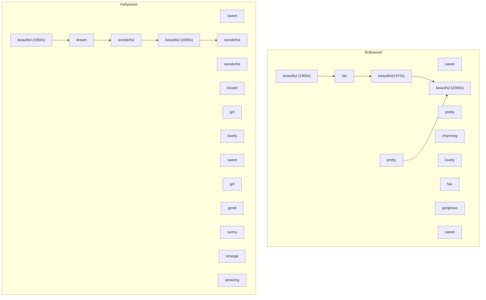
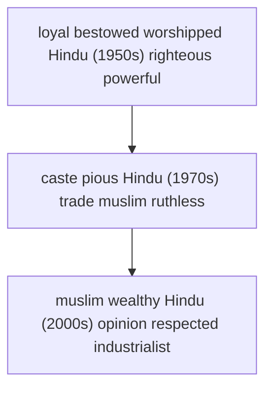
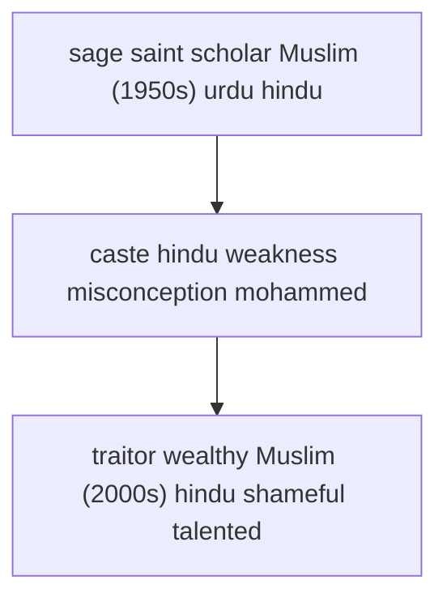
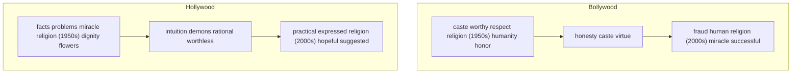

arXiv:2102.09103v1 [cs.CY] 18 Feb 2021

# GENDER BIAS, SOCIAL BIAS AND REPRESENTATION: 70 YEARS OF BHOLLYWOOD

A PREPRINT

**Kunal Khadilkar\***
Carnegie Mellon University
kkhadilk@cs.cmu.edu

**Ashiqur R. KhudaBukhsh\***
Carnegie Mellon University
akhudabu@cs.cmu.edu

**Tom M. Mitchell**
Carnegie Mellon University
tom.mitchell@cs.cmu.edu

February 19, 2021

## **ABSTRACT**

With an outreach in more than 90 countries, a market share of 2.1 billion dollars and a target audience base of at least 1.2 billion people, Bollywood, aka the Mumbai film industry, is a formidable entertainment force. While the number of lives Bollywood can potentially touch is massive, no comprehensive NLP study on the evolution of social and gender biases in Bollywood dialogues exists. Via a substantial corpus of movie dialogues spanning a time horizon of 70 years, we seek to understand the portrayal of women, in a broader context studying subtle social signals, and analyze the evolving trends in geographic and religious representation in India. Our argument is simple – popular movie content reflects social norms and beliefs in some form or shape. In this project, we propose to analyze such trends over 70 years of Bollywood movies contrasting them with their Hollywood counterpart and critically acclaimed world movies.

**Keywords** Gender Bias · Social Bias · Bollywood · Hollywood

## **1 Introduction**

*What types of social biases can we analyze and detect through the lens of a diachronic corpus of popular entertainment?* In this paper, we focus on Bollywood, aka the Mumbai film industry, and analyze a curated corpus of film subtitles for the last 70 years. While Bollywood is an entertainment industry worth billions and has a target audience of 1.2 billion people, little or no work exists that analyzed a wide range of social biases and signals that can be uncovered from this rich corpus. In this work, we contrast our findings with an analogous corpus of Hollywood and for a specific subset of research questions, we dig deeper and look into world movies.

Our primary focus is gender bias. As shown in Table 1, several Bollywood movies are riddled with sexist and misogynist dialogues. It is thus not surprising that cutting edge NLP methods would reveal some of these existing biases. We are, however, interested in a broader research question: *In a developing nation, what kind of social insights can be gleaned from popular entertainment?* Is it possible to understand subtle gender biases such as son's preference? Can we track the evolving nature of retrograde social practises like dowry?

Our second focus in this work is broader representation questions such as geographic representation, religious representation and caste representation. In our mixed method analyses, we identify that (1) some of gender biases observed in Bollywood is very much present in it's Western counterpart; (2) a positive trend is witnessed in observing reduced biases with progress of time and; and (3) a similar trend is observed in religious and geographic representation, with a considerable scope for improved diversity and inclusion.

\*Kunal Khadilkar and Ashiqur R. KhudaBukhsh are equal contribution first authors.

Gender Bias, Social Bias and Representation: 70 Years of BHollywood A PREPRINT

<table><tr><td>Akeli ladki khuli tijori ki tarah hoti hai (Jab We Met)</td><td>A girl who is alone is like an open treasure. (Jab We Met)</td></tr><tr><td>Generated Movie Revenue: ≈$14,899,137</td><td></td></tr><tr><td>Marriage se pehle ladkiyajn sex object hoti hain, our marriage ke baad they object to sex! (Kambakkht Ishq)</td><td>Before marriage, girls are sex objects, and after marriage, girls object to sex. (Kambakkht Ishq)</td></tr><tr><td>Generated Movie Revenue: ≈$17,531,586</td><td></td></tr><tr><td>Tu ladki ke peche bhagega, ladki paise ke peche bhagegi. Tu paise ke piche bhagega, ladki tere peche bhagegi (Wanted)</td><td>You are chasing the girls, while the girls are chasing money. If you start chasing money, girls will automatically chase you. (Wanted)</td></tr><tr><td>Generated Movie Revenue: ≈$27,630,059</td><td></td></tr></table>

Table 1: Illustrative examples of misogynistic dialogues present in blockbuster Bollywood movies (movie names are presented in parentheses). The dialogues (in blue) are in Romanized Hindi, and their approximate English translations are highlighted in red.

## 2 Research questions

We aim to answer the following research questions -

***RQ 1:*** *How is gender bias reflected through movie dialogues in the Bollywood and Hollywood movie industries?*
***RQ 2:*** *How do award winning foreign feature films compare with Bollywood and Hollywood in addressing gender equality? Does genre make any difference?*
***RQ 3:*** *Is beauty associated with fair skin in the movie dialogues describing women?*
***RQ 4:*** *Does Bollywood reflect the well-documented son’s preference in medical and social science research? How has the sentiment around retrograde social practices such as dowry evolved?*
***RQ 5:*** *Which geographical areas have been consistently underrepresented in the Indian film industry?*
***RQ 6:*** *Can we gain an insight into the religious representation of a country, through a film corpus spanning 70 years?*
***RQ 7:*** *Can we extract economic signals through popular film dialogues?*
***RQ 8:*** *How are religions perceived in movies? Can we track evolving national priorities from popular entertainment?*

## 3 Related Work

Studies analyzing gender stereotypes across different languages [1] and detecting bias in word embeddings [2] use books and news data sources for their analyses. Existing lines of work in uncovering entertainment industry bias focus on a single Bollywood movie [3] or a small subset of movies [4]. [5] focused on plot points and film information taken from Wikipedia. We consider a different and potentially richer data set of film subtitles spanning 70 years. We contrast our work with Hollywood and award winning world movies, and our analyses cover a broader set of aspects such as retrograde social practices, uncovering subtler biases and highlighting geographical and religious underrepresentation. Unlike previous work on movie subtitles [1], our focus is on Bollywood content largely ignored by the information science research community so far.

In terms of our dataset, our work is most similar to [6] that looked at a smaller corpus of Bollywood subtitles. Our work contrasts with [6] in the following key ways. First, our treatment to the analyses of gender bias (1) includes diachronic-word embedding analysis and word embedding association tests (WEAT); (2) is grounded on well-established lexicons; (3) looks into subtler signals such as son’s preference; (4) tracks retrograde social practices such as dowry and (5) considers additional data sources (e.g., world movies). Second, our work tackles important questions on geographic and religious representation unaddressed by [6]. Finally, we look into questions related to economic signals and show promising computational creativity results.

In this paper, we explore a wide array of NLP techniques to analyze our research questions through the lens of popular movies. We use

1. Simple *count-based statistics* relying on highly popular lexicons [7] and gender representation studies [8, 9];
2. *Cloze test*, an analysis technique that have a solid grounding in psycholinguistics literature [10, 11]. To the best of our knowledge, for the first time, we explore a recent technique [12] previously used to mine political insights [13] in the context of uncovering social biases. Through a series of cloze tests on a language model [14] fine-tuned on our data sets, we present our findings.
3. *Analysis of aligned diachronic word embedding spaces* using recently proposed techniques [15].

2

Gender Bias, Social Bias and Representation: 70 Years of BHollywood A PREPRINT

*4. Free form text completion using GPT-2* [16], for a novel task of tracking economic signals.

We employ this broad suite of NLP techniques on a novel domain of popular entertainment.

Geographical and community representation in India has been studied by various political and social scientists. [17] showcase the population misrepresentation in political settings, while [18] focuses on underrepresentation of north-east India in mainstream newspapers. Our work complements this research [18] and presents corroborating evidence from a very different data source.

## 4 Data Set

We construct the following two data sets of movie subtitles.

**1. Bollywood movies, $D_{bolly}$:** We consider movies spanning seven decades (1950–2020). For each decade, we retrieved subtitles [19] of 100 movies (700 total films).

**2. Hollywood movies, $D_{holly}$:** Similar to Bollywood movies, we considered 100 top-grossing movies from each of the seven decades (700 total films). Overall, $D_{bolly}$ and $D_{holly}$ consist of 1.1M dialogues (6.2M Tokens) and 1M dialogues (5.4M Tokens), respectively.

For a subset of our analyses, we divide our corpus into three buckets presented in Table 2.

<table><thead><tr><th>Corpus</th><th>Industry</th><th>Time Period</th></tr></thead><tbody><tr><td>Dold_bolly</td><td>Bollywood</td><td>1950 - 1969</td></tr><tr><td>Dmid_bolly</td><td>Bollywood</td><td>1970 - 1999</td></tr><tr><td>Dnew_bolly</td><td>Bollywood</td><td>2000 - 2020</td></tr></tbody></table>

<table><thead><tr><th>Corpus</th><th>Industry</th><th>Time Period</th></tr></thead><tbody><tr><td>Dold_holly</td><td>Hollywood</td><td>1950 - 1969</td></tr><tr><td>Dmid_holly</td><td>Hollywood</td><td>1970 - 1999</td></tr><tr><td>Dnew_holly</td><td>Hollywood</td><td>2000 - 2020</td></tr></tbody></table>

Table 2: Dataset split for Bollywood and Hollywood

We further collect 150 movies which have been nominated for the *Best International Feature Film* award 1970 onwards, at the Oscars (https://www.oscars.org) for a subset of our analyses.

## 5 Gender Bias in Movie Dialogues

***RQ 1:*** *How is gender bias reflected through movie dialogues in the Bollywood and Hollywood movie industries?*

### 5.1 Gendered pronouns

<table><thead><tr><th>Year</th><th>Hollywood</th><th>Bollywood</th><th>Google Books</th></tr></thead><tbody><tr><th>1950 - 1959</th><td>65.5</td><td>58.0</td><td>73.5</td></tr><tr><th>1960 - 1969</th><td>58.5</td><td>56.5</td><td>73.5</td></tr><tr><th>1970 - 1979</th><td>65.5</td><td>59.0</td><td>70.0</td></tr><tr><th>1980 - 1989</th><td>60.0</td><td>62.0</td><td>64.0</td></tr><tr><th>1990 - 1999</th><td>62.5</td><td>60.0</td><td>55.0</td></tr><tr><th>2000 - 2009</th><td>53.5</td><td>54.5</td><td>50.0</td></tr><tr><th>2010 - 2019</th><td>56.5</td><td>53.0</td><td>50.0</td></tr></tbody></table>

Figure 1: *MPR* in $D_{bolly}$ and $D_{holly}$

Following extensive literature on gendered pronouns’ relative distributions and their implications [8, 9], we consider a simple measure of gender representation: relative occurrence of pronouns of each gender (Men: he, him. Women: she, her). Let $N_w$ denote the number of times a token $w$ appears in a corpus. We define *Male Pronoun Ratio* (*MPR*) as follows: $MPR = \frac{N_{he}+N_{him}}{N_{he}+N_{him}+N_{she}+N_{her}} * 100$. Figure 1 plots *MPR* of our decade-wise movie data sets and contrasts with *MPR* computed using google n-grams. Our results indicate that even now, both Bollywood and Hollywood exhibit comparable skew in gendered pronoun usage.

3

Gender Bias, Social Bias and Representation: 70 Years of BHollywood A PREPRINT

## **5.2 Cloze tests**

When presented with a sentence (or a sentence stem) with a missing word, a cloze task [10] is essentially a fill-in-the-blank task. For instance, in the following cloze task: *In the* [MASK], *it is very sunny*, summer is a likely completion for the missing word. Given a cloze test, BERT, a well-known language model [14], outputs a series of token ranked by probability. In fact, in the above cloze test, the top three tokens (ranked by probability) predicted by BERT*base* are: summer, winter and spring. Recent lines of research has explored BERT’s masked query prediction for (1) knowledge base extraction [12] and (2) mining political insights [13].

<table><thead><tr><th>Probe</th><th>BERTbase</th><th>BERToldDolly</th><th>BERTnewDolly</th><th>BERToldDolly</th><th>BERTnewDolly</th></tr></thead><tbody><tr><td>cloze₁</td><td>man, widow, woman, doctor, slave, soldier, bachelor, merchant, farmer, lawyer, servant [4.8]</td><td>prostitute, servant, woman, slave, bachelor, doctor, lawyer, man, widow, maid, worker [4.64]</td><td>doctor, woman, servant, lawyer, maid, hindu, nurse, teacher, gardener, lady, man [5.7]</td><td>woman, slave, servant, nurse, lady, man, teacher, lawyer, peasant, maid, wife [5.3]</td><td>woman, lawyer, doctor, nurse, teacher, man, writer, secretary, prostitute, professional, carpenter [5.7]</td></tr><tr><td>cloze₂</td><td>man, soldier, gentleman, farmer, merchant, woman, slave, bachelor, doctor, carpenter, servant [5.48]</td><td>man, gentleman, lawyer, lawyer, servant, doctor, farmer, worker, craftsman, slave, criminal [5.0]</td><td>doctor, lawyer, policeman, man, farmer, bachelor, gardener, servant, soldier, mechanic, builder [5.3]</td><td>carpenter, policeman, man, lawyer, soldier, gentleman, servant, man, peasant, slave, doctor [5.0]</td><td>man, lawyer, soldier, doctor, carpenter, gentleman, clergyman, farmer, writer, craftsman, minister [5.78]</td></tr></tbody></table>

Table 3: Cloze test results. Predicted tokens are ranked by decreasing probability. Positive and negative words are color coded with blue and red, respectively. The number in the bracket represents the average valence score (obtained from [7]) calculated for the answers to the cloze test.

Our cloze test results are summarized in Table 3. We observe that completion results for both genders across both movie industries improve over time. In order to quantify the completion results, we consider a well-known lexicon of emotional valence ratings [7] of nearly 14,000 English words to quantify the change of cloze test completions over time. The valence score of these words are presented in a scale of 1 to 10 with 10 indicating highly positive and 1 indicating highly negative. For example, the emotional valence score of happy and sad are 8.47 and 2.10, respectively. For a given data set and a cloze test pair, we compute the average valence score of the completions (listed in square brackets in Table 17). We further note that comparing completion words across the two genders can be technically difficult simply because we observe that there can be potential bias in the scores. For instance, the valence scores for man and woman are 5.42 and 7.09, respectively. Hence we restrict ourselves to comparing within a specific gender for a given movie industry.

<table><tr><td></td><th>Bollywood</th><th>Hollywood</th></tr><tr><td>Women</td><td>22%</td><td>7%</td></tr><tr><td>Men</td><td>5%</td><td>15%</td></tr></table>

Table 4: Percent increase in average valence score for cloze test completions between old movies and new movies.

Table 4 lists the percentage of increase in the valence score of the completion for a particular gender across different movie industries. We note that for both Bollywood and Hollywood, the valence scores for both genders improved over time. However, for Bollywood, we notice that rate of increase for women is substantially more pronounced than that for men. This observation aligns with the continual fight for gender equality in India [20] and major movements that have mobilised voices for women’s right to work [21], financial independence [22], and marital laws [23].

## **5.3 Diachronic word embeddings**

The meaning of words and the context in which they are used change over time [24]. The language spoken in a community is representative of the cultural norms and customs followed in that region. Existing hypotheses [25] indicate that word frequency may play a role in changing the meaning of the words over time. The meanings of less-frequent words are more susceptible to drifts than that of highly frequent words. [15] provide a robust multilingual approach to align diachronic word embeddings using orthogonal procrustes. We follow the same method to align different sub-corpora for Bollywood and Hollywood. In addition to the four sub-corpora – $D_{bollywood}^{old}$, $D_{bollywood}^{new}$, $D_{hollywood}^{old}$, $D_{hollywood}^{new}$ – we consider the time period of 1970-2000 and construct two additional sub-corpora $D_{bollywood}^{mid}$ and $D_{hollywood}^{mid}$. We train word2vec [26] with SGNS (Skip-gram with Negative Sampling), to create embeddings for each of the buckets mentioned above. Let $W^{(t)} \in R^{(d) \times V}$ be the matrix of word embeddings learnt for period $t$ for vocabulary $V$. Following

4

Gender Bias, Social Bias and Representation: 70 Years of BHollywood A PREPRINT

image: word embeddings for Bollywood and Hollywood

(a) Woman over the years

(b) Man over the years

Figure 2: Nearest neighbors of man and woman over the years. The overall average valence of nearest neighbors according to the lexicon provided in [7] for a given time-period is presented in blue font.

[15], we align the word embeddings using the top 10,000 common tokens present across time periods $t$ and $t + 1$ by optimizing:

$$R^t = arg \min_{Q^T Q=I} \left\| QW^t - W^{(t+1)} \right\|_F \tag{1}$$

where $R^t \in R^{d \times d}$.

We focus on the portrayal of women and men using these aligned embeddings. We observe that the valence scores for both genders across both movie industries show a similar pattern. The scores are the lowest during the 1970-1999 time period. The valence scores for the newer movies are better than the scores for the older movies. The dip in the valence scores during the time-period of 1970-1999 in India can be ascribed to a social and cultural crisis influenced by an unstable political climate (assassinations of two prime ministers [27, 28]), two major wars between India and Pakistan [29, 30], and a large overlap with a pre-economic liberalization period [31].

## 5.4 Word Embedding Association Test (WEAT) for quantifying gender bias

While valence scores give us an indication regarding the difference in valence (degree of pleasantness) scores between the two genders on Language Models cloze tests, we explore quantifying the bias in our corpus using a more popular technique of Word Embedding Association Test (WEAT) [32]. For the purpose of this analysis, We train the sub-corpora using GloVe [33] embeddings, as given in [32], to understand the evolution of gender bias through time. According to WEAT, we consider two equal sized sets of occupations, $S_1$ and $S_2$ and two sets of attribute words $A_1$ and $A_2$.

The similarity of two words, say $x$ and $y$, is given by calculating the cosine similarity of the corresponding word embeddings, $cos(w_x, w_y)$. As given in [32], the differential association of a word $c$ with word sets $A_1$ and $A_2$ is given by:

$$g(c, A_1, A_2, w) = \frac{mean}{a\epsilon A_1 cos(w_c, w_a)} - \frac{mean}{b\epsilon A_2 cos(w_c, w_b)} \tag{2}$$

Further, the WEAT is calculated as:

$$B_{weat}(w) = \frac{mean}{std-dev} \frac{seS_1 g(s, A_1, A_2, w) - t\epsilon S_2 g(t, A_1, A_2, w)}{seS_1 S_2 g(s, A_1, A_2, w)} \tag{3}$$

Here, the occupation sets taken from [34] $S_1$ and $S_2$ are:
$S_1 = [“maestro”, “skipper”, “protege”, “philosopher”, “captain”, “architect”, “financier”, "warrior”, “broadcaster”; “magician”, “pilot”, “boss”] $S_2 = [“homemaker”, “nurse”, “receptionist”, “librarian”, “socialite”, “hairdresser”, “nanny”, “bookkeeper”, “stylist”, “housekeeper”, “designer”, “counselor”]

And the attribute word sets $A_1$ and $A_2$ are: $A_1 = [“he”, “man”, “male”] $A_2 = [“she”, “woman”, “female”]

5

Gender Bias, Social Bias and Representation: 70 Years of BHollywood A PREPRINT

<table><thead><tr><th>Industry</th><th>Old</th><th>Mid</th><th>New</th></tr></thead><tbody><tr><td>Bollywood</td><td>0.601</td><td>0.559</td><td>0.543</td></tr><tr><td>Hollywood</td><td>0.456</td><td>0.443</td><td>0.410</td></tr></tbody></table>

Table 5: Average WEAT scores for Bollywood and Hollywood across different time periods. A larger value indicates greater gender bias.

As shown in Table 5, we find that the average WEAT scores across both industries reduced over time. As compared to Bollywood, for any given time period, Hollywood exhibits lesser gender bias.

## **6 Genre Specific Analysis**

***RQ 2:*** *How do award winning foreign feature films compare with Bollywood and Hollywood in addressing gender equality? Does genre make any difference?*

Along with performing a comparative study between Bollywood and Hollywood, we are further interested in comparing the WEAT scores of Bollywood and Hollywood with that of a set of critically acclaimed world movies. To this end, we construct a corpus of 150 movies nominated at the foreign film category at the Academy awards.

<table><thead><tr><th>Industry</th><th>WEAT score</th></tr></thead><tbody><tr><td>Bollywood</td><td>0.523</td></tr><tr><td>Hollywood</td><td>0.504</td></tr><tr><td>World movies</td><td>0.285</td></tr></tbody></table>

Table 6: WEAT scores for Bollywood, Hollywood and world movies.

Our results indicate that the average WEAT score obtained for nominated foreign feature films is the lowest as compared to the average WEAT score for Bollywood and Hollywood.

Adventure/Action and Romance are the two most popular genres across different industries, with hundreds of films released every year. Action films generally tend to be male dominated, compared to Romantic films. We explore this hypothesis using WEAT, for the given genres. For this analysis, we consider four token-balanced sub corpora, $G_{bollywood}^{action}, G_{bollywood}^{romance}, G_{hollywood}^{action}, G_{hollywood}^{romance}$, each containing 150 films. All the films were post 1990, and were chosen based on the genre lists/tags given by imdb and Google.

<table><tr><td></td><th>Romance</th><th>Action</th></tr><tr><td>Hollywood</td><td>0.079</td><td>0.591</td></tr><tr><td>Bollywood</td><td>0.343</td><td>0.512</td></tr></table>

Table 7: WEAT scores for Romance and Action films.

Table 7 shows that the gender bias for action movies is a lot more pronounced than that in Romance movies. Across both industries and movie genres, Hollywood action films exhibit most bias.

## **7 Associating Beauty with Fair Skin**

***RQ 3:*** *Is beauty associated with fair skin in the movie dialogues describing women?*

We first present our cloze test results with the probe *"A beautiful woman should have [MASK] skin."* in Table 8. We note that while BERT*base* model predicts *soft* in place of [MASK], all fine-tuned BERT models on the film corpora predict *fair* as the top choice. Figure 3 visualizes the nearest neighbors of beautiful in our aligned embedding spaces of Hollywood and Bollywood sub-corpora.

6

Gender Bias, Social Bias and Representation: 70 Years of BHollywood A PREPRINT

<table><thead><tr><th>BERTbase</th><th>BERToldholly</th><th>BERTnewholly</th><th>BERToldholly</th><th>BERTnewholly</th></tr></thead><tbody><tr><td>soft, beautiful, pale, tanned, smooth</td><td>fair, no, pale, tanned, tan</td><td>fair, tanned, golden, smooth, pale</td><td>fair, pale, blue, golden, gold</td><td>fair, pale, tanned, golden, dark</td></tr></tbody></table>

Table 8: Cloze test results for the probe *A beautiful woman should have* [MASK] *skin..*

flow_chart: Nearest neighbors of beautiful over the years

Figure 3: Nearest neighbors of beautiful over the years

As shown in Figure 3 and Table 8, the age-old affinity toward lighter skin in Indian culture [35, 36, 37] is reflected through the consistent presence of *fair* among the nearest neighbors of all three Bollywood sub-corpora. Although our cloze tests indicates Hollywood also exhibits bias towards lighter skin color, our diachronic word embedding analysis reveals that possibly the bias is less pronounced than in Bollywood.

## 8 Subtler Biases

***RQ 4:*** *Does Bollywood reflect the well-documented son’s preference in medical and social science research? How has the sentiment around retrograde social practices such as dowry evolved?*

Occupational stereotypes aside, a diachronic corpus may reveal subtler forms of biases. In our next analysis, we seek to analyze two seemingly disconnected aspects: son’s preference and perception of dowry. Son’s preference in India is a well-documented phenomenon and skewed sex ratio, female feticide and higher child mortality rate for girls have attracted policymakers’ attention [38, 39, 40, 41]. In order to prevent female feticide, in 1994, the Parliament of India enacted the Pre-Conception and Pre-Natal Diagnostic Techniques (PCPNDT) Act also known as the Prohibition of Sex Selection Act that effectively rendered prenatal sex discernment illegal.

Similarly, certain retrograde practice such as dowry, can influence son’s preference as a girl-child might be looked upon as financial burden [42]. The ‘dowry’ system has plagued the Indian society for a long time [43]. Dowry refers to a transaction of tangible financial objects in the form of durable goods, cash, and real or movable property between the bride’s family gives and the bridegroom, his parents and his relatives as a condition of the marriage. Although legally, dowry has been prohibited in India since 1961 [44], this practice has continued well after its legal prohibition and has a strong link to social crises such as female foeticide [45], domestic abuse and violence [46, 47], and dowry deaths [48]. However, while the practice continued, recent studies have reported positive changes in the society where the general attitude towards the system has become negative [49].

### 8.1 Son’s preference

A popular Bollywood plot point is the introduction of a child into the family. Approximately, every 1 in 10 collected movies had a scene involving birth of a child. We were curious to analyze when a child is born in a Bollywood movie, is it a boy or a girl? We retrieve the dialogues talking about childbirth using a template based approach, by searching for the following keywords - ‘birth’, ‘baby’, ‘pregnant’, ‘pregnancy’, ‘congratulations’ as well as phrases - “It’s a boy”, “It’s a girl”. We annotated the retrieved dialogues related to childbirth, and perform a temporal analysis.

7

Gender Bias, Social Bias and Representation: 70 Years of BHollywood A PREPRINT

Let $N_w$ denote the number of times a dialogue talking about the baby’s gender $w$ appears in a corpus. We define *Male Birth Ratio (MBR)* as follows:
$$MBR = \frac{N_{boy}}{N_{boy} + N_{girl}} * 100.$$ Table 9 suggests that the family dynamics portrayed in Bollywood movies have shown considerable shift, with the *MBR* being 73.9 in old movies, to almost achieving parity (54.5) in newer movies.

<table><tr><td></td><th>Old</th><th>Mid</th><th>New</th></tr><tr><td>MBR</td><td>73.9</td><td>76.4</td><td>54.5</td></tr></table>

Table 9: The Male Birth Ratio (MBR) calculated based on Bollywood movie dialogues

image: Nearest neighbors of dowry over the years

Figure 4: Nearest neighbors of dowry over the years.

## **8.2 Dowry**

As shown in Figure 4, we observe that while nouns such as money, debt, jewellery, fees, and loan are the nearest neighbors in older films indicating compliance to this practice, modern films exhibit non-compliance (e.g., guts and refused) and indicate some of the consequences of such non-compliance (e.g., divorce and trouble) in the form of nearest neighbors. We find that indeed, films provide a snapshot of cultural values of a particular country thus allowing us to gauge the progress of a nation over time.

# **9 Broader Representation Questions**

## **9.1 Geographic representation**

***RQ 5: Which geographical areas have been consistently underrepresented in the Indian film industry?***

We now shift our focus to two broader representational aspects: geographical and religious representations. Of the 28 states in India, we next present an analysis of the relative representation of each of these states and major Indian cities.

From the beginning, Bollywood has it’s roots in Mumbai, and Delhi is India’s capital. Hence, it is not surprising that the cities are mentioned heavily across all time periods (see Table 10). Figure 5(a) and 5(b) compare the geographic representations in the most recent 20 years with the rest of our corpus spanning 1950–2000. We observe that initially based out of major hotspots of Delhi, Goa and cities like Mumbai, recent Bollywood content is geographically more inclusive. However, A key point we highlight in Figure 5(c) is that, in line with prior research on underrepresentation of North Eastern states in news content [18], there is severe underrepresentation of Bollywood content surrounding these North Eastern states. There have been zero mentions of the states of Manipur, Arunachal Pradesh, Meghalaya, Tripura, Mizoram in over 500 movies across 70 years.

8

Gender Bias, Social Bias and Representation: 70 Years of BHollywood | A PREPRINT

map: Geographical representation in films from 1950s to 2000s
(a) 1950–1999
(b) 2000–2020
(c) No representation

Figure 5: (a) Geographical Representation in films from 1950s to 2000s (b) Geographical Representation in films post 2000 (c) States never mentioned in our corpus in the last 70 years. The base maps used for this plot are sourced from the Government of India. The authors are aware that these maps include disputed territories. These maps do not constitute judgments on existing disputes.

map: Table placeholder

Table 10: City mentions in movies

## **9.2 Religious representation**

***RQ 6:*** *Can we gain an insight into the religious representation of a country, through a film corpus spanning 70 years?*

<table><tr><td>Most-frequent surnames</td></tr><tr><td>Singh, Krishna, Khan, Rai, Ali, Kapoor, Sharma, Mohan, Prasad, Khanna, Shah, Lal, Thakur, Dev, Shekhar, Chaudhary, Gandhi, Verma, Gupta, Prakash, Rana, Nath, Patel, Pandey, Roy, Pandit, Saxena, Mathur, Roshan, Bachchan, Pal, Mehta, Narayan, Das, Rode, Dayal, Mehra, Bhagat, Shastri, Chandra, Patil, Banerjee, Tilak, Rao, Tripathi, Yadav, Kumari, Suman, Mukherjee, Bhatia, Acharya, Chatterjee, Rehman, Iyer</td></tr></table>

Table 11: The top surnames occurring in Bollywood movies (in decreasing order of frequency)

India is a diverse country with 6 main religions, 22 major languages and more than 700 dialects. According to the 2011 census [50], the religious distribution among the Indian population is 79.8% follow Hinduism, 14.2% adheres to Islam, 1.72% adheres to Sikhism, 2.3% adheres to Christianity, 0.7% adheres to Buddhism and 0.37% adheres to Jainism. There has been discussion in the past, regarding the religious stereotypes portrayed in Bollywood [51], and we build upon this by understanding the religious representation present in the large corpus of Bollywood subtitles. The surnames appearing in the movies (e.g., Mrs. Kapoor, Mr. Khan etc.) are annotated manually by two annotators, with each surname given one label from the list of labels: Hindu; Muslim; Sikh; Christian; Parsi; and Multiple. The annotators achieved a Cohen $\kappa$ score of 0.8879 indicating high inter-rater agreement. The discrepancies were resolved by the annotators through a follow-up adjudication process and by consulting relevant literature. Figures 6, 7, 8 provide the religion distribution obtained in movies. We note that: (1) the distribution is more or less consistent with the census

<table>
    <tr>
      <td>Old</td>
      <td>Mid</td>
      <td>New</td>
    </tr>
    <tr>
      <td>Bombay/Mumbai (55)</td>
      <td>Bombay/Mumbai (73)</td>
      <td>Bombay/Mumbai (91)</td>
    </tr>
    <tr>
      <td>Agra (50)</td>
      <td>Delhi (46)</td>
      <td>Delhi (63)</td>
    </tr>
    <tr>
      <td>Delhi (30)</td>
      <td>Agra (46)</td>
      <td>Agra (42)</td>
    </tr>
    <tr>
      <td>Daman (22)</td>
      <td>Daman (14)</td>
      <td>Bangalore/Bengaluru (11)</td>
    </tr>
    <tr>
      <td>Lucknow (14)</td>
      <td>Rampur (13)</td>
      <td>Pune (10)</td>
    </tr>
    <tr>
      <td>Mathura (6)</td>
      <td>Lucknow (12)</td>
      <td>Hyderabad (9)</td>
    </tr>
    <tr>
      <td>Srinagar (6)</td>
      <td>Pune (9)</td>
      <td>Amritsar (9)</td>
    </tr>
    <tr>
      <td>Jalgaon (4)</td>
      <td>Bangalore (8)</td>
      <td>Lucknow (8)</td>
    </tr>
    <tr>
      <td>Allahabad (4)</td>
      <td>Nagpur (7)</td>
      <td>Chandigarh (6)</td>
    </tr>
</table>

9

Gender Bias, Social Bias and Representation: 70 Years of BHollywood A PREPRINT

<table><tr><td colspan="2">Surnames of doctors</td></tr><tr><td colspan="2">Kapoor, Chopra, Khurana, Tripathi, Kapoor, Ansari, Awasthi, Kothari, Mathur, Puri, Nayak, Bhalerao, Sawant, Tandon, Swamy, Banerjee, Verma, Rana, Ruby, Singh, Shrivastav, Khanna, Bhandari, Tiwari, Saxena, Shinde, Mehta, Goenka, Kumar, Goswami</td></tr></table>

Table 12: Surnames of doctors in Bollywood movies

numbers; (2) representation for other religions has increased in recent years; and (3) the representation of Muslims is slightly less than the community’s population share.

<table><thead><tr><th>Religion</th><th>Percent</th></tr></thead><tbody><tr><th>Sikh</th><td>7.26</td></tr><tr><th>Hindu</th><td>81.27</td></tr><tr><th>Muslim</th><td>6.16</td></tr><tr><th>Multiple</th><td>3.74</td></tr><tr><th>Parsi</th><td>1.32</td></tr><tr><th>Christian</th><td>0.22</td></tr></tbody></table>

Figure 6: Religious Representation in Old movies

<table><thead><tr><th>Religion</th><th>Percent</th></tr></thead><tbody><tr><th>Sikh</th><td>8.14</td></tr><tr><th>Hindu</th><td>83.54</td></tr><tr><th>Muslim</th><td>5.43</td></tr><tr><th>Multiple</th><td>2.07</td></tr><tr><th>Parsi</th><td>0.63</td></tr><tr><th>Christian</th><td>0.15</td></tr></tbody></table>

Figure 7: Religious Representation in Mid movies

<table><thead><tr><th>Religion</th><th>Percent</th></tr></thead><tbody><tr><th>Sikh</th><td>8.06</td></tr><tr><th>Hindu</th><td>79.52</td></tr><tr><th>Muslim</th><td>7.81</td></tr><tr><th>Multiple</th><td>3.84</td></tr><tr><th>Christian</th><td>0.49</td></tr><tr><th>Parsi</th><td>0.24</td></tr></tbody></table>

Figure 8: Religious Representation in New movies

Table 12 indicates the surnames of the doctors occuring in Bollywood movies. To retrieve these surnames from the subtitles, we employ a template based approach, searching for keywords like ‘Dr. ’, ‘doctor’ from our corpus. While a broader religious representation is observed in our overall results, the observed representation for the medical profession is quite skewed, with large number of surnames being Brahmins (the uppermost caste in the Hindu caste-system in India).

## **10 Economic Signals**

***RQ 7: Can we extract economic signals through popular film dialogues?***

By looking at a popular entertainment corpus of a developing nation, we are able to showcase the evolution of gender bias, evolving attitude towards social evils, geographic and religious representations. Can we detect economic signals

10

Gender Bias, Social Bias and Representation: 70 Years of BHollywood A PREPRINT

<table><tr><td></td><th>Old</th><th>Mid</th><th>New</th></tr><tr><td>Predicted Average Ransom Amount</td><td>594,805</td><td>10,959,940</td><td>29,688,280</td></tr><tr><td>Inflation adjusted</td><td>-</td><td>2,194,830</td><td>21,000,280</td></tr></table>

Table 13: Average amount for text completion results on the input sentence *The ransom amount is* using fine-tuned GPT-2 models. The inflation-adjusted values for 594,805 INR in 1960 is presented in bottom row.

as well, from the Bollywood dialogues? 100 rupees in 1958 are equivalent to 8,117.22 rupees in 2020 [52]. We seek to understand whether language models can capture these noisy signals. GPT-2 [16], a popular language model with more than 100 million parameters, has achieved state of the art results for text completion, zero shot transfer learning etc. GPT-2 has been widely used for generating free form text, to create artificial newsletters, poems [53] etc. We noticed that the most common dialogues expressing monetary figures or large amounts of money were generally associated with ransom. For example, a sample dialogue is “We have kidnapped your kid, the ransom amount is 2 million Rupees.”

To understand this change at a large scale, we fine-tune GPT-2 on three Bollywood sub-corpora, each belonging to films from different time periods, for the end goal of text/dialogue generation. On these finetuned models, we input the sentence *“The ransom amount is”* and analyze the generated text by the model. Table 13 showcases the average amount across 100 generated samples from the finetuned models. We note that our while our predicted values overestimate the inflation rate, the ransom amounts capture the general increasing pattern and have increased significantly over time.

# 11 Evolving National Priorities as Reflected in Movies and Responsible Censorship

***RQ 8:*** *How are religions perceived in movies? Can we track evolving national priorities from popular entertainment?*

## 11.1 Responsible censorship

India has faced two major partitions over the last 70 years, which have resulted in considerable religious turmoil and riots [54]. The Censor Board is a governing body which along with giving each movie a certification, has the ability to remove offensive or controversial content or in some extreme cases, completely ban films from being screened in theatres. With religion being a contentious topic in India, offensive terms surrounding it are also discouraged, and this has been constant throughout the years. To validate this hypothesis, we look at the word ‘religion’ and how it has evolved over the years. Figure 10 indicates that ‘religion’ is always accompanied with neutral/mild terms, and movie dialogues have stayed away from using extreme or hateful terms surrounding religion.

Along with understanding the nearest neighbors of ‘religion’, we wanted to understand the discussion surrounding the two biggest religions in India, ‘Hindu’ and ‘Muslim’ (Figures 9(a), 9(b)). We contrast our findings on the movie corpus with prior research involving raw social media data [13]. While negative words like ruthless, shameless, and traitor creeping up in newer movies might indicate religious polarization, we notice that words like terrorists found in social media data [13], do not surface among the nearest neighbors. Along with word embedding analysis, we analyze the BERT cloze tests for the probes (1) *Hindus are* [MASK] and (2) *Muslims are* [MASK]. For both probes, we do not notice completions such as terrorists or fools previously reported in [13]. This indicates that while recent social media analyses might indicate religious polarization, film certification board largely ensured movie content do not reflect such divide.

<table><thead><tr><th>BERTbase</th><th>BERToldbolly</th><th>BERTnewbolly</th></tr></thead><tbody><tr><td>corruption, poverty, malaria, pollution, hunger, terrorism, unemployment, drought, famine, war, tourism</td><td>poverty, love, war, hunger, unemployment, india, famine, money, marriage, education, Kashmir</td><td>poverty, pakistan, Kashmir, terrorism, corruption, india, drugs, dowry, unemployment, hunger, rape</td></tr></tbody></table>

Table 14: Cloze test results for *The biggest problem in India is* [MASK] .

## 11.2 Evolving National Priorities as Reflected in Movies

Similar to BERT’s cloze test applications to uncover gender and racial bias showcased in earlier sections, we employ BERT to analyze evolving national priorities using the following two cloze tests.

1. For Bollywood: *The biggest problem in India is* [MASK] .

11

Gender Bias, Social Bias and Representation: 70 Years of BHollywood A PREPRINT

flow_chart: Hindu over the years

flow_chart: Muslim over the years

(a) Hindu over the years (b) Muslim over the years

Figure 9: Nearest neighbors of Hindu and Muslim over the years.

<table><thead><tr><th>BERT_base</th><th>BERToldholly</th><th>BERTnewholly</th></tr></thead><tbody><tr><td>poverty, corruption, unemployment, crime, terrorism, racism, pollution, hunger, war, cancer, inequality</td><td>war, poverty, money, unemployment, slavery, immigration, alcoholism, education, imperialism, russia, hunger</td><td>poverty, slavery, immigration, unemployment, money, war, racism, hunger, communism, america, education</td></tr></tbody></table>

Table 15: Cloze test results for *The biggest problem in America is* [MASK].

2. For Hollywood: *The biggest problem in America is* [MASK].

We observe that the dynamic political conditions are reflected in the completion results in Tables 14 and 15 (e.g., Kashmir, Pakistan and Russia) [29, 30, 55]. We also note that the list of ongoing problems in the U.S. contains the major issue on which the 2020 election was fought over: racism.

# 12 Future Directions and Conclusion

## 12.1 Future directions

While our current work focused on answering research questions related to inclusion and bias, our corpus may find use in several other interesting applications. Here, we outline an exploratory analysis on computational creativity.

In recent years, the emergence of neural architectures and language models like GPT-2 [16] with millions of parameters have resulted in rapid advancements for various NLP tasks. These models has proved efficient in generating artificial poems [56, 57], stories, news articles with just a few epochs of fine-tuning. We employ a similar strategy to generate

flow_chart: religion over the years

Figure 10: religion over the years

12

Gender Bias, Social Bias and Representation: 70 Years of BHollywood A PREPRINT

dialogues based on the subtitles collected from more than 2000 films, using GPT-2 [16]. To the best of our knowledge, ours is the first ever attempt to automatically generate artificial Bollywood dialogues with human evaluations conducted by annotators with professional experience with the Bollywood industry.

<table><thead><tr><th>Input Probe</th><th>Artificially Generated Subtitles</th></tr></thead><tbody><tr><td>The ransom for kidnapping</td><td>The ransom for kidnapping hasn’t been paid yet. We’ll ask for the ransom at the next hearing. Then call up Mr. Trivedi and ask him for the ransom at the next hearing. Fine. Then we’ll ask for the next hearing at our doorstep. And he’ll refuse. Yes, tell me. Come. Sir, please listen to me.</td></tr><tr><td>Your eyes are so</td><td>Your eyes are so beautiful. They don’t let me sleep." They are just dreams." My heart is singing." Don’t let it go, beloved." Don’t let it go, beloved."</td></tr><tr><td>What does the police have to say about this incident?</td><td>What does the police have to say about this incident? What do you mean? They don’t have a witness, madam. No case can be filed under section 302. They only record the statement of the complainants. The police is much more capable than this. Their power and reach is much more impressive.</td></tr></tbody></table>

Table 16: Machine generated subtitles using the GPT2 model. We provide the input probe to the model and output the free form text completion generated by the finetuned LM on our corpus.

**Human Evaluation of the generated dialogues:** We employed two annotators either working professionally or closely associated with the Bollywood film industry, to guess the dialogues into one of the two labels, Real or Generated. We provided a list of 5 real dialogue snippets taken from movies, along with 6 artificially generated subtitles. *Annotator*1 labelled 4 out of 6 artificial dialogues as being real, while *annotator*2 labelled 3 out of 6 artificial dialogues as being real, thus showcasing the efficacy of recent advancement in language models in generating human-like movie diaolgues.

## 12.2 Conclusions

In this paper, we analyzed how social biases and subtle gender biases get reflected on diachronic corpora of popular entertainment. Our research indicates that our NLP methods are capable of uncovering important social signals. Our results demonstrate that indeed, societal changes do get reflected in popular content. But does popular entertainment also influence the society in turn? A recent movie on acid attack, Chhapak, was inspired from a true story of an acid attack survivor who set up an NGO and was a recipient of the *International Women of Courage* [58] award. Her biopic and her initiative of *Stop Acid Sale* when released, triggered regulatory legislation that made it difficult to buy certain types of acids without legal authorization. Devising NLP methods to identify how popular entertainment influences society will be a worthy future research challenge.

13

Gender Bias, Social Bias and Representation: 70 Years of BHollywood A PREPRINT

## **References**

[1] Molly Lewis and Gary Lupyan. Gender stereotypes are reflected in the distributional structure of 25 languages. *Nature human behaviour*, pages 1–8, 2020.

[2] Nikhil Garg, Londa Schiebinger, Dan Jurafsky, and James Zou. Word embeddings quantify 100 years of gender and ethnic stereotypes. *Proceedings of the National Academy of Sciences*, 115(16):E3635–E3644, 2018.

[3] Sushmita Chatterjee. ‘english vinglish’and bollywood: what is ‘new’about the ‘new woman’? *Gender, Place & Culture*, 23(8):1179–1192, 2016.

[4] Subuhi Khan and Laramie Taylor. Gender policing in mainstream hindi cinema: A decade of central female characters in top-grossing bollywood movies. *International Journal of Communication*, 12:22, 2018.

[5] Nishtha Madaan, Sameep Mehta, Taneea S. Agrawal, Vrinda Malhotra, Aditi Aggarwal, and Mayank Saxena. Analyzing gender stereotyping in bollywood movies. *CoRR*, abs/1710.04117, 2017.

[6] Kunal Khadilkar and Ashiqur R. KhudaBukhsh. An unfair affinity toward fairness: Characterizing 70 years of social biases in bhollywood (student abstract). In *The Thirty-Fifth AAAI Conference on Artificial Intelligence, AAAI 2021*, page To Appear. AAAI Press, 2021.

[7] Amy Beth Warriner, Victor Kuperman, and Marc Brysbaert. Norms of valence, arousal, and dominance for 13,915 english lemmas. *Behavior research methods*, 45(4):1191–1207, 2013.

[8] Jean M Twenge, W Keith Campbell, and Brittany Gentile. Male and female pronoun use in us books reflects women’s status, 1900–2008. *Sex roles*, 67(9-10):488–493, 2012.

[9] Marie Gustafsson Sendén, Sverker Sikström, and Torun Lindholm. “she” and “he” in news media messages: Pronoun use reflects gender biases in semantic contexts. *Sex Roles*, 72(1-2):40–49, 2015.

[10] Wilson L Taylor. “cloze procedure”: A new tool for measuring readability. *Journalism quarterly*, 30(4):415–433, 1953.

[11] Nathaniel Smith and Roger Levy. Cloze but no cigar: The complex relationship between cloze, corpus, and subjective probabilities in language processing. In *Proceedings of the Annual Meeting of the Cognitive Science Society*, volume 33, 2011.

[12] Fabio Petroni, Tim Rocktäschel, Sebastian Riedel, Patrick Lewis, Anton Bakhtin, Yuxiang Wu, and Alexander Miller. Language models as knowledge bases? In *Proceedings of the 2019 Conference on Empirical Methods in Natural Language Processing and the 9th International Joint Conference on Natural Language Processing (EMNLP-IJCNLP)*, pages 2463–2473, Hong Kong, China, November 2019. Association for Computational Linguistics.

[13] Shriphani Palakodety, Ashiqur R. KhudaBukhsh, and Jaime G. Carbonell. Mining insights from large-scale corpora using fine-tuned language models. In *Proceedings of the Twenty-Fourth European Conference on Artificial Intelligence (ECAI-20)*, pages 1890–1897, 2020.

[14] Jacob Devlin, Ming-Wei Chang, Kenton Lee, and Kristina Toutanova. BERT: Pre-training of deep bidirectional transformers for language understanding. In *NAACL-HLT*, pages 4171–4186, June 2019.

[15] William L. Hamilton, Jure Leskovec, and Dan Jurafsky. Diachronic word embeddings reveal statistical laws of semantic change. In *Proceedings of the 54th Annual Meeting of the Association for Computational Linguistics (Volume 1: Long Papers)*, pages 1489–1501, Berlin, Germany, August 2016. Association for Computational Linguistics.

[16] Alec Radford, Jeffrey Wu, Rewon Child, David Luan, Dario Amodei, and Ilya Sutskever. Language models are unsupervised multitask learners. 2018.

[17] Jashodhara Mukherjee. From kabir singh to housefull 4, these sexist film dialogues from 2019 need to be cancelled.

[18] Haoginlen Chongloi. Portrayal of northeast india in mainstream media: A case of underrepresentation and misinterpretation. *International Journal of Research in Social Sciences*, 7(5).

[19] Pierre Lison and Jörg Tiedemann. Opensubtitles2016: Extracting large parallel corpora from movie and tv subtitles. 2016.

[20] Purusottam Nayak and Bidisha Mahanta. Women empowerment in india. *Bulletin of Political Economy*, 5(2):155–183, 2012.

[21] Martha Chen. *A matter of survival: Women’s right to employment in India and Bangladesh*, volume 38. Oxford: Clarendon Press, 1995.

14

Gender Bias, Social Bias and Representation: 70 Years of BHollywood A PREPRINT

[22] Meenu Goyal and Jai Parkash. Women entrepreneurship in india-problems and prospects. *International journal of multidisciplinary research*, 1(5):195–207, 2011.

[23] Shalu Nigam. Understanding justice delivery system from the perspective of women litigants as victims of domestic violence in india (specifically in the context of section 498-a, ipc). *Nigam Shalu (2005) Understanding Justice Delivery System From The Perspective of Women Litigants as Victims of Domestic Violence in India (Specifically in the Context of Section 498-A IPC)*, *Occasional Paper*, (35), 2005.

[24] Jing Yi Xie, Renato Ferreira Pinto Junior, Graeme Hirst, and Yang Xu. Text-based inference of moral sentiment change. In *Proceedings of the 2019 Conference on Empirical Methods in Natural Language Processing and the 9th International Joint Conference on Natural Language Processing (EMNLP-IJCNLP)*, pages 4654–4663, November 2019.

[25] Joan Bybee. *Frequency of Use and the Organization of Language*. 12 2006.

[26] Tomas Mikolov, Ilya Sutskever, Kai Chen, Greg S Corrado, and Jeff Dean. Distributed representations of words and phrases and their compositionality. In C. J. C. Burges, L. Bottou, M. Welling, Z. Ghahramani, and K. Q. Weinberger, editors, *Advances in Neural Information Processing Systems 26*, pages 3111–3119. Curran Associates, Inc., 2013.

[27] Robert L Hardgrave Jr. India in 1984: Confrontation, assassination, and succession. *Asian Survey*, 25(2):131–144, 1985.

[28] DR Kaarthikenyan and Radhavinod Raju. *Rajiv Gandhi Assassination*. Sterling Publishers Pvt. Ltd, 2008.

[29] Victoria Schofield. *Kashmir in conflict: India, Pakistan and the unending war*. Bloomsbury Publishing, 2010.

[30] Sumantra Bose. *Kashmir: Roots of conflict, paths to peace*. Harvard University Press, 2009.

[31] Jørgen Dige Pedersen. Explaining economic liberalization in india: state and society perspectives. *World Development*, 28(2):265–282, 2000.

[32] Marc-Etienne Brunet, Colleen Alkalay-Houlihan, Ashton Anderson, and Richard S. Zemel. Understanding the origins of bias in word embeddings. *CoRR*, abs/1810.03611, 2018.

[33] Jeffrey Pennington, Richard Socher, and Christopher Manning. GloVe: Global vectors for word representation. In *Proceedings of the 2014 Conference on Empirical Methods in Natural Language Processing (EMNLP)*, pages 1532–1543, Doha, Qatar, October 2014. Association for Computational Linguistics.

[34] Tolga Bolukbasi, Kai-Wei Chang, James Zou, Venkatesh Saligrama, and Adam Kalai. Man is to computer programmer as woman is to homemaker? debiasing word embeddings, 2016.

[35] Ncoza C Dlova, Saja H Hamed, Joyce Tsoka-Gwegweni, and Anneke Grobler. Skin lightening practices: an epidemiological study of south african women of african and indian ancestries. *British Journal of Dermatology*, 173:2–9, 2015.

[36] Sriya Chattopadhyay. *Fair-Unfair: Prevalence of Colorism in Indian Matrimonial Ads and Married Women’s Perceptions of Skin-Tone Bias in India*. PhD thesis, Bowling Green State University, 2019.

[37] Anwesha Madhukalya. These dialogues from bollywood blockbusters are so sexist that you’ll want to pull your hair out, 2020.

[38] Rohini Pande, Anju Malhotra, Sanyukta Mathur, Manisha Mehta, Anju Malhotra, Margaret A Lycette, Sarah Degnan Kambou, Veronica Magar, Jill Gay, Heidi Lary, et al. Son preference and daughter neglect in india. 2006.

[39] P. N. Mari Bhat and A. J. Francis Zavier. Fertility decline and gender bias in northern india. *Demography*, 40(4):637–657, 2003.

[40] Rebecca Echávarri. Gender bias in sex ratio at birth: The case of india. 02 2006.

[41] Sucharita Sinha Mukherjee. Women’s empowerment and gender bias in the birth and survival of girls in urban india. *Feminist Economics*, 19(1):1–28, 2013.

[42] Nadia Diamond-Smith, Nancy Luke, and Stephen McGarvey. ‘too many girls, too much dowry’: son preference and daughter aversion in rural tamil nadu, india. *Culture, health & sexuality*, 10(7):697–708, 2008.

[43] Sonia Dalmia and Pareena G Lawrence. The institution of dowry in india: Why it continues to prevail. *The Journal of Developing Areas*, pages 71–93, 2005.

[44] R Jaganmohan Rao. Dowry system in india—a socio-legal approach to the problem. *Journal of the Indian Law Institute*, 15(4):617–625, 1973.

[45] Devaki Monani Ghansham. Female foeticide and the dowry system in india. In *Townsville International Women’s Conference, James Cook Univ., Australia*, 2002.

15

Gender Bias, Social Bias and Representation: 70 Years of BHollywood A PREPRINT

[46] Priya R Banerjee. Dowry in 21st-century india: the sociocultural face of exploitation. *Trauma, Violence, & Abuse*, 15(1):34–40, 2014.

[47] Mudita Rastogi and Paul Therly. Dowry and its link to violence against women in india: Feminist psychological perspectives. *Trauma, Violence, & Abuse*, 7(1):66–77, 2006.

[48] Nehaluddin Ahmad. Dowry deaths (bride burning) in india and abetment of suicide: a socio-legal appraisal. *JE Asia & Int’l L.*, 1:275, 2008.

[49] Padma Srinivasan and Gary R Lee. The dowry system in northern india: Women’s attitudes and social change. *Journal of Marriage and Family*, 66(5):1108–1117, 2004.

[50] Religion census 2011.

[51] By: Haris Zargar 4 Feb 2020 Analysis. How bollywood furthers india’s hindu nationalism, Mar 2020.

[52] Inflation calculator - indian rupee.

[53] Gvern. Gpt-2 neural network poetry, Mar 2019.

[54] Sriya Iyer and Anand Shrivastava. Religious riots and electoral politics in india. *Journal of Development Economics*, 131:104 – 122, 2018.

[55] Walter LaFeber and Brian Abbott. *America, Russia, and the Cold War, 1945-1975*. Wiley, 1972.

[56] Tim Van de Cruys. Automatic poetry generation from prosaic text. In *Proceedings of the 58th Annual Meeting of the Association for Computational Linguistics*, pages 2471–2480, Online, July 2020. Association for Computational Linguistics.

[57] Rajat Agarwal and Katharina Kann. Acrostic poem generation. In *Proceedings of the 2020 Conference on Empirical Methods in Natural Language Processing (EMNLP)*, pages 1230–1240, Online, November 2020. Association for Computational Linguistics.

[58] Acid attack victim laxmi to receive international women of courage award - india news , firstpost, Mar 2014.

16

Gender Bias, Social Bias and Representation: 70 Years of BHollywood A PREPRINT

# A APPENDIX

## A.1 Implementation Details

Experiments are conducted on a Google Colab Pro instance, using the Tesla V100 and P100 GPUs provided by Google in the Colab notebook.

We follow the standard preprocessing steps recommended to fine-tune BERT language model. For our task, we use the bert-base-uncased pretrained English model, with the following parameter details: 12 transformer layers, hidden state length of 768, 12 attention heads, 110M overall parameters. The pre-trained model is fine tuned on the target corpus using the training parameters showcased below.

* Batch size: 16
* Maximum sequence length: 128
* Maximum predictions per sequence: 20
* Fine-tuning steps: 10,000
* Warmup steps: 10
* Learning rate: 2e-5

For fine-tuning the language model for free form text completion tasks, we use the smallest GPT2 model with 124M parameters, trained for 10,000 steps. The results showcased in Table 16 are obtained from the fine-tuned model by setting length=250 and temperature=0.9.

## A.2 BERT Fine Tuning Results

<table>
    <tr>
      <td>Probe</td>
      <td>BERTbase</td>
      <td>BERTDold
bolly</td>
      <td>BERTDnew
bolly</td>
      <td>BERTDold
holly</td>
      <td>BERTDnew
holly</td>
    </tr>
    <tr>
      <td>cloze1</td>
      <td>man, widow, woman,
doctor, slave, soldier,
bachelor, merchant,
farmer, lawyer, ser-vant [4.8]</td>
      <td>prostitute, servant,
woman, slave, bach-elor, doctor, lawyer,
man, widow, maid,
worker [4.64]</td>
      <td>doctor, woman, ser-vant, lawyer, maid,
hindu, nurse, teacher,
gardener, lady, man
[5.7]</td>
      <td>woman, slave, ser-vant, nurse, lady,
man, teacher, lawyer,
peasant, maid, wife
[5.3]</td>
      <td>woman, lawyer, doc-tor, nurse, teacher,
man, writer, secre-tary, prostitute, pro-fessional, carpenter
[5.7]</td>
    </tr>
    <tr>
      <td>cloze2</td>
      <td>man, soldier, gentle-man, farmer, mer-chant, woman, slave,
bachelor, doctor, car-penter, servant [5.48]</td>
      <td>man, gentleman,
lawyer, lawyer, ser-vant, doctor, farmer,
worker, craftsman,
slave, criminal [5.0]</td>
      <td>doctor, lawyer,
policeman, man,
farmer, bachelor,
gardener, servant,
soldier, mechanic,
builder [5.3]</td>
      <td>carpenter, police-man, lawyer, soldier,
farmer, gentleman,
servant, man, peas-ant, slave, doctor
[5.0]</td>
      <td>man, lawyer, soldier,
doctor, carpenter,
gentleman, clergy-man, farmer, writer,
craftsman, minister
[5.78]</td>
    </tr>
    <tr>
      <td>cloze3</td>
      <td>soft, beautiful, pale,
tanned, smooth</td>
      <td>fair, no, pale, tanned,
tan</td>
      <td>fair, tanned, golden,
smooth, pale</td>
      <td>fair, pale, blue,
golden, gold</td>
      <td>fair, pale, tanned,
golden, dark</td>
    </tr>
</table>

Table 17: Cloze test results. Predicted tokens are ranked by decreasing probability. Positive and negative words are color coded with blue and red, respectively. The number in the bracket represents the average valence score (obtained from [7]) calculated for the answers to the cloze test.

17